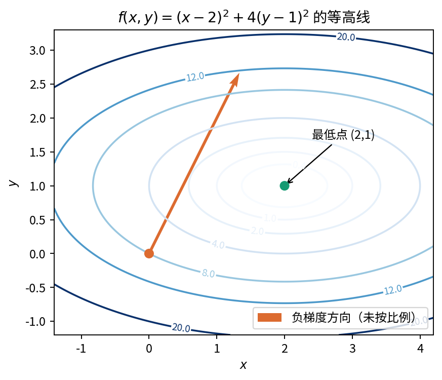

学最优化方法，最容易发生的事是：背下一个迭代公式，又看到另一个迭代公式，却不知道为什么要替换它。为了避免这种情况，先用一个问题串起全书。

假设你调节两个参数 $x$、$y$，想让某个误差尽可能小：

$$
f(x,y)=(x-2)^2+4(y-1)^2.
$$

你可以试很多组数，但不可能把实数平面上的点全部试遍。最优化方法想做的是：利用函数的结构，**聪明地选择下一次要试的点**。例如 $(0,0)$ 的误差是 8，而 $(2,1)$ 的误差是 0；如果能读懂函数的斜率和弯曲程度，我们就能更有方向地靠近 $(2,1)$。

同一道题还有两种会改变解法的情况。如果 $x+y\le 2$，原本的 $(2,1)$ 不再允许，我们必须在可行范围内寻找最好的点；如果目标和约束都是线性的，则能用专门处理线性结构的单纯形法。全书就是沿着这三层困难逐步推进：**读懂函数 → 在没有限制时让函数下降 → 有限制时仍然找到最优点**。

## 推荐阅读顺序

先读 [01](01、数学基础、泰勒展开与凸性.md)，学会用梯度描述一阶变化，用 Hessian 描述二阶变化；同时认识范数和凸性。随后可以读 [03](03、线搜索与步长.md)：方向和步长是两种不同的决定。再读 [04](04、最速下降、牛顿与共轭梯度.md) 看几个算法怎样选择方向。读 [02](02、线性规划与单纯形表.md) 时先用几何理解可行域，再进入表格。最后读 [05](05、约束最优性与二次规划.md)，把无约束的想法推广到有边界的情形。

如果课程安排按“线性规划 → 无约束 → 约束优化”，也可以按 01 → 02 → 03 → 04 → 05 读。路线不同不影响理论先后依赖：**学习 04 前务必先读 03 的一维搜索思想**。

**读到生词时怎样办**：本套理论篇会在术语第一次出现时给出直白解释和至少一个数字演示。读到矩阵、检验数、线搜索、割线条件、工作集等词，如果你还不知道它在当前例题中对应什么，就不要先背公式，先看紧跟在词后的具体计算。学每个算法时坚持三问：**它根据什么选择方向？沿方向走多远？什么情况下停下？** 如果只知道迭代式，无法回答这三问，就还没有真正理解算法。

## 如何检验自己是否学懂

看完一段后，把笔记盖住，尝试解释“上一个方法解决不了什么，所以才需要下一个方法”。然后自己算一遍数字案例。数学证明则要说出每个不等号来自什么性质；数值算法要能说明为什么选择当前这一步，而不是只复述结果。

[06 综合例题](06、综合例题与解析.md)提供完整的审题、运算与验算，[07 老师作业原题](07、老师作业与补充练习.md)练证明和算法计算，[09 自测卷](09、独立自测题.md)不在题目旁揭示答案。真正需要考前查表时才打开 [08 速查](08、公式与题型速查.md)。

> 重要边界：本套自测和综合例题是原创练习，不冒充旧站未能核实的真题。你可以先把理论学懂，再将真实老师作业逐题代入相同的方法。

## 相关资料

- [最优化方法实验](../最优化方法实验/00、复习路线与资料说明.md)
