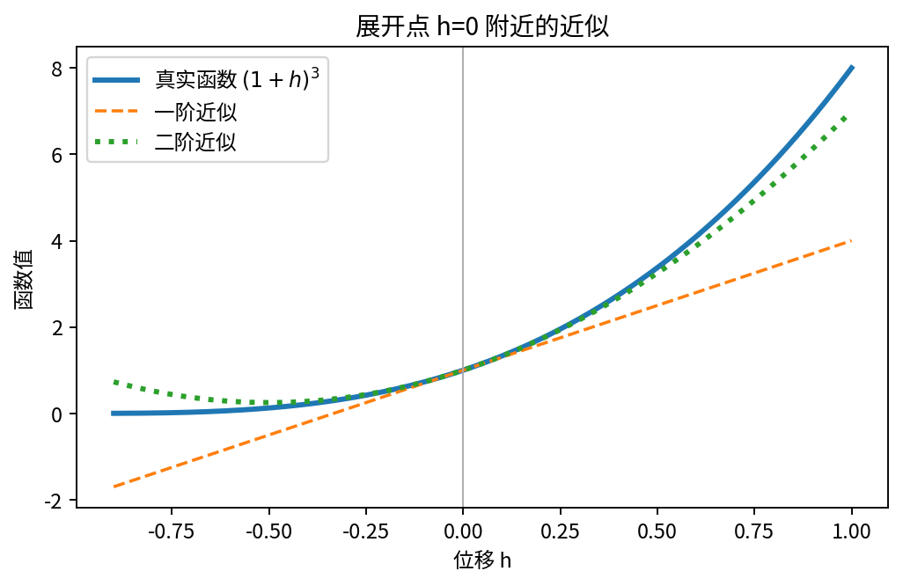
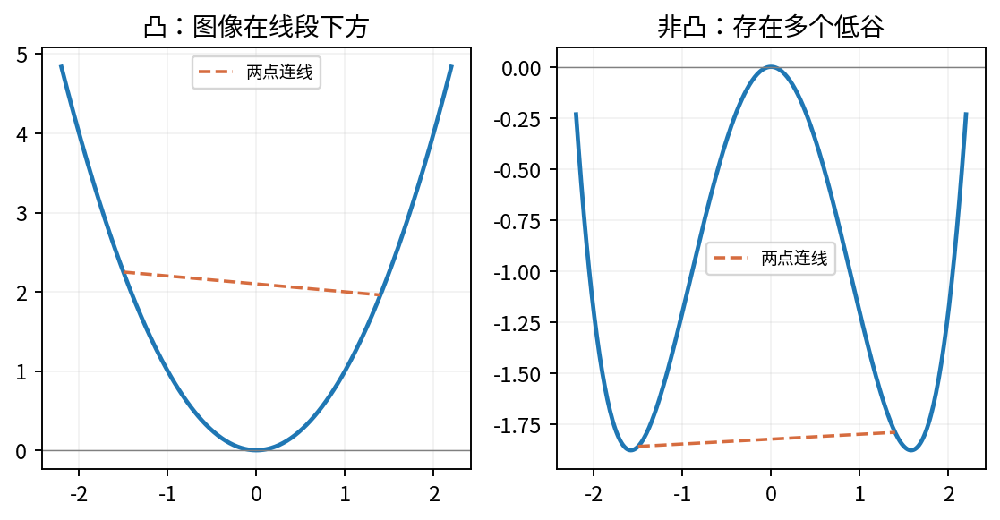
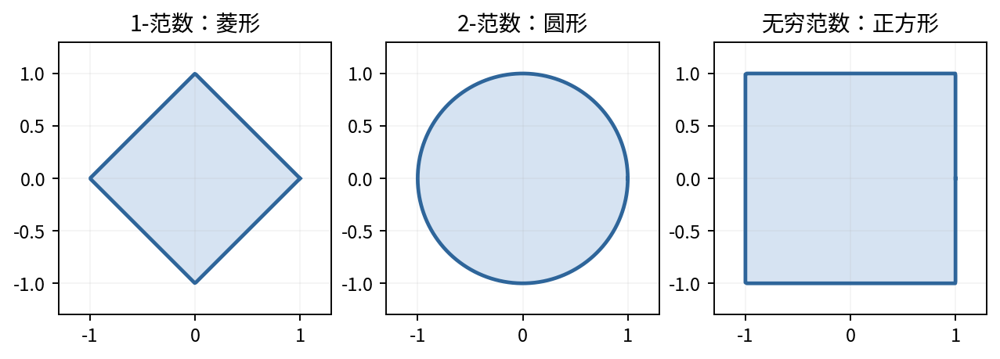

学最优化，核心就一件事：**找一个函数最低的地方**。
一维函数画条曲线，最低点一眼看穿——“底部是平的”，也就是导数为 $0$。但变量一多变成 $f(x,y)$，你就站在了三维山谷里，不仅要问“坡陡不陡”，还得问“往哪边走下坡最快、山谷往哪边弯”。

这篇就是把后面所有算法要用的<strong>5 件基础工具</strong>一次认全：**梯度、Hessian、泰勒展开、凸集/凸函数、范数**。

---

## 0. 开篇防晕：本篇符号分队

| 队伍 | 符号 | 人话标签 |
| :--- | :--- | :--- |
| **一阶坡度** | $\nabla f(x)$ 或 $g$ | **梯度（Gradient）**：把所有偏导数竖着排成一列，指向<strong>上坡最快</strong>的方向。 |
| **二阶弯曲** | $H(x) = \nabla^2 f(x)$ | **Hessian 矩阵**：把所有二阶偏导数排成方阵，描述“山谷往各个方向有多弯”。 |
| **走路参数** | $d, \; h, \; s, \; \alpha$ | $d$ 是方向（direction），$h$ 或 $\alpha$ 是步长，$s$ 是总位移向量（常写成 $s = \alpha d$）。 |
| **衡量大小** | $\|x\|_1, \; \|x\|_2, \; \|x\|_\infty$ | **范数（Norm）**：给向量量长度的尺子。 |
| **凸性判断** | $t u + (1-t)v$ | **凸组合**：连接 $u, v$ 两点的线段上的任意一点（$0 \le t \le 1$）。 |

---

## 1. 一元函数：导数为 0 只是“平了”，不一定是谷底

看 $f(x) = (x-2)^2 + 1$，求导得：

$$
f'(x) = 2(x-2).
$$

- $x < 2$ 时导数为负，往右走会下坡；
- $x > 2$ 时导数为正，往右走反而上坡；
- $x = 2$ 时导数为 $0$，刚好卡在谷底。

但光看“一阶导数为 $0$”很容易被骗：
- $f(x) = -x^2$ 在 $x=0$ 导数也是 $0$，但它是<strong>山顶</strong>（极大点）；
- $f(x) = x^3$ 在 $x=0$ 导数也是 $0$，但它是<strong>半山腰的平坡</strong>（既非极大也非极小）。

所以必须看<strong>二阶导数 $f''(x)$</strong>：
- $f''(x) > 0$：曲线像碗一样<strong>向上弯</strong>，配合 $f'(x)=0$ 就能确定是严格局部极小；
- $f''(x) < 0$：曲线向下扣，是极大点；
- $f''(x) = 0$：信息不够，没法直接下结论。

**一句话总结**：一阶导数看<strong>坡度</strong>，二阶导数看<strong>弯曲方向</strong>。

---

## 2. 多变量时，“坡度”升级成了梯度

先复习两个基本动作：
- **列向量与转置**：$x = (x_1, x_2)^T$ 是把两个数竖着写；右上角的 $T$ 是转置，把竖排变横排。
- **内积（点积）**：$a^T b$ 就是“对应位置相乘再相加”。比如 $a=(2,3)^T, b=(4,5)^T$，则 $a^T b = 2\times 4 + 3\times 5 = 23$。以后看到 $g^T d$，就是梯度和方向做点积。

来看二维山谷：

$$
f(x,y) = (x-2)^2 + 4(y-1)^2.
$$

分别固定另一个变量求<strong>偏导数（Partial Derivative）</strong>：

$$
\frac{\partial f}{\partial x} = 2(x-2), \qquad \frac{\partial f}{\partial y} = 8(y-1).
$$

把它们竖着拼成一列，就是<strong>梯度（Gradient）</strong>：

$$
\nabla f(x,y) = \begin{pmatrix} 2(x-2) \\ 8(y-1) \end{pmatrix}.
$$

> **核心直觉**：梯度 $\nabla f$ 指向的是<strong>上坡最快</strong>的方向；加上负号，$-\nabla f$ 才是<strong>下坡最快</strong>的方向（在单位长度方向里比）。

比如在 $(0,0)$ 处，梯度是 $(-4, -8)^T$，负梯度是 $(4, 8)^T$。为什么沿负梯度走一定会下坡？
从 $x$ 沿方向 $d$ 迈出一小步 $h$，一阶近似为：

$$
f(x + hd) \approx f(x) + h \nabla f(x)^T d.
$$

这里 $\nabla f(x)^T d$ 叫<strong>方向导数（Directional Derivative）</strong>，意思是“沿 $d$ 走时的瞬时坡度”：
- 如果 $\nabla f(x)^T d < 0$，说明迈出足够小的一步一定会下坡（$d$ 是<strong>下降方向</strong>）；
- 取单位负梯度 $d = -\nabla f / \|\nabla f\|_2$ 时，方向导数等于 $-\|\nabla f\|_2 < 0$，所以只要梯度不为零，往负梯度走一小步必降。

至于“这一步到底该迈多大”，留到 [03 线搜索](03、线搜索与步长.md) 解决。

---

## 3. Hessian 矩阵：给山谷各个方向的“弯度”建一张表

一元函数只有一个二阶导数 $f''$，多元函数每个变量都能对每个变量再求一次导，排成方阵就是 **Hessian 矩阵**：

$$
H(x) = \nabla^2 f(x) = \begin{pmatrix} f_{xx} & f_{xy} \\ f_{yx} & f_{yy} \end{pmatrix}.
$$

还是上面的例子 $f(x,y) = (x-2)^2 + 4(y-1)^2$，没有 $xy$ 交叉项，所以：

$$
H = \begin{pmatrix} 2 & 0 \\ 0 & 8 \end{pmatrix}.
$$

数字 $2$ 和 $8$ 一眼告诉你：**山谷在 $y$ 方向比 $x$ 方向陡（弯）得多**。
想知道沿任意单位方向 $d$ 有多弯？算二次型 $d^T H d$ 就行（先算 $Hd$，再和 $d$ 做内积）：
- 沿水平 $d=(1,0)^T$：$d^T H d = 2$；
- 沿竖直 $d=(0,1)^T$：$d^T H d = 8$；
- 沿 $45^\circ$ 斜向 $d=(1/\sqrt{2}, 1/\sqrt{2})^T$：$d^T H d = 5$。

### 什么叫正定、半正定？（考场速判法）
- **正定（$H \succ 0$）**：对<strong>任意</strong>非零方向 $d$，都有 $d^T H d > 0$——不管往哪边看，地面都是向上弯的（一个标准大碗）。
- **半正定（$H \succeq 0$）**：只要求 $d^T H d \ge 0$——允许某些方向是平的（比如槽沟）。

**怎么快速判断实对称矩阵正定？（顺序主子式判别法 / Sylvester 判别法）**
从左上角依次框出 $1\times 1$、$2\times 2$、$3\times 3$ 的子方阵，算它们的行列式，**全部严格大于 $0$** 就是正定：
- **二维速判**：对 $H = \begin{pmatrix} a & b \\ b & c \end{pmatrix}$，只需检查 **$a > 0$ 且 $ac - b^2 > 0$**。
- **三维例子**：检查
  $$
  H = \begin{pmatrix} 3 & 2 & 0 \\ 2 & 2 & 1 \\ 0 & 1 & 6 \end{pmatrix}
  $$
  一阶行列式 $= 3 > 0$；二阶 $= 3\times 2 - 2\times 2 = 2 > 0$；三阶沿第一行展开 $= 3(2\times 6 - 1) - 2(2\times 6) = 9 > 0$。全正，故 $H$ 正定。

> **避坑提醒**：
> 1. 千万别把“顺序主子式全 $\ge 0$”当成半正定判据！半正定要检查<strong>所有主子式</strong>非负，或看<strong>所有特征值 $\lambda \ge 0$</strong>（特征值满足 $Hv = \lambda v$）。
> 2. 在驻点（$\nabla f = 0$）处，$H$ **正定** $\Rightarrow$ 严格局部极小；但 $H$ <strong>半正定</strong>推不出极小（反例：$x^4$ 和 $-x^4$ 在 $0$ 点二阶导数都是 $0$）。

---

## 4. 泰勒展开：用脚下的坡度和弯度，猜下一步的高度

站在当前点，不想把附近所有点都算一遍，怎么办？用一条简单的二次曲线（抛物线/碗）去贴合脚下的地形，这就是<strong>泰勒展开（Taylor Expansion）</strong>。

### 一元版：为什么二阶项前面有个 $\frac{1}{2}$？
想用 $A + Bh + Ch^2$ 去近似 $f(t+h)$，让它们在 $h=0$ 处：
- 函数值一样 $\Rightarrow A = f(t)$；
- 一阶导数一样 $\Rightarrow B = f'(t)$；
- 二阶导数一样：$(Ch^2)'' = 2C = f''(t) \Rightarrow C = \frac{1}{2} f''(t)$。

所以这个 $\frac{1}{2}$ 不是谁硬规定的，纯属<strong>为了抵消 $h^2$ 求两次导冒出来的系数 $2$</strong>：

$$
\boxed{f(t+h) \approx f(t) + f'(t)h + \frac{1}{2} f''(t) h^2.}
$$

举个例子：$f(t) = t^3$，在 $t=1$ 处往右走 $h=0.1$。$f(1)=1, f'(1)=3, f''(1)=6$，二阶近似 $= 1 + 3(0.1) + \frac{1}{2}(6)(0.1)^2 = 1.33$，而真实值 $1.1^3 = 1.331$，只差了被忽略的三阶项 $0.001$。

### 多元版：把数字换成向量和矩阵，结构一模一样
位移变成向量 $s$，公式长这样：

$$
f(x+s) \approx f(x) + \nabla f(x)^T s + \frac{1}{2} s^T H(x) s.
$$

如果把位移写成 $s = \alpha d$（沿方向 $d$ 走步长 $\alpha$），注意两边各提一个 $\alpha$ 出来，二阶项变成 $\alpha^2$：

$$
f(x + \alpha d) \approx f(x) + \alpha \nabla f(x)^T d + \frac{1}{2} \alpha^2 d^T H(x) d.
$$

**拆开看一眼 $\frac{1}{2} s^T H s$ 为什么靠谱**：
拿带交叉项的 $f(x_1, x_2) = x_1^2 + x_1 x_2 + 2 x_2^2$ 试一下。在 $x=(1,1)^T$ 处，$f(x)=4$，$\nabla f(x) = (2x_1+x_2, x_1+4x_2)^T = (3,5)^T$，$H = \begin{pmatrix} 2 & 1 \\ 1 & 4 \end{pmatrix}$。
设位移 $s=(h,k)^T$，硬算矩阵乘法：

$$
\begin{aligned}
Hs &= \begin{pmatrix} 2h+k \\ h+4k \end{pmatrix}, \\
s^T H s &= h(2h+k) + k(h+4k) = 2h^2 + 2hk + 4k^2, \\
\frac{1}{2} s^T H s &= h^2 + hk + 2k^2.
\end{aligned}
$$

拼起来得 $4 + 3h + 5k + h^2 + hk + 2k^2$，和直接把 $(1+h, 1+k)$ 代进原函数展开的结果<strong>分毫不差</strong>。

### 写作业/考试要补上的“余项”
考试写等号不能漏余项，常见有两种写法（**别混拼**）：
1. **Peano 余项**（当 $h \to 0$，表示误差比 $\|h\|$ 或 $\|h\|^2$ 消失得更快）：
   $$
   f(x+h) = f(x) + \nabla f(x)^T h + o(\|h\|),
   $$
   $$
   f(x+h) = f(x) + \nabla f(x)^T h + \frac{1}{2} h^T \nabla^2 f(x) h + o(\|h\|^2).
   $$
   固定非零方向 $d$ 令 $h = \alpha d$ 时，余项写作 $o(|\alpha|)$ 和 $o(\alpha^2)$（对应 [老师作业第 1 章第 1 题](07、老师作业与补充练习.md)）。
2. **拉格朗日余项**（存在 $0 < \theta < 1$，把 Hessian 放在中间点，不再额外加 $o(\|h\|^2)$）：
   $$
   f(x+h) = f(x) + \nabla f(x)^T h + \frac{1}{2} h^T \nabla^2 f(x + \theta h) h.
   $$

---

## 5. 凸集与凸函数：为什么最优化天天念叨“凸”？

这两个词长得像，但管的事完全不同：
- <strong>凸集</strong>管的是<strong>地盘（可行域）</strong>：允许你站的位置有没有凹坑或空洞。
- <strong>凸函数</strong>管的是<strong>地形（目标函数）</strong>：这个山谷有没有藏着别的更低的坑。

### 凸集（Convex Set）：任意两点连线不跑偏
想象一个实心圆盘：里面随便挑两点连直线，整条线段都在圆盘里 $\Rightarrow$ **凸集**。如果中间挖个洞变成圆环，左右各挑一点连线会穿过空洞 $\Rightarrow$ **非凸集**。

线段上的任意一点写成<strong>凸组合</strong> $w = t u + (1-t) v$（$t \in [0, 1]$，两个权重非负且相加为 $1$）。比如 $u=(0,0)^T, v=(4,2)^T, t=\frac{1}{4}$，得到 $w = \frac{1}{4}(0,0)^T + \frac{3}{4}(4,2)^T = (3, \frac{3}{2})^T$。

严格定义：集合 $S$ 是凸集，当且仅当对<strong>任意</strong> $u, v \in S$ 和<strong>任意</strong> $t \in [0, 1]$，都有：

$$
\boxed{t u + (1-t) v \in S.}
$$

**考试必会的 3 个凸集套路**（注意证明必须对“任意 $u,v,t$”成立，不能只举数字例子）：
1. **线性不等式围出的区域是凸集**：如 $2x_1 + x_2 \le 6$，因为 $u, v$ 都满足，所以 $2w_1 + w_2 = t(2u_1+u_2) + (1-t)(2v_1+v_2) \le 6t + 6(1-t) = 6$。
2. **凸集的交集还是凸集**（[老师作业第 1 章第 2 题](07、老师作业与补充练习.md)）：任取 $u,v \in S_1 \cap S_2$，它们既在 $S_1$ 里也在 $S_2$ 里；因为两者都凸，连线点 $w$ 既在 $S_1$ 里也在 $S_2$ 里，所以也在交集里。
3. **凸集数乘 $\alpha S = \{\alpha x \mid x \in S\}$ 还是凸集**（[往年 A 卷第 2 题](06、往年A卷逐题解析.md)）：任取 $u=\alpha a, v=\alpha b \in \alpha S$，则 $tu + (1-t)v = \alpha\bigl(ta + (1-t)b\bigr)$。括号里仍在 $S$ 中，乘上 $\alpha$ 自然仍在 $\alpha S$ 中（全程不用除以 $\alpha$，所以 $\alpha=0$ 也照样成立）。

### 凸函数（Convex Function）：局部最低就是全局最低
普通函数可能坑坑洼洼，你掉进一个小坑还以为到了世界最低点；但<strong>定义在凸集上的凸函数，只要找到局部最低点，就一定是全局最低点</strong>——这就是大家拼命证明凸性的原因！

严格定义（比凸集多了函数 $f$ 和不等号 $\le$）：对任意 $u, v$ 和 $t \in [0, 1]$，

$$
\boxed{f\bigl(tu + (1-t)v\bigr) \le t f(u) + (1-t) f(v).}
$$

**人话翻译**：先混合位置再算高度，永远不会高于“先算两端高度再连直线”（图像在弦的下方）。
比如证明 $f(x)=x^2$ 是凸函数，算右边减左边：

$$
tu^2 + (1-t)v^2 - [tu + (1-t)v]^2 = t(1-t)(u-v)^2 \ge 0.
$$

**另外两个更好用的等价判据（针对可微函数）**：
- **一阶判据**：$f(y) \ge f(x) + \nabla f(x)^T (y-x)$。意思是“图像永远在任意一点的切平面上方”。一旦 $\nabla f(x_*) = 0$，立刻推出 $f(y) \ge f(x_*)$——驻点直接就是全局最低点！
- **二阶判据**：在开凸区域内<strong>处处</strong>满足 Hessian 半正定（$H(x) \succeq 0$）$\Leftrightarrow$ $f$ 是凸函数；处处正定 $\Rightarrow$ 严格凸（注意不能只看某一个点）。

---

## 6. 范数：给向量“量长度”的不同尺子

对向量 $x=(3,4)^T$，不同的尺子量出的“大小”不一样：
- **2-范数（欧氏直线距离）**：$\|x\|_2 = \sqrt{3^2 + 4^2} = 5$；
- **1-范数（曼哈顿街区距离）**：$\|x\|_1 = |3| + |4| = 7$；
- **$\infty$-范数（看最大分量）**：$\|x\|_\infty = \max(|3|, |4|) = 4$。

所有满足 $\|x\| \le 1$ 的点叫<strong>闭单位球</strong>（含内部），$\|x\| = 1$ 的边界叫<strong>单位球面</strong>。三种尺子画出的单位球分别是圆形、菱形、正方形：

### 为什么任何范数都是凸函数？（考试高频证明）
不管哪种范数，都必须遵守两条铁律：
1. **绝对齐次性**：$\|cx\| = |c|\|x\|$（向量放大 $c$ 倍，长度放大 $|c|$ 倍）；
2. **三角不等式**：$\|u+v\| \le \|u\| + \|v\|$（两点之间直线最短）。

有了这两条，证明 $f(x) = \|x\|$ 是凸函数只需要两行（对任意 $u,v$ 和 $\theta \in [0,1]$）：

$$
\begin{aligned}
\|\theta u + (1-\theta) v\| &\le \|\theta u\| + \|(1-\theta) v\| && \text{（三角不等式）} \\
&= \theta \|u\| + (1-\theta) \|v\| && \text{（绝对齐次性，且 }\theta, 1-\theta \ge 0\text{）}.
\end{aligned}
$$

**进阶变式**：证明 $f(x) = \|Ax + b\|$ 是凸函数，只需先做一步拆解：

$$
A\bigl(\theta u + (1-\theta)v\bigr) + b = \theta(Au+b) + (1-\theta)(Av+b),
$$

再直接套上面的范数凸性即可（注意：范数在原点往往不可微，不能用 Hessian 去证，必须用定义）。

---

## 7. 自己检查（附人话思路）

1. **为什么 $f''(0)=0$ 不能直接判断极小？**
   - *思路*：$f''(0)=0$ 说明二阶弯曲信息为零，无法判断附近是向上弯还是向下弯。比如 $x^4$ 在 $0$ 点是极小，$-x^4$ 是极大，$x^3$ 既非极大也非极小，但它们的 $f''(0)$ 全都是 $0$。
2. **$\|u+v\| \le \|u\| + \|v\|$ 在范数凸性证明中起了什么作用？**
   - *思路*：用来把“合在一起的范数” $\|\theta u + (1-\theta)v\|$ 拆开成两个独立范数的和 $\|\theta u\| + \|(1-\theta)v\|$，这是推导出 $\le$ 号的关键一步。
3. **为什么“任意例子成立”不等于“一般证明成立”？**
   - *思路*：凸集/凸函数的定义要求对定义域内<strong>所有</strong>点对 $u,v$ 和<strong>所有</strong>比例 $t \in [0,1]$ 都成立。举几个数字例子只能说明这几个点没问题，无法排除其他位置存在反例。

下一步：既然知道负梯度能下坡，实际<strong>走多大一步</strong>才合适？见 [03 线搜索](03、线搜索与步长.md)。
