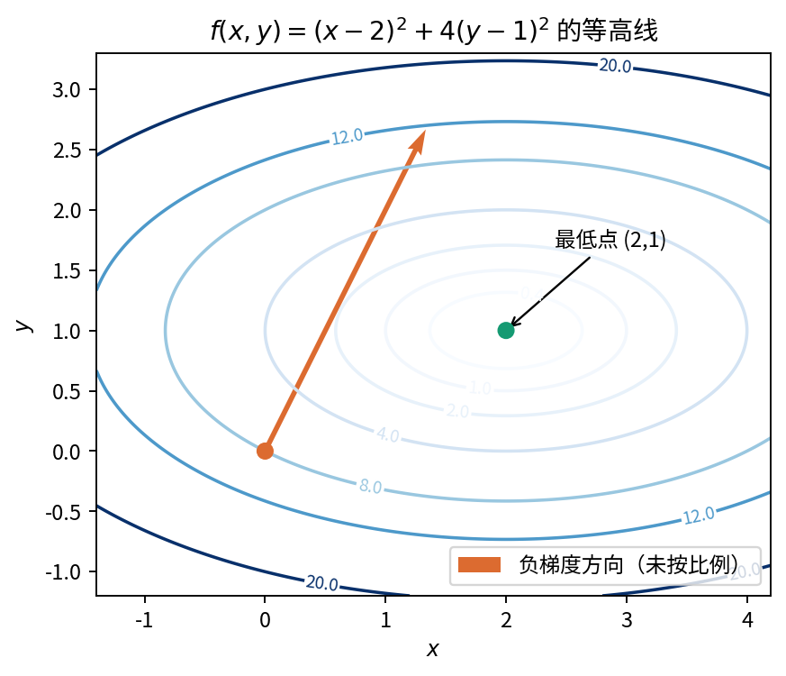
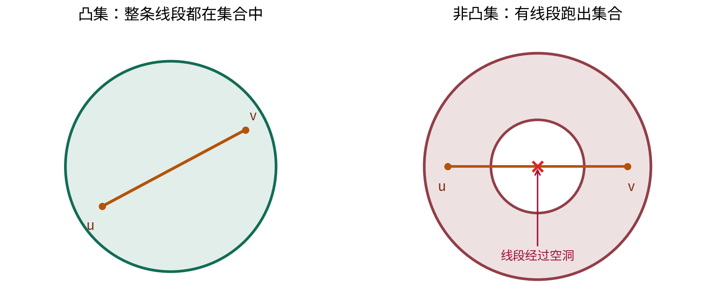

我们想找一个函数最小的地方。对于只有一个变量的函数，画出曲线后你可能会说：“最低处附近是平的。”这句话已经暗示了导数。但是当函数变成 $f(x,y)$，我们不仅要问“斜不斜”，还要问“向哪个方向走会下降、下降得多快”。这就是梯度和 Hessian 出现的原因。等读完本篇，你还会知道范数为什么与优化有关，以及为什么凸性能够让寻找最小值这件事更放心。

## 从一元函数出发

先看 $f(x)=(x-2)^2+1$。代入 $x=0$ 得到 5，代入 $x=2$ 得到 1。对它求导：

$$
f'(x)=2(x-2).
$$

当 $x<2$，导数是负的，向右移动一小步会使函数下降；当 $x>2$，导数是正的，继续往右反而会上升。在 $x=2$ 处导数为零，而且附近都比它高，所以 $x=2$ 是极小点。

但“导数为零”只能说明这个点**可能**是极小点。例如 $f(x)=-x^2$ 在 $x=0$ 的导数同样为零，却是极大点；$f(x)=x^3$ 在零点导数为零，既不是极大也不是极小。于是我们还要观察二阶导数：$f''(x)>0$ 表示曲线在此处向上弯，在一阶导数已经为零时，它提供了判断严格局部极小的充分条件；$f''(x)<0$ 对应严格局部极大。$f''(x)=0$ 时不能直接下结论。

这就引出一个思想：**一阶信息告诉我们当前的坡度，二阶信息告诉我们坡度正在怎样变化。**

## 多变量时，“坡度”变成了梯度

一个二维向量可以写成 $x=(x_1,x_2)^T$，意思是把两个坐标上下排成一个**列向量**。右上角的 $T$ 叫“转置”，它把列排布变成横排布。例如 $(2,3)^T$ 是两行一列，而 $(2,3)$ 可以理解为一行两列。两个列向量的内积 $a^Tb$ 等于“对应位置相乘再相加”：若 $a=(2,3)^T,b=(4,5)^T$，则 $a^Tb=2\times4+3\times5=23$。后面看到 $g^Td$，可以先把它当成两个向量的点积，不必害怕字母。

把函数换成

$$
f(x,y)=(x-2)^2+4(y-1)^2.
$$

这里可以朝无数方向移动。为了分别观察沿 $x$、$y$ 改变的影响，我们先求偏导：求 $x$ 的偏导时将 $y$ 当常量；求 $y$ 的偏导时把 $x$ 当常量。

$$
\frac{\partial f}{\partial x}=2(x-2),\qquad \frac{\partial f}{\partial y}=8(y-1).
$$

**偏导数**可以先理解为“只改变一个坐标时的坡度”；把所有坐标方向上的坡度放在一起，就得到**梯度**。符号 $\nabla$ 读作“nabla”，在这里表示把各个偏导收集起来。把两个偏导放在一个列向量中，就是梯度：

$$
\nabla f(x,y)=\begin{pmatrix}2(x-2)\\8(y-1)\end{pmatrix}.
$$

例如在 $(0,0)$，梯度是 $(-4,-8)$。它并不是“下山箭头”，而是在欧氏距离意义下**局部上升最快**的方向；因此 $-\nabla f=(4,8)$ 是局部下降最快的方向。这里的“最快”要强调 **单位长度的方向**，因为方向不归一化，任意放大向量都能让方向导数的数值变大。先验一个非常小的变化：在 $(0,0)$ 时沿水平方向向右移动 $0.01$，一阶变化约为 $-4\times0.01=-0.04$；向上移动 $0.01$，一阶变化约为 $-8\times0.01=-0.08$。这解释了为什么这里竖直向上比水平向右下降得快。不过把两方向合起来的负梯度方向下降更快，下面的内积会给出严格依据。

为什么负梯度会让函数下降？假设我们从位置 $x$ 沿单位向量 $d$ 走一小步 $h$，则

$$
f(x+hd)\approx f(x)+h\nabla f(x)^Td.
$$

这里先拆开三个新符号：$d$ 是**方向向量**（告诉我们朝哪里走），$h$ 是沿该方向移动的很小的**步长**（告诉我们走多远），$\nabla f(x)^Td$ 是**方向导数**（沿 $d$ 每增加一单位步长时，函数在起点的一阶变化率）。它的算法仍是对应分量相乘再相加。例如在 $(0,0)$，选 $d=(1,0)^T$，方向导数是 $(-4,-8)\cdot(1,0)=-4$；选 $d=(0,1)^T$ 则是 $-8$。负数代表起初朝这个方向走会下降。取 $d=-\nabla f/\lVert \nabla f\rVert_2$，得到 $\nabla f^Td=-\lVert \nabla f\rVert_2<0$（只要梯度非零），所以足够小的正步长会让函数减小。方向的确定只是第一步，究竟走多远要留到 [03 线搜索](03、线搜索与步长.md) 才知道。

## Hessian 为什么是一张矩阵

一元函数有 $f''$，多元函数则有很多二阶偏导。把梯度中每一项再分别对各变量求导，得到 Hessian 矩阵：

$$
H(x)=\nabla^2f(x)=\begin{pmatrix}f_{xx}&f_{xy}\\f_{yx}&f_{yy}\end{pmatrix}.
$$

以上面的二次函数为例：

$$
H=\begin{pmatrix}2&0\\0&8\end{pmatrix}.
$$

为了看清矩阵里的数字，先解释**混合二阶偏导**：$f_{xy}$ 是先对 $x$ 求导、再对 $y$ 求导（对本例等于 0），$f_{yy}$ 是对 $y$ 连续求两次导数。以 $f=(x-2)^2+4(y-1)^2$ 为例，对 $x$ 两次求导得 $2$，对 $y$ 两次得 $8$；由于不存在 $xy$ 交叉乘积，另外两项为 $0$。所以四个数字依次排成这张 $2\times2$ 的表。它告诉我们沿 $y$ 方向弯得比沿 $x$ 方向更陡。比如选单位方向 $d=(1,0)^T$（只往水平走），用矩阵乘法得到 $d^THd=2$；选 $d=(0,1)^T$（只往竖直走），就得到 $d^THd=8$。如果你第一次接触矩阵乘法，就把 $d^THd$ 当成三步：先算 $Hd$（每行与 $d$ 的分量对应相乘再相加），然后算 $d^T(Hd)$（再做一次内积）。例如 $d=(1,0)^T$ 时，$Hd=(2,0)^T$，最后 $(1,0)\cdot(2,0)=2$。若选单位斜向方向 $d=(1/\sqrt2,1/\sqrt2)^T$，则 $Hd=(\sqrt2,4\sqrt2)^T$，所以 $d^THd=1+4=5$。**方向变了，曲率数值也会变**。所以“竖直更弯”可以从数字中看出来。一般而言，沿单位方向 $d$ 的二阶曲率是 $d^THd$。如果对任何非零 $d$ 都有 $d^THd>0$，就称 $H$ **正定**；如果只要求 $\ge 0$，就是**半正定**。在二维对称矩阵 $H=\begin{pmatrix}a&b\\b&c\end{pmatrix}$ 中，正定可以用 $a>0$ 且 $ac-b^2>0$ 判断。后面这个 $ac-b^2$ 叫矩阵的**行列式**：对于 $\begin{pmatrix}a&b\\c&d\end{pmatrix}$，行列式就是左上乘右下减去右上乘左下，即 $ad-bc$。例如本题 $a=2,b=0,c=8$，算出 $2>0$ 且 $2\times8-0=16>0$，因此 Hessian 正定。它是一条可以直接使用的二维判别法；“正定”的本来含义仍是对任意非零方向 $d$ 都有 $d^THd>0$。

请区分两个常见结论：在驻点处，如果 Hessian **正定**，则是严格局部极小；如果 Hessian **半正定**，单靠这个条件不足以判断，例如 $x^4$ 和 $-x^4$ 在零点二阶导数都是零。若可微函数在一个凸区域内处处 Hessian 半正定（并满足相应光滑性），则整个函数是凸的；这比只看一个点的 Hessian 强得多。

## 泰勒展开：用附近能算的东西，近似还没到达的位置

现在我们已经有了一阶、二阶信息。怎样用它们估计移动一步之后的函数值？答案是泰勒展开。先别急着背公式：假设在位置 $t$ 附近，我们用一个二次式

$$
f(t+h)\approx A+Bh+Ch^2
$$

来近似原函数。要求在 $h=0$ 处函数值相同，得到 $A=f(t)$；要求一阶导数相同，得到 $B=f'(t)$；再求一次导数，因为 $Ch^2$ 的二阶导数是 $2C$，必须有 $2C=f''(t)$，所以 $C=f''(t)/2$。

于是：

$$
\boxed{f(t+h)\approx f(t)+f'(t)h+\tfrac12f''(t)h^2}.
$$

你以前可能困惑为什么这里有 $1/2$：不是谁规定的，而是**为了抵消 $h^2$ 求两次导数产生的系数 2**。三阶是除以 $3!=6$，也是同一个原因。严格的泰勒公式还有余项；我们这里写近似号，表示忽略了高于二阶的影响，不意味着任意大的 $h$ 都能准确近似。

举个具体例子：$f(t)=t^3$，在 $t=1$ 附近移动 $h=0.1$。因为 $f(1)=1$，$f'(1)=3$，$f''(1)=6$，二阶近似是

$$
1+3(0.1)+\tfrac12(6)(0.1)^2=1.33.
$$

真实值是 $1.1^3=1.331$，相差 $0.001$，正好就是这里忽略的三阶项 $h^3$。

多元时，位移变成向量 $s$：

$$
f(x+s)\approx f(x)+\nabla f(x)^Ts+\tfrac12s^TH(x)s.
$$

看着复杂，其实结构完全没变：函数当前值 + 一阶变化 + 二阶修正。例如取 $s=\alpha d$，则

$$
f(x+\alpha d)\approx f(x)+\alpha\nabla f(x)^Td+\tfrac12\alpha^2d^TH(x)d.
$$

这条式子是后面牛顿法的核心。先理解“位移是 $\alpha d$”，不要把 $\alpha$ 和 $d$ 当成两个无关的量。

**把泰勒式写成严格的等式，余下的误差在哪里？** 上面使用的“约等于”适合解释直觉；写作业时通常还需要余项。只要函数在附近有相应光滑性，令位移 $h\to0$，可写为

$$
 f(x+h)=f(x)+\nabla f(x)^Th+o(\|h\|),
$$

$$
 f(x+h)=f(x)+\nabla f(x)^Th+\tfrac12h^T\nabla^2f(x)h+o(\|h\|^2).
$$

这里的 $o(\|h\|^2)$ 不是“把误差写成 0”，而是指误差除以 $\|h\|^2$ 后，在 $h\to0$ 时趋于 0。若固定一个方向 $d$ 并取 $h=\alpha d$，则一阶和二阶余项分别可以写作 $o(|\alpha|)$ 与 $o(\alpha^2)$（固定非零 $d$）。这正是 [老师作业第一章第一题](07、老师作业与补充练习.md) 的两种展开式。

还有一种写法叫**拉格朗日余项形式**：在沿线二次连续可微等条件下，存在 $0<\theta<1$ 使

$$
 f(x+h)=f(x)+\nabla f(x)^Th+\tfrac12 h^T\nabla^2 f(x+\theta h)h.
$$

注意 Hessian 取在中间点 $x+\theta h$，这里没有再额外加上 $o(\|h\|^2)$。它与前面的 Peano 形式是不同的余项表达，考试不能混拼。

**三维 Hessian 怎样判断正定？** 前面只给了二维判别，而 [老师的三维牛顿题](07、老师作业与补充练习.md) 还需要三维情形。对于实对称矩阵，常用的**顺序主子式判别法**（Sylvester 判别法）是：从左上角依次取 $1\times1$、$2\times2$、$3\times3$ 的方阵，分别计算其行列式；三者全大于零，矩阵正定。例如

$$
 H=\begin{pmatrix}3&2&0\\2&2&1\\0&1&6\end{pmatrix}.
$$

第一阶行列式为 $3$；第二阶为 $3\cdot2-2\cdot2=2$；第三阶沿第一行展开，得 $3(2\cdot6-1)-2(2\cdot6)=9$。三个数 $3,2,9$ 都为正，所以 $H$ 正定。**不要把这条“全部大于零”的规则直接改成“全部大于等于零”来判断半正定**；半正定要检查所有主子式非负，或者通过特征值等价判据来判断。这里的**特征值**是满足 $Hv=\lambda v$（$v\ne0$）的数 $\lambda$：它描述某些方向被矩阵变换后伸缩多少。对于实对称矩阵，所有特征值非负等价于半正定。

## 凸集：先看哪些位置允许我们走

在最优化里，有时我们可以在整个平面上随意寻找最小值；有时只能在规定的范围里移动。比如“生产数量不能为负”“使用的原料不能超过库存”，就会限制哪些点能选。**所有满足约束的点组成的集合**叫作*可行域*。判断可行域是不是凸集，能帮助我们分析后面的线性规划和约束优化。

先想象在纸上画了一个实心圆盘，从里面随便选两点，用尺子连接起来，整条线都留在圆盘里。这样的集合叫**凸集**。如果画的是一个中间挖空的圆环，从左右两侧各取一点，连线会穿过空洞，圆环就**不是凸集**。关键不是边缘是不是弯的，而是“任意两点之间的整条线段，是否仍在集合内”。

怎样用数学语言写“线段上的任意一点”？设两个点是 $u$ 和 $v$，取一个数 $t$，满足 $0\le t\le1$，写成

$$
 w=tu+(1-t)v.
$$

这个表达式叫作**凸组合**。它是把两个点按比例混合：$t=1$ 得到 $u$；$t=0$ 得到 $v$；$t=\frac12$ 得到中点；其他介于 0 和 1 的数得到线段上的其他位置。注意 $u,v$ 可以是两个数字，也可以是二维、三维乃至更高维的向量，运算都是逐个坐标进行。

亲自算一次。令 $u=(0,0)^T$、$v=(4,2)^T$，取 $t=\frac14$：

$$
\begin{aligned}
 w&=\tfrac14(0,0)^T+\tfrac34(4,2)^T\\
  &=(0,0)^T+(3,\tfrac32)^T=(3,\tfrac32)^T.
\end{aligned}
$$

这里 $w$ 更靠近 $v$，因为 $v$ 的权重是 $\frac34$。如果不理解为什么有两个系数，可以把它当成两个比例，**相加必须是 1，而且都不能为负**，才能保证混合结果不跑到线段外面。

现在才能读懂凸集的严格定义：一个集合 $S$ 是凸集，意思是**对集合里的任意两点 $u,v$，以及任意 $t\in[0,1]$**，都有

$$
 \boxed{u,v\in S\quad\Longrightarrow\quad tu+(1-t)v\in S.}
$$

式子里的 $\in$ 读作“属于”，$u\in S$ 就是“点 $u$ 在集合 $S$ 中”。这道定义题有两个关键字：**任意两点**、**任意比例**。随便找一对点验证通过，只能说明这对点没问题；要证明整个集合凸，需要覆盖所有情况。反过来，要证明集合不凸，只要找出一对点，它们连线上的某一点落到集合外面就够了。上图的圆环已经给出这样的反例。

**怎样从一道实际约束判断凸集？** 假设可行域是

$$
 S=\{(x_1,x_2)^T\mid x_1\ge0,\ x_2\ge0,\ 2x_1+x_2\le6\}.
$$

大括号表示“满足右边条件的所有点”。竖线 $\mid$ 可以读成“使得”；三个不等式分别限制第一坐标、第二坐标和总资源。选 $u=(1,1)^T$ 和 $v=(2,2)^T$，它们都满足约束。中点 $w=(\frac32,\frac32)^T$ 也满足，因为 $2\times\frac32+\frac32=\frac92\le6$。这只是演示。

为什么这个例子的**所有**两点都成立？以最后一个约束为例，如果 $u$ 和 $v$ 都满足 $2x_1+x_2\le6$，把它们的坐标写成 $u_1,u_2$ 与 $v_1,v_2$，那么

$$
\begin{aligned}
2w_1+w_2
&=t(2u_1+u_2)+(1-t)(2v_1+v_2)\\
&\le t\cdot6+(1-t)\cdot6=6.
\end{aligned}
$$

最后一步成立，是因为两个系数都非负，且原先两点各自的资源消耗都不超过 6。另外两个非负约束也可同样证明。于是**任取两点得到的新点仍满足全部约束**，所以这个可行域是凸集。这也是线性不等式约束为什么常给出凸可行域的原因。

**两个凸集的交为什么还是凸集？** 这里的“交”是指**同时属于两个集合**的点。例如 $S_1$ 要求 $x_1\ge0$，$S_2$ 要求 $x_2\ge0$，交集 $S_1\cap S_2$ 就是右上方的第一象限（包括坐标轴）。

证明时不要直接写“显然”。任取 $u,v\in S_1\cap S_2$，这意味着 $u$ 和 $v$ **都在 $S_1$ 中，也都在 $S_2$ 中**。由于两个集合都凸，任取 $t\in[0,1]$，$w=tu+(1-t)v$ 属于 $S_1$；同理它也属于 $S_2$。因此 $w$ 同时属于两者，即 $w\in S_1\cap S_2$。这就符合凸集定义，证明完成。若交集为空，按通常的凸集定义，空集也视为凸集。更多规范的考试书写见 [07 老师作业第 1 章第 2 题](07、老师作业与补充练习.md)。

**把凸集乘一个数，为什么仍是凸集？** 先认识记号 $\alpha S=\{\alpha x\mid x\in S\}$：它表示**把 $S$ 内每个点的所有坐标都乘以 $\alpha$，再收集所有结果**，不是把集合的面积乘以一个数。比如 $S$ 中有点 $(1,2)^T$，$\alpha=-2$ 时，这个点变成 $(-2,-4)^T$。负号相当于把点翻到原点另一侧，绝对值 2 表示与原点的距离扩大为两倍，但原来相连的点不会突然断开。

来证明它对任意实数 $\alpha$ 都成立。设 $C=\alpha S$，从 $C$ 中任取 $u,v$。按照 $C$ 的定义，一定能在原集合 $S$ 中找到 $a,b$，满足 $u=\alpha a$、$v=\alpha b$。于是对任意 $t\in[0,1]$：

$$
\begin{aligned}
 tu+(1-t)v
 &=t\alpha a+(1-t)\alpha b\\
 &=\alpha\bigl(ta+(1-t)b\bigr).
\end{aligned}
$$

括号里的 $ta+(1-t)b$ 因为 $S$ 凸，所以仍在 $S$ 中；整个表达式就是“$S$ 内某个点乘以 $\alpha$”，所以按 $C$ 的定义属于 $C$。因此 $C$ 是凸集。注意证明完全不需要除以 $\alpha$，因此 **$\alpha=0$ 也没有例外**：只要 $S$ 非空，$0S=\{0\}$，只有原点的集合也是凸集；若 $S$ 为空，结果仍为空。这个正是 [06 往年 A 卷第二题](06、往年A卷逐题解析.md) 的完整思路。

到这里先把凸集的作用收住：它主要描述的是**允许选择哪些点**。它本身没有告诉我们某个点的函数值是高还是低。接下来讨论的凸函数，才是描述**目标函数的形状和数值变化**。两个概念名字相近，但考试里的证明要求并不一样。

## 凸函数：再看目标值有没有隐藏的低谷

对一般函数来说，沿一个方向走到附近的低谷，并不代表已经找到全局最低处。但是对定义在凸集上的**凸函数**，任何局部最小点也是全局最小点。这正是最优化中要研究凸性的理由。

这里的定义不仅比较“点在不在集合中”，还要比较**函数值**。设定义域是凸集，任取其中两点 $u,v$ 和比例 $t\in[0,1]$，要求

$$
\boxed{f(tu+(1-t)v)\le tf(u)+(1-t)f(v).}
$$

左边先把**输入位置**混合，再计算函数值；右边先分别计算两个端点的函数值，再按照相同比例混合。几何上说，图像在连接两端函数值的线段**下方或线上**。和凸集定义相比，它多了 $f$ 和一个不等号，证明时不要写混。

拿 $f(x)=x^2$ 来看，选 $u=0$、$v=2$、$t=\frac12$，左边 $f(1)=1$，右边 $\frac12f(0)+\frac12f(2)=2$，所以 $1\le2$。这是为了读懂公式；如果要真正证明所有点都满足，可以计算**右边减左边**：

$$
\begin{aligned}
&tu^2+(1-t)v^2-[tu+(1-t)v]^2\\
&\qquad=t(1-t)(u-v)^2\ge0.
\end{aligned}
$$

因为 $t\ge0$、$1-t\ge0$，而平方不小于零，所以对所有 $u,v,t$ 都成立，$x^2$ 确实是凸函数。这个一般性的证明，比代一组数更有说服力。

**最后分清两个问题：**“可行域是凸集吗？”是在问给定两点后能不能沿直线留在允许区域内；“目标函数是凸函数吗？”是在问函数值如何变化。凸集与凸函数经常一起出现，但不能互相代替：即使可行域是凸集，目标函数也可能是非凸的。

有时你不用重新代入任意 $u,v,t$ 来证明函数凸性。对于定义在凸区域上的可微函数，下面这个**一阶判据**与凸性等价：

$$
 f(y)\ge f(x)+\nabla f(x)^T(y-x)\qquad(\text{任意 }x,y).
$$

它的意思是“函数图像始终不低于任意一点处的一阶切线（多维时叫切平面）”。以 $f(t)=t^2$、$x=1$ 为例，切线是 $f(1)+f'(1)(y-1)=1+2(y-1)=2y-1$；因为 $y^2-(2y-1)=(y-1)^2\ge0$，它确实在切线上方。这能帮助理解为什么凸函数的驻点就是全局最小点：若 $\nabla f(x_*)=0$，不等式变成 $f(y)\ge f(x_*)$。

若函数在开凸区域二阶连续可微，还可以检查 Hessian 是否**在每个点都半正定**：这是凸性的等价判据；若处处正定，可以推出严格凸（但严格凸不一定处处正定，例如 $x^4$ 在零点二阶导数为零）。注意“某一个点的 Hessian 半正定”不能据此证明整个函数凸。

## 范数：给向量的大小一个明确规则

在二维平面，向量 $x=(3,4)$ 的直线长度是 5，写成 $\lVert x\rVert_2=5$。但还可以有别的“大小规则”：$\lVert x\rVert_1=|3|+|4|=7$，$\lVert x\rVert_\infty=\max(|3|,|4|)=4$。这三种范数都合法，不同规则会对应不同的单位球形状。这里的“单位球”不是突然冒出来的另一套知识，它只是**所有范数等于 1 的向量端点组成的边界**。例如 $\|(1,0)^T\|_2=1$，所以 $(1,0)$ 在 2-范数单位圆上；而 $(1,1)$ 的 2-范数为 $\sqrt2$，不在单位圆上。图中画不同形状，正是因为不同范数对“长度等于 1”的判定不同。

任何范数都满足：大小非负，只有零向量大小为零；$\lVert cx\rVert=|c|\lVert x\rVert$（绝对齐次性）；$\lVert u+v\rVert\le \lVert u\rVert+\lVert v\rVert$（三角不等式）。为什么最后一条合理？走一段路再走另一段路，合起来的直线位移不会比两段路程之和更长。

例如在 2-范数下，$u=(3,0)$，$v=(0,4)$，则 $\lVert u+v\rVert_2=5$，而 $\lVert u\rVert_2+\lVert v\rVert_2=7$；把 $u$ 乘 2 后长度由 3 变成 6，这展示了齐次性。

你可以先检查两条性质的数字：取 $u=(3,0)^T$、$v=(0,4)^T$，有 $\|u+v\|_2=5\le3+4=7$，这是**三角不等式**；把 $u$ 乘 $-2$ 后长度变成 6，而不是 $-6$，这是**绝对齐次性**中绝对值存在的原因。这两个例子只是演示性质，不是证明所有向量都成立。现在我们终于有足够材料证明 $f(x)=\lVert x\rVert$ 是凸函数了。任取 $u,v$ 和 $0\le \theta \le 1$，

$$
\begin{aligned}\|\theta u+(1-\theta)v\|&\le\|\theta u\|+\|(1-\theta)v\|\\&=\theta\|u\|+(1-\theta)\|v\|.\end{aligned}
$$

第一行用三角不等式；第二行用绝对齐次性和 $\theta ,1-\theta \ge 0$。结论正好是凸函数定义。注意它证明的是**任意范数**的凸性，当然包含 1、2 和无穷范数。范数在原点往往不可微，所以不能用“处处存在 Hessian”作为唯一证明工具。

再看 $f(x)=\lVert Ax+b\rVert$，这里 $A$ 是矩阵，$b$ 是常向量。关键只做一次代数变形：

$$
A(\theta u+(1-\theta)v)+b=\theta(Au+b)+(1-\theta)(Av+b).
$$

右边多出来的两个 $b$ 其实是 $\theta b+(1-\theta )b=b$。然后把上一段的范数凸性应用在 $Au+b$ 和 $Av+b$ 上，就证明这种函数依然凸。它在最小化预测误差 $\lVert Ax-b\rVert_2$ 等问题中非常常见。凸不等于严格凸；凸问题的最优解不一定唯一。

**到这里该记住什么？** 梯度告诉我们局部改变的一阶趋势；Hessian 描述曲率；泰勒展开把这两种信息组合成局部模型；范数衡量误差和步长；凸性告诉我们是否需要担心其他更低的局部谷底。下一步，我们就要回答：既然负梯度能让函数下降，实际**走多大一步**才合适？见 [03](03、线搜索与步长.md)。

**自己检查**：① 为什么 $f''(0)=0$ 不能直接判断极小？② $\lVert u+v\rVert\le \lVert u\rVert+\lVert v\rVert$ 在范数凸性证明中起了什么作用？③ 为什么“任意例子成立”不等于“一般证明成立”？
