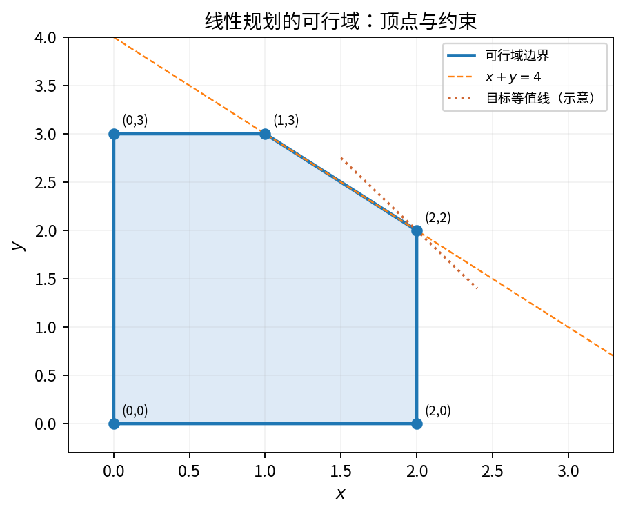

上一篇我们用梯度等工具研究会弯曲的函数。这一篇先换一个更容易看见的问题：假如一个工厂要安排生产，怎样在原料有限的情况下赚到最多的钱？我们先用图找到答案，然后把同一个问题搬进单纯形表。**别急着记“进基、出基、检验数”**，看懂每张表的数字怎么来的以后，它们才有意义。

## 从一个小工厂的利润说起

工厂生产两种产品，分别用 $x$、$y$ 表示它们的产量。每生产一件 $x$ 产品赚 3 元，每生产一件 $y$ 产品赚 2 元。那么总利润是

$$
P=3x+2y.
$$

这里的 $P$ 是我们希望尽可能大的数，叫**目标函数**；$3$ 和 $2$ 分别表示对应产品每增加一件带来的利润，叫**目标系数**。以后把它们写成 $c_x=3$、$c_y=2$：字母 $c$ 只是表示“目标函数里的系数”，下标表示它属于哪个变量。请注意：**目标系数不是凭单纯形表计算出来的，而是从题目给出的目标函数直接读出来的。**

但生产受到限制：两种产品合起来不能超过 4 件；$x$ 最多生产 2 件；$y$ 最多生产 3 件。产量也不能为负。因此

$$
\begin{cases}
x+y\le 4,\\
x\le 2,\\
y\le 3,\\
x\ge 0,\quad y\ge 0.
\end{cases}
$$

这些不等式叫**约束条件**，意思是“一个方案必须满足的限制”。一个具体方案，例如 $(x,y)=(1,2)$，如果同时满足全部约束，就叫**可行解**。所有可行解组成的区域叫**可行域**。

在图上，把每个角上的方案代入利润公式：

| 方案 $(x,y)$ | $(0,0)$ | $(2,0)$ | $(2,2)$ | $(1,3)$ | $(0,3)$ |
|---|---:|---:|---:|---:|---:|
| 利润 $3x+2y$ | 0 | 6 | **10** | 9 | 6 |

答案是生产 $x=2$ 件、$y=2$ 件，利润为 10 元。这里的五个角叫**顶点**。为什么要看顶点？对于这个有界的线性规划问题，至少存在一个顶点能取得最优值；若一条边上的每个点都同样好，也仍然能在边的端点找到最优方案。这是单纯形法的出发点：**不用遍历区域里的所有点，而是从一个顶点走到可能更好的相邻顶点。**

不过，只有两个变量时画图容易；变量变成几十个时，图画不出来。这才需要**单纯形表**：把约束与目标函数整理成一张可以反复做加减运算的表格，用代数运算代替画图。

## 先学会画初始表，不要急着算

原来的三个约束使用的是“$\le$”，但表格更方便处理等式。我们给每条约束增加一个“还剩多少”的变量：

$$
\begin{aligned}
x+y+s_1&=4,\\
x+s_2&=2,\\
y+s_3&=3.
\end{aligned}
$$

例如生产 $(x,y)=(1,2)$ 时，第一条限制一共允许 4 件、实际用了 3 件，所以 $s_1=1$。同理 $s_2=1$、$s_3=1$。这三个表示剩余量的 $s_1,s_2,s_3$ 叫**松弛变量**，它们也必须非负。

松弛变量本身不会创造利润，所以目标函数可以写成

$$
P=3x+2y+0s_1+0s_2+0s_3.
$$

这一步很重要：**五个变量的目标系数按 $x,y,s_1,s_2,s_3$ 排列，就是 $3,2,0,0,0$。** 表头的 $c_j$ 行直接抄这五个数，其中 $j$ 只表示“第几个变量”，不是一个需要计算的新变量。你以后看到 $c_1,c_2,\ldots$，仍然是在说各列的目标系数。

再找一个最容易计算的起点。先不生产任何产品，即设 $x=0,y=0$，上面三个等式变成

$$
s_1=4,\qquad s_2=2,\qquad s_3=3.
$$

此时 $x,y$ 被暂时定为零，叫**非基变量**；$s_1,s_2,s_3$ 可以直接通过等式求出来，叫**基变量**。这里的“基”不是说它们更重要，而是说我们暂时选它们作为“通过方程解出来的一组变量”。当这些值都非负时，便得到了一个**基本可行解**：本例的起点 $(x,y)=(0,0)$。以后每一轮会更换这组基变量，这叫**换基**。

现在终于可以画表了。先在纸上做一个骨架：左侧放“基变量”“$c_B$”，中间按顺序放五个变量，右侧放“右端 $b$”。其中：

- **$c_B$**：当前每个基变量在目标函数里的系数。起初基变量全是松弛变量，故都是 0。下标 $B$ 可以理解为“当前选中的基（Basis）”。
- **右端 $b$**：每条等式右边的数字。这里依次是 4、2、3，不是从目标函数来的。
- **表内系数**：直接抄等式左边每个变量前面的数。没有出现的变量系数填 0，单独一个变量的系数是 1。例如第一行 $x+y+s_1=4$ 对应 $1,1,1,0,0\mid4$。

按以上规则填写得到**初始单纯形表**：

| 基变量 | $c_B$ | $x$ | $y$ | $s_1$ | $s_2$ | $s_3$ | 右端 $b$ |
|:---|---:|---:|---:|---:|---:|---:|---:|
| 目标系数 $c_j$ | — | **3** | **2** | **0** | **0** | **0** | — |
| $s_1$ | 0 | 1 | 1 | 1 | 0 | 0 | 4 |
| $s_2$ | 0 | 1 | 0 | 0 | 1 | 0 | 2 |
| $s_3$ | 0 | 0 | 1 | 0 | 0 | 1 | 3 |
| $z_j$ | — | 0 | 0 | 0 | 0 | 0 | $P=0$ |
| 检验数 $\sigma_j=c_j-z_j$ | — | **3** | **2** | 0 | 0 | 0 | — |

先不用理会底下的 $z_j$、$\sigma_j$，上面的目标系数和三条约束已经可以独立填出来了。核对一下：第一行的 4 来自“总产量不超过 4”，第二行的 2 来自“$x$ 不超过 2”，绝不是利润里的 3 和 2。

**如果只能记住一件事：表头的 $c_j$ 来自目标函数；表格中间的系数和右端 $b$ 来自约束；$c_B$ 由当前基变量是谁来决定。** 这三种来源不能混淆。

## 为什么需要“检验数”？从第一步的利润变化看

现在我们站在 $(0,0)$，想知道应该先增加哪种产品。增加 $x$，每件多赚 3；增加 $y$，每件多赚 2。这里起初没有必须牺牲的“有利润的基变量”，所以先增 $x$ 很自然。

但增加 $x$ 不是无限制的。设 $x$ 从 0 增加到 $t$，而 $y$ 暂时保持为 0，三个等式就变成：

$$
s_1=4-t,\qquad s_2=2-t,\qquad s_3=3.
$$

要保证剩余量不为负，必须 $t\le4$，同时 $t\le2$。因此最多增加到 $t=2$，第二条限制先用光：$s_2$ 从 2 变成 0。此时生产方案从 $(0,0)$ 移到 $(2,0)$，利润从 0 变为 6。

表格中把**准备从零增加的变量**叫**入基变量**，本轮就是 $x$；把**最先下降到零、将被换出去的旧基变量**叫**出基变量**，本轮是 $s_2$。为了确定谁出基，要做**最小比值检验**：用每行右端 $b_i$ 除以入基列的正系数 $a_{ij}$，取最小结果。本轮 $x$ 列系数依次是 1、1、0：

| 行 | 对应等式中的限制 | 比值 | 说明 |
|---|---|---:|---|
| $s_1$ | $s_1=4-x$ | $4/1=4$ | 最多允许 $x$ 增加 4 |
| $s_2$ | $s_2=2-x$ | **$2/1=2$** | 最先达到零，出基 |
| $s_3$ | $s_3=3$ | 不计算 | $x$ 列系数为 0，不限制这次增加 |

符号 $a_{ij}$ 没什么神秘的：$i$ 指第几行，$j$ 指第几列；$a_{ij}$ 就是表中第 $i$ 行、第 $j$ 列的那个数字。我们只使用**正的**入基列系数，因为若某行表示 $s_i=b_i-(-2)t=b_i+2t$，它随着 $t$ 增大反而增加，不会先撞到零。

这里可以先把“入基”和“出基”理解为：**把位置留给一个新变量，同时让一个旧变量退出“由等式求出的变量名单”。** 接下来我们真的动手改表。

### 第一轮：从 $s_2$ 换成 $x$

交叉位置在“$s_2$ 行、$x$ 列”，它的数是 1。这个要作为消元中心的数叫**主元**。将主元所在行叫**主元行**。我们希望换基后，$x$ 列变成 $0,1,0$：这样第二行就能直接表示 $x$，其他行不再含有 $x$。这和解联立方程时使用的**高斯消元**是同一类运算。

原来的第二行是

$$
x+s_2=2,
$$

因为主元为 1，不用除；只要把它从第一行减掉：

$$
(x+y+s_1)-(x+s_2)=4-2,
$$

整理成 $y+s_1-s_2=2$。第三行原本不含 $x$，所以不动。新的三条等式成为

$$
\begin{aligned}
y+s_1-s_2&=2,\\
x+s_2&=2,\\
y+s_3&=3.
\end{aligned}
$$

现在基变量是 $s_1,x,s_3$；非基变量是 $y,s_2$。把 $y=s_2=0$，从右端读到 $s_1=2,x=2,s_3=3$，正是刚才得到的方案 $(2,0)$。

**此时会遇到你问的核心问题：为什么不能永远只用目标系数 $c_j$ 判断好坏？**

看现在的第二行：$x+s_2=2$。假设你让 $s_2$ 增加 1，那么 $x$ 必须从 2 减到 1，才能保持等式成立。$s_2$ 自己的目标系数是 0，看起来“不影响利润”，可实际却少生产了 1 件 $x$，**损失 3 元**。所以判断某个新变量是否值得增加，不能只看它自己带来的收益，还得算其他基变量联动改变造成的收益或损失。

这就是**检验数**所解决的问题：它表示一个非基变量从 0 增加一单位、同时调整当前基变量以保持约束时，目标函数发生多少净变化。单纯形表将它写成 $\sigma_j=c_j-z_j$。

其中 $c_j$ 是这个候选变量原本的目标系数；$z_j$ 是当前基变量因为需要联动变化而带来的“机会成本”，按表中该列的系数、分别乘上对应的 $c_B$ 后求和：

$$
z_j=(\text{第1行 }c_B)(\text{第1行该列系数})
+(\text{第2行 }c_B)(\text{第2行该列系数})
+(\text{第3行 }c_B)(\text{第3行该列系数}).
$$

这是一种带符号的代数计算，不能把 $z_j$ 理解为一定非负的成本；这里“机会成本”只是帮助理解的名称。

我们刚才的新基变量 $s_1,x,s_3$ 的目标系数 $c_B$ 分别是 $0,3,0$。反过来看最初那张表，三个 $c_B$ 都是 0，所以每一列的 $z_j$ 都是 0，初始检验数自然等于原来的目标系数 $c_j$。比如算 $s_2$ 这一列，新表的系数是 $-1,1,0$，于是

$$
z_{s_2}=0\times(-1)+3\times1+0\times0=3,
$$

$$
\sigma_{s_2}=c_{s_2}-z_{s_2}=0-3=-3.
$$

检验数 $-3$ 的意思和刚才直观计算一致：$s_2$ 增加 1，利润净减少 3 元。

再算 $y$：它在三行里的系数是 $1,0,1$，而它原本的目标系数是 2，所以

$$
z_y=0\times1+3\times0+0\times1=0,
$$

$$
\sigma_y=c_y-z_y=2-0=2.
$$

现在让 $y$ 增加一单位，利润净增加 2 元，值得尝试。把所有列按同样方法计算，就得到了**第一次换基后的完整单纯形表**：

| 基变量 | $c_B$ | $x$ | $y$ | $s_1$ | $s_2$ | $s_3$ | 右端 $b$ |
|:---|---:|---:|---:|---:|---:|---:|---:|
| 目标系数 $c_j$ | — | 3 | 2 | 0 | 0 | 0 | — |
| $s_1$ | 0 | 0 | 1 | 1 | -1 | 0 | 2 |
| $x$ | **3** | 1 | 0 | 0 | 1 | 0 | 2 |
| $s_3$ | 0 | 0 | 1 | 0 | 0 | 1 | 3 |
| $z_j$ | — | 3 | 0 | 0 | 3 | 0 | $P=6$ |
| 检验数 $\sigma_j=c_j-z_j$ | — | 0 | **2** | 0 | -3 | 0 | — |

其中 $P=6$ 不是随意填写的：当前基变量依次是 $s_1=2,x=2,s_3=3$，目标值等于 $0\times2+3\times2+0\times3=6$。同理，你以后在表底看到目标值，也可以用“基变量的 $c_B$ 乘右端 $b$ 再相加”核对。

如果仍觉得 $z_j$ 抽象，还可以完全不用这个符号来检验：由新表的第二行 $x+s_2=2$ 得 $x=2-s_2$；$y$ 还是自由调整的非基变量。因此，直接把 $x=2-s_2$ 代入利润公式：

$$
P=3(2-s_2)+2y=6+2y-3s_2.
$$

最后两个系数 $2$、$-3$，正好就是 $y$、$s_2$ 的检验数。**检验数就是把约束引起的联动关系考虑进去后，目标函数对非基变量的新系数。** 这比先死记矩阵公式更值得理解。

### 第二轮：从 $s_1$ 换成 $y$

我们研究的是**最大化**利润，而且统一定义 $\sigma_j=c_j-z_j$，所以**正检验数意味着增加对应非基变量可以提高利润**。现在只有 $y$ 的检验数为正，值是 2，于是让 $y$ 进基。

看 $y$ 列：$s_1$ 行系数为 1、右端 2，允许增量 $2/1=2$；$s_3$ 行系数为 1、右端 3，允许增量 $3/1=3$；$x$ 行系数为 0，不参与比值。最小比值是 2，所以 $s_1$ 出基，主元就是“$s_1$ 行、$y$ 列”的 1。

要把 $y$ 列变成 $1,0,0$，原第一行的 $y+s_1-s_2=2$ 保留；第二行本来不含 $y$，保留；第三行 $y+s_3=3$ 减去第一行，得到

$$
(y+s_3)-(y+s_1-s_2)=3-2,
$$

即 $-s_1+s_2+s_3=1$。现在三条等式是

$$
\begin{aligned}
y+s_1-s_2&=2,\\
x+s_2&=2,\\
-s_1+s_2+s_3&=1.
\end{aligned}
$$

新基变量是 $y,x,s_3$，对应的 $c_B$ 依次为 $2,3,0$。把非基变量 $s_1=s_2=0$，可以从右端读到 $y=2,x=2,s_3=1$，利润为 $2\times2+3\times2=10$。

把它们填进表中，再算各列的 $z_j$。例如 $s_1$ 列为 $1,0,-1$，故 $z_{s_1}=2\times1+3\times0+0\times(-1)=2$，于是 $\sigma_{s_1}=0-2=-2$。$s_2$ 列为 $-1,1,1$，故 $z_{s_2}=2\times(-1)+3\times1+0\times1=1$，所以 $\sigma_{s_2}=0-1=-1$。

| 基变量 | $c_B$ | $x$ | $y$ | $s_1$ | $s_2$ | $s_3$ | 右端 $b$ |
|:---|---:|---:|---:|---:|---:|---:|---:|
| 目标系数 $c_j$ | — | 3 | 2 | 0 | 0 | 0 | — |
| $y$ | **2** | 0 | 1 | 1 | -1 | 0 | 2 |
| $x$ | **3** | 1 | 0 | 0 | 1 | 0 | 2 |
| $s_3$ | 0 | 0 | 0 | -1 | 1 | 1 | 1 |
| $z_j$ | — | 3 | 2 | 2 | 1 | 0 | $P=10$ |
| 检验数 $\sigma_j=c_j-z_j$ | — | 0 | 0 | **-2** | **-1** | 0 | — |

现在所有检验数都**不大于零**，表示没有非基变量可以从 0 开始增加并继续改善利润，因此可停止。最终 $x=2,y=2$，最大利润 $P=10$，和前面画图得到的结果一致。

再用一个不依赖表格的办法检查：最后两条含 $x,y$ 的等式给出 $x=2-s_2$、$y=2-s_1+s_2$。代进目标函数得到

$$
P=3(2-s_2)+2(2-s_1+s_2)=10-2s_1-s_2.
$$

因为剩余量 $s_1,s_2$ 不能为负，所以 $P\le10$。这个结论直接证明了 10 就是最优值，也解释了为什么最后表格里 $s_1,s_2$ 的检验数是 $-2,-1$。

注意：最大化问题中“选**最大**的正检验数入基”是常用的选列规则，而不是唯一合法的选法；退化或并列时需要额外考虑规则。本例两轮恰好都没有这些困难。

## 回头看检验数公式：现在每个字母都能找到位置了

前面的手算已经足够完成这道题。教材常把同样的算法写成

$$
\boxed{\sigma_j=c_j-c_B^TB^{-1}a_j}.
$$

第一次看到它没必要害怕，因为它只是“用当前基变量的目标系数，去乘表格里这一列的数字，再从原目标系数里减掉”的矩阵简写。

这里多出现几个记号，需要逐个说明：

- $a_j$：**原约束矩阵**中第 $j$ 个变量的整列系数。例如初始表中的 $x$ 列就是 $a_x=(1,1,0)^T$；上标 $T$ 表示转置，把列向量变为行向量。
- $B$：当前基变量在**原约束矩阵**中对应的列，按当前基变量顺序并排组成的方阵，称为**基矩阵**。
- $B^{-1}$：$B$ 的**逆矩阵**，是满足 $B^{-1}B=I$ 的矩阵，$I$ 是单位矩阵（相当于矩阵运算中的 1）。这要求所选的基列线性独立。
- $B^{-1}a_j$：将原始第 $j$ 列换算成“当前单纯形表里”的那列数值。我们已经通过每轮消元，在表中得到了这个结果。
- $c_B^T$：将当前基变量的目标系数组成行向量，例如第一轮后是 $(0,3,0)$。它乘表格的某一列，就得到前面手算的 $z_j$。

因此所谓 $c_B^TB^{-1}a_j$，不是一个新概念，而是我们刚才算 $0\times(-1)+3\times1+0\times0$ 的另一种写法。**第一次做单纯形表时，直接算 $z_j=\sum_i c_{B_i}\bar a_{ij}$ 就够了**；其中 $\sum_i$ 表示“每行相乘后加总”，$\bar a_{ij}$ 表示**消元后的当前表格**第 $i$ 行、第 $j$ 列数字。

还要防止一个常见误会：$\sigma_j$ 的正负规则和**最小化/最大化**有关，也和书上把检验数定义为 $c_j-z_j$ 还是 $z_j-c_j$ 有关。本篇固定使用 $c_j-z_j$。因此最大化时选正检验数改善、全部 $\le0$ 时停止；若是最小化，则选负检验数改善、全部 $\ge0$ 时停止。千万不要把这两种情况反过来背。

**如果初始表根本画不出这样简单的松弛变量基怎么办？** 上面的工厂例题非常幸运：全部约束都是“$\le$”，右端为非负，令原变量为 0 后，每个松弛变量也都非负。但例如 $x\ge2$，写成 $x-s=2$、$s\ge0$ 后令 $x=0$ 会得到 $s=-2$，这**不是可行解**，不能拿它冒充初始基。一般需要引入**人工变量**，通过**两阶段法**（先找可行基、再优化原目标）或大 $M$ 法来开始；这一段是认识边界情形，不要求把人工变量当作真正有利润的决策变量。

还要区分三种常见现象：若某一列检验数提示可以改善，但该列在约束行中没有可用的正系数（在本篇最大化、$c_j-z_j$ 约定下），就没有变量能阻挡它，可能沿该方向使目标无界；若比值检验最小值是 $0$，换基后目标可能不变，这叫**退化**，不是算错；如果存在非基变量的检验数为 $0$，有时可能存在另一个最优基本可行解，但不能仅凭这一项就断定有不同的最优点。考试时要写清采用的检验数正负约定和具体表格证据，不能只根据图形猜结论。

## 再试一眼老师的原题：目标系数从哪里抄

[第 07 篇的老师作业](07、老师作业与补充练习.md)是**极小化**问题。它给出的原目标函数是

$$
\min f=3x_1-5x_2+6x_3,
$$

所以原来的三个变量的目标系数依次就是 $3,-5,6$。请特别注意：**$-5$ 是目标系数，不是某个约束的系数，也不是算出来的检验数。** 第一个约束的右端是 $-7$，它与目标系数无关。

为了得到方便的初始基，把第一条约束

$$
-2x_1+x_2-2x_3\ge-7
$$

两边乘 $-1$，不等号同时翻转为 $2x_1-x_2+2x_3\le7$。加上 $x_4,x_5,x_6$ 三个松弛变量后，目标函数仍是

$$
f=3x_1-5x_2+6x_3+0x_4+0x_5+0x_6.
$$

因此，老师题的初始表应这样**从题目逐格抄出**：

| 基变量 | $c_B$ | $x_1$ | $x_2$ | $x_3$ | $x_4$ | $x_5$ | $x_6$ | 右端 $b$ |
|:---|---:|---:|---:|---:|---:|---:|---:|---:|
| 目标系数 $c_j$ | — | **3** | **-5** | **6** | **0** | **0** | **0** | — |
| $x_4$ | 0 | 2 | -1 | 2 | 1 | 0 | 0 | 7 |
| $x_5$ | 0 | -5 | 3 | 0 | 0 | 1 | 0 | 15 |
| $x_6$ | 0 | 2 | 0 | 7 | 0 | 0 | 1 | 10 |
| $z_j$ | — | 0 | 0 | 0 | 0 | 0 | 0 | $f=0$ |
| 检验数 $\sigma_j=c_j-z_j$ | — | 3 | **-5** | 6 | 0 | 0 | 0 | — |

这张表与刚才小工厂的表结构完全一样。差别只在于老师要做的是**极小化**，所以这次要寻找**负的**检验数来降低目标值。初始唯一为负的数是 $-5$，在 $x_2$ 列；$x_2$ 列依次为 $-1,3,0$，只有第二行的 3 是正数，因此允许增加 $15/3=5$，$x_5$ 出基。至于后面怎样把三张表完整算到最优值，第 07 篇已经逐轮展开，可以直接对照练习。

**最后检验自己是否真的学会了：**不看上面的填表说明，能否从老师原题单独写出“目标系数行 $3,-5,6,0,0,0$”以及约束第一行“$2,-1,2,1,0,0\mid7$”？再回答一句：为什么第一次换基后 $s_2$ 的原目标系数仍是 0，检验数却变成了 $-3$？如果这两点都能说清，才说明你理解了表是怎么来的，而不只是记住了结果。

[下一篇：为什么方向选完后还需要线搜索](03、线搜索与步长.md)
