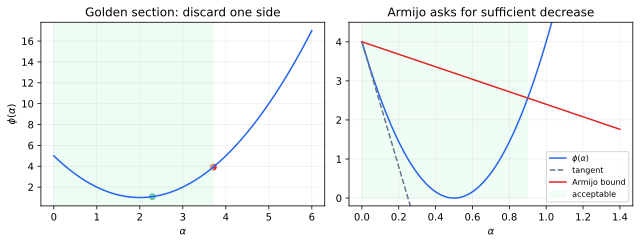

上一章在线性规划中沿边移动到下一个顶点；这里把同一思想推广到光滑函数：先由算法给出方向 $d_k$，再只在直线 $x^{(k)}+\alpha d_k$ 上选一个步长。先修是 01 篇的梯度、方向导数和泰勒展开。学完应能区分精确与非精确线搜索，完整执行一次区间搜索，并解释失败时该检查什么。

## 1. 先认方向和步长（第 2 天）

**例题。** 你站在 $x^{(0)}=(2,1)^T$，给定方向 $d_0=(-2,-2)^T$。如果取步长 $\alpha=1/2$，先把方向的两个坐标都乘 $1/2$，得到位移 $(-1,-1)^T$，再加到原位置，得到 $(1,0)^T$。

| $\alpha$ | 实际位移 $\alpha d_0$ | 到达位置 |
|---:|---|---|
| 0 | $(0,0)^T$ | $(2,1)^T$ |
| $1/2$ | $(-1,-1)^T$ | $(1,0)^T$ |
| 1 | $(-2,-2)^T$ | $(0,-1)^T$ |

正式记作 $x^{(k+1)}=x^{(k)}+\alpha_kd_k$。括号里的上标表示轮次：$x^{(0)}$ 是起点，$x^{(1)}$ 是走完第一步得到的整个点；后面 $x_1,x_2$ 表示一个点的两个坐标。$d_k$ 和 $\alpha_k$ 的下标也表示第几轮。给定当前位置和方向，比较不同的 $\alpha$，这个动作就叫**线搜索**。第 2 天先算出表里的三个位置即可。

把 $\phi(\alpha)=f(x^{(k)}+\alpha d_k)$ 写出来后，多元搜索就变成了一元搜索。链式法则给出 $\phi'(0)=g_k^Td_k$。若它不小于 0，当前 $d_k$ 不是严格下降方向，通常应先修正方向，而不是盲目搜索正步长。

## 2. 精确线搜索就是找线上最好的那个步长（第 4 天）

**例题。** 仍从 $(2,1)^T$ 沿 $(-2,-2)^T$ 走，目标是 $f(x_1,x_2)=\tfrac12x_1^2+x_2^2$。上表三个候选位置的目标值分别为 $3,\tfrac12,1$。$\alpha=1/2$ 比另外两个好，中间也许还有更好的，下面直接算出来。

先写出任意步长对应的坐标 $(2-2\alpha,\,1-2\alpha)$，再代回 $f$。新函数只剩一个自变量 $\alpha$，把它记作 $\phi(\alpha)$。

$$
\begin{aligned}
\phi(\alpha)
&=\tfrac12(2-2\alpha)^2+(1-2\alpha)^2\\
&=(2-4\alpha+2\alpha^2)+(1-4\alpha+4\alpha^2)\\
&=3-8\alpha+6\alpha^2.
\end{aligned}
$$

求导得到 $\phi'(\alpha)=-8+12\alpha$。让它等于 0，解得 $\alpha=8/12=2/3$。二次项系数 $6>0$，抛物线开口向上，且 $2/3$ 在允许的 $\alpha\ge0$ 范围内，所以这就是最小点。代回逐项算：$x^{(1)}=(2-2\cdot\tfrac23,1-2\cdot\tfrac23)^T=(\tfrac23,-\tfrac13)^T$。目标值是 $\tfrac12(\tfrac23)^2+(-\tfrac13)^2=\tfrac29+\tfrac19=\tfrac13$。

再看 $\phi'(0)=-8$。说明刚开始往这个方向走，目标确实会降低，这样的方向叫**下降方向**。如果题目只给你方向和函数，先用代入、求导、检查这三步，就能处理常见的正定二次手算题。

精确线搜索要求找到 $\min_{\alpha\ge0}\phi(\alpha)$ 的真正最优步长；非精确线搜索只要求步长满足可验证的下降条件。前者每步可能更好，但求解一维最小值也有成本；后者通常更适合一般非线性程序。

## 3. 同一道题，用梯度和 Hessian 算快一点（第 4 天）

**例题。** 不再展开平方，试着用第 1 天练过的内积求同一个 $2/3$。在 $(2,1)^T$ 有 $g=(2,2)^T$、$Q=\begin{pmatrix}1&0\\0&2\end{pmatrix}$，方向 $d=(-2,-2)^T$。

1. 算一次项。$g^Td=2\cdot(-2)+2\cdot(-2)=-8$。
2. 算二次项。先乘矩阵得到 $Qd=(-2,-4)^T$，再算 $d^TQd=(-2)(-2)+(-2)(-4)=12$。
3. 用第 2 天的展开。沿线的值等于 $f(x)+\alpha g^Td+\tfrac12\alpha^2d^TQd$。对 $\alpha$ 求导，得到 $g^Td+\alpha d^TQd$。令它为 0，把 $g^Td$ 移到右边，再除以 $d^TQd$，得到

   $$
   \boxed{\alpha=-\frac{g^Td}{d^TQd}=\frac{8}{12}=\frac23.}
   $$

公式适合正定二次目标、非零下降方向。前面的负号会把负斜率变成正步长。若方向正好等于 $-g$，可以用 $g^Tg/g^TQg$。FR 的第二步方向一般带着上一轮的信息，继续用上面带 $d$ 的公式。

**先去动笔。** 把步长遮住重新算一遍，能算出 $2/3$ 就进入 [04、最速下降、牛顿与共轭梯度](04、最速下降、牛顿与共轭梯度.md)。以下内容可在三种迭代做完后补读。

## 补读一｜课件里怎么在一条线上找点

### 先找一个能夹住极小点的区间

对于单峰函数，找到 $a<m<b$ 且 $\phi(m)<\phi(a),\phi(b)$，就夹住了最小点。常用试探方式是从起点迈一小步，若下降就往同一方向扩大步幅，直到再试发现升高。比如 $\phi(t)=(t-3)^2$，试 $0,1,3,7$ 得到 $9,4,0,16$，最后三点夹住了极小点。有了区间，再开始缩小。

### 黄金分割：比较两个函数值

记 $\rho=(\sqrt5-1)/2\approx0.618$。在 $[a,b]$ 取 $p=a+(1-\rho)(b-a)$，$q=a+\rho(b-a)$，所以 $p<q$。

- 若 $\phi(p)\le\phi(q)$，保留 $[a,q]$。
- 若 $\phi(p)>\phi(q)$，保留 $[p,b]$。

在严格单峰的假设下，这样不会丢掉极小点。黄金比例让下一轮能复用一个已算的点和函数值。重复到 $b-a\le\varepsilon$，可返回中点作为近似解。

为什么恰好是 $0.618$？设保留下来的新区间长度是原来的 $\rho$ 倍，并希望旧内部点在缩区间后仍处在同样的相对位置，以便只新增一次函数计算。长度关系给出 $\rho^2=1-\rho$，即 $\rho^2+\rho-1=0$。取 $(0,1)$ 内的根，得到 $\rho=(\sqrt5-1)/2\approx0.618$。

例如 $\phi(t)=(t-2)^2+1$，初始 $[0,6]$。$p\approx2.292,q\approx3.708$，由于 $\phi(p)<\phi(q)$ 保留 $[0,3.708\ldots]$。下一轮旧的 $p$ 成为新区间右侧试探点。

### 导数二分：看中点的坡度

若 $\phi$ 可微且严格凸，则 $\phi'$ 单调递增；在两端满足 $\phi'(a)<0<\phi'(b)$ 时，可对导数的零点做二分。取 $m=(a+b)/2$，$\phi'(m)>0$ 时保留左半，$\phi'(m)<0$ 时保留右半，等于 0 可停。更一般地，至少要确认目标极小点左侧导数为负、右侧为正；仅有“可微单峰”还不够，因为非极小点也可能出现水平切线。对 $\phi(t)=(t-2)^2+1$ 从 $[0,6]$ 开始，$m=3$ 处导数为 2，下一轮区间就是 $[0,3]$。

### 三点二次插值：用三个函数值拟合抛物线

课件取 $t_1<t_2<t_3$，中间点的函数值最低。用 $P(t)=a+bt+ct^2$ 通过三点，令 $P'(\bar t)=0$。10 月 16 日课件第 118 张把试探点写成

$$
\begin{aligned}
B_1&=(t_2^2-t_3^2)\phi(t_1),&
B_2&=(t_3^2-t_1^2)\phi(t_2),&
B_3&=(t_1^2-t_2^2)\phi(t_3),\\
C_1&=(t_2-t_3)\phi(t_1),&
C_2&=(t_3-t_1)\phi(t_2),&
C_3&=(t_1-t_2)\phi(t_3),\\
\bar t&=\frac{B_1+B_2+B_3}{2(C_1+C_2+C_3)}.
\end{aligned}
$$

例如点 $0,1,3$ 的函数值分别为 $13/4,5/4,13/4$。两个和分别为 $-18,-6$，所以 $\bar t=3/2$。这组数据来自 $\phi(t)=(t-1.5)^2+1$。代回原函数得 $\phi(3/2)=1$，比原中间点更小，下一组三点取 $1,3/2,3$。

课件的停止准则为 $|t_2-\bar t|<\varepsilon$。它只表示“拟合抛物线的顶点接近当前中点”，不是原函数极小点误差不超过 $\varepsilon$ 的证明。比如 $\phi(t)=1+2t^2+0.1(t^3-4t)$ 在 $[-2,2]$ 上严格凸，三点函数值为 $9,1,9$，拟合顶点仍是 0，会立刻满足这个准则；但 $\phi'(0)=-0.4$，真实极小点约为 $0.0993$。

若还未停，就比较新点的原函数值，从四点中取最低点和它左右相邻的点继续。在精确运算且中间函数值严格低于两端时，拟合抛物线会向上开口且顶点位于区间内；分母为 0、曲率非正或顶点越界主要会出现在平坦/非严格数据、舍入误差或输入未真正括住极小点时。此时算法应报告失败，或者由外层算法明确切换到黄金分割；不能悄悄把失败记成三点插值成功。这里拟合的是一元抛物线，作业的双线性插值则使用四个像素值和两个坐标方向。

注意三点插值的逻辑边界：三点只保证存在一个插值抛物线，不保证原函数就是抛物线，也不保证拟合曲率为正。具体数据能验证本轮候选点，不能证明对所有函数都成功。

## 补读二｜接受一个够好的步长

一般非线性题很难每步都精确求最小点，可以接受一个足够好的步长。常见的 Armijo 条件为

$$
\phi(\alpha)\le\phi(0)+c_1\alpha\phi'(0),\qquad 0<c_1<1.
$$

右边沿初始斜率预估了一部分下降。回溯法先试 $\alpha=1$，条件未满足就乘上 $\rho\in(0,1)$ 再试，满足时返回当前步长。比如 $f(t)=t^2$，从 $t=2$ 沿 $d=-4$ 走，$\phi(0)=4,\phi'(0)=-16$。取 $c_1=0.1,\rho=0.5$，试 $\alpha=1$ 得 $4>2.4$，减半试 $\alpha=0.5$ 得 $0\le3.2$，接受。这个例子刚好接受精确步长，Armijo 的一般目标是保证足够下降。

Wolfe 条件在 Armijo 之外再看新点的斜率。Armijo 只要求下降量够多，极小的正步长往往也能通过；若每次都接受这种步长，算法会推进得很慢。常用曲率条件

$$
\phi'(\alpha)\ge c_2\phi'(0),\qquad c_1<c_2<1,
$$

要求新点的负斜率已经明显变缓，避免离起点太近。强 Wolfe 再限制越过谷底后的正斜率不能太大，把条件改成 $|\phi'(\alpha)|\le c_2|\phi'(0)|$。

**例题。** 接着 $f(t)=t^2$、$t=2$、$d=-4$ 的例子，令 $c_2=1/2$。沿线的导数是 $\phi'(\alpha)=-16+32\alpha$。过小的 $\alpha=1/16$ 给出 $\phi=49/16\le3.9$，能通过 $c_1=0.1$ 的 Armijo；但 $\phi'=-14<-8=c_2\phi'(0)$，没有通过 Wolfe。试 $\alpha=1/4$ 得 $f(1)=1\le3.6$，且导数是 $-8$，两种 Wolfe 版本都通过。若试 $\alpha=7/8$，仍满足 Armijo，但此时斜率为 $12$，超过强 Wolfe 允许的绝对值 $8$。

## 补读三｜信赖域先圈出允许试的范围

信赖域先规定本次位移的长度上限 $\Delta$。用当前位置的梯度和 Hessian 写二次模型，先在 $\lVert d\rVert\le\Delta$ 内找一个模型喜欢的点，再拿原函数验算预测准不准。

**例题。** $f(t)=t^2$，现在 $t=2$，规定本次最多移动 1。模型是 $m(d)=4+4d+d^2$。若无长度限制，最低点是 $d=-2$，超过这一步允许范围，所以在 $[-1,1]$ 里选 $d=-1$。模型预测下降为 $4-m(-1)=3$，实际下降是 $f(2)-f(1)=3$，两者之比是 1，可以接受这一步。若原函数的下降远小于预测，通常会把信赖域缩小再试。可继续查教材 §2.3–2.5。

## 方法比较与实验代码对照

| 方法 | 需要什么 | 停止/接受依据 | 主要风险 |
|---|---|---|---|
| 进退法 | 函数值、初始点和试探步长 | 找到中间点低于两侧的三点区间 | 函数不单峰或受边界限制时可能找不到括区间 |
| 黄金分割 | 单峰括区间 | 区间宽度不超过容差 | 稳健但只利用函数值，通常迭代较多 |
| 三点二次插值 | 三个不同点及函数值 | 新旧中心足够接近 | 分母为零、曲率非正或候选点跑出区间 |
| Armijo 回溯 | 函数值、梯度、下降方向 | 足够下降不等式 | 非下降方向会使条件失去预期意义；参数太保守会步长过小 |
| Wolfe/强 Wolfe | 还需新点方向导数 | 下降量与曲率共同达标 | 每次试探需要更多导数信息 |
| 信赖域 | 局部模型和半径 | 实际下降/预测下降之比 | 子问题更复杂，但坏模型时比盲目长步更稳健 |

对照实验源码：题目与入口在[实验一 main.py](/downloads/optimization/实验一_线搜索方法/code/main.py)，算法分别在 `code/methods/`，其中可直接查看[三点插值](/downloads/optimization/实验一_线搜索方法/code/methods/parabolic_interpolation.py)与 [Armijo](/downloads/optimization/实验一_线搜索方法/code/methods/armijo_search.py)。Armijo 固定 `alpha0=1`、`c1=1e-4`、`rho=0.5`；三点插值按课件的 $B_i,C_i$ 公式实现，遇到非正曲率或候选点越界会报告失败，并不会自动换成另一个算法。工作区的 `最优化方法实验/原始实验包` 只是旧归档，不作为本节代码依据。

也可以先阅读站内的[实验一代码导读](../最优化方法实验/02、实验一：线搜索方法.md)。

## 理解检查

1. $g^Td<0$ 与 Armijo 各保证了什么？
2. 黄金分割为什么能复用一次函数值？
3. 三点插值算出的顶点落在区间外时，为什么不应直接接受？

核对答案

1. 前者只保证起点附近沿该方向初始下降；Armijo 检查某个具体步长是否取得了相对于初始斜率的足够下降。
2. $\rho$ 满足自相似长度关系 $\rho^2=1-\rho$，缩区间后一个旧内部点正好落在下一轮所需位置。
3. 三点只是在局部拟合；区间外顶点不再受已有括区间信息保护，可能远离原函数的极小点，还可能来自不可靠曲率。

## 本章闭环

现在已经会在方向给定后选步长。下一章将回答方向从哪里来：只用梯度得到最速下降，用 Hessian 得到牛顿方向，用历史方向得到共轭梯度。

[返回五天路线](00、考试重点与复习路线.md)
