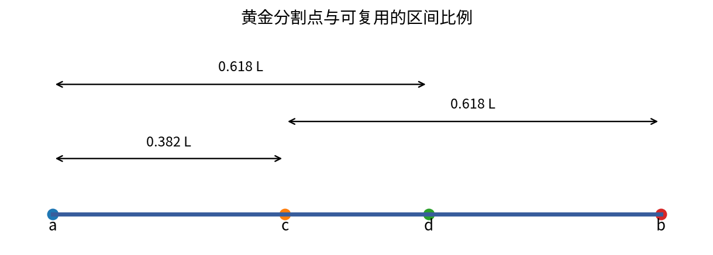

上一讲（以及第 01 篇）告诉我们：只要选对下降方向 $d_k$，迈出一小步就能下坡。但“往东走会下坡”不等于“往东走十公里还会下坡”——步子迈太大，直接跨过谷底爬到对面山坡上了。

所以每次<strong>迭代（Iteration）</strong>都要拆成两步：**先定方向 $d_k$，再定步长 $\alpha_k$**：

$$
x_{k+1} = x_k + \alpha_k d_k, \qquad \alpha_k > 0.
$$

把当前点 $x_k$ 和方向 $d_k$ 固定住，原函数就从 $n$ 元函数退化成只看步长 $\alpha$ 的<strong>一元沿线函数</strong>：

$$
\phi(\alpha) = f(x_k + \alpha d_k).
$$

<strong>线搜索（Line Search）</strong>干的唯一一件事，就是在这条直线上挑一个靠谱的步长 $\alpha$。

---

## 0. 开篇防晕：本篇符号分队

| 队伍 | 符号 | 人话标签 |
| :--- | :--- | :--- |
| **迭代走路** | $x_k, \; d_k, \; \alpha_k$ | 第 $k$ 轮的位置 $x_k$、搜索方向 $d_k$、步长 $\alpha_k$。 |
| **沿线函数** | $\phi(\alpha), \; \phi'(0)$ | 把 $n$ 维山谷切成一维剖面曲线 $\phi(\alpha)$；起点坡度 $\phi'(0) = \nabla f(x_k)^T d_k$。 |
| **区间缩小** | $[a, b], \; L, \; r, \; c, \; d$ | 括住谷底的区间 $[a,b]$，长度 $L=b-a$，黄金比例 $r \approx 0.618$，两个内部试探点 $c, d$。 |
| **三点插值** | $(a, m, b), \; q(\alpha), \; u$ | 括谷三点（中点 $m$ 最低），拟合抛物线 $q(\alpha)=A\alpha^2+B\alpha+C$，抛物线谷底 $u$。 |
| **不精确判据** | $c_1, \; c_2, \; \rho, \; \Delta$ | Armijo 下降系数 $c_1$、Wolfe 曲率系数 $c_2$、回溯缩放比 $\rho$、信赖域半径 $\Delta$。 |

> **避坑提醒**：黄金分割小节里的 $d$ 只是<strong>区间里的一个右试探点（标量）</strong>，不是多维的<strong>搜索方向向量 $d_k$</strong>，看清上下文别串台。

---

## 1. 精确线搜索：怎么判断方向对不对，以及为什么步子不能乱迈？

看个一眼懂的例子：$f(x) = (x-2)^2$，从 $x_0=0$ 往 $d=4$ 走，沿线函数为：

$$
\phi(\alpha) = (4\alpha - 2)^2.
$$

- 走 $\alpha = 0.5$：正好落到谷底 $x=2$，函数值 $0$；
- 走 $\alpha = 1$：直接跨过谷底冲到 $x=4$，函数值弹回 $4$，白忙活。

<strong>精确线搜索（Exact Line Search）</strong>就是直接找 $\phi(\alpha)$ 的最低点——求导令 $\phi'(\alpha) = 2(4\alpha-2)\cdot 4 = 32\alpha - 16 = 0$，解得 $\alpha = 1/2$。

### 动手找步长前，先查方向是不是真的下坡
由链式法则，沿线函数在起点 $\alpha=0$ 的斜率（方向导数）为：

$$
\phi'(0) = \nabla f(x_k)^T d_k.
$$

比如 $f(x,y)=x^2+4y^2$，在 $(1,1)$ 处梯度为 $(2,8)^T$，选方向 $d=(-2,-8)^T$，内积为 $2(-2)+8(-8)=-68 < 0$（和把 $(1-2\alpha)^2+4(1-8\alpha)^2$ 在 $\alpha=0$ 求导算出的 $-68$ 完全一致）。

> **铁律**：只有 $\phi'(0) < 0$ 时，$d_k$ 才是<strong>严格下降方向</strong>。如果 $\phi'(0) > 0$，说明方向指反了，**千万别指望靠缩小步长救回来**，必须先改方向！

---

## 2. 没导数也能找谷底：进退法、黄金分割、导数二分

实际问题里，有时求导很麻烦（甚至没法求导），只想靠算函数值把谷底“夹”出来。前提是函数在区间内是<strong>单峰（Unimodal）</strong>的——先一路降到一个谷底，再一路升，没有好几个坑。

### 第一步：进退法（Bracketing）——先圈出谷底大概在哪
像蒙眼探路，步子越迈越大，直到发现“开始上坡了”，谷底就被夹在中间了。
以 $\phi(\alpha) = (\alpha-2)^2$ 为例，从 $\alpha=0$ 出发，初始试探步长 $h=0.5$，每次翻倍：

| 试探点 $\alpha$ | $0$ | $0.5$ | $1.5$ | $3.5$ |
| :--- | ---: | ---: | ---: | ---: |
| 函数值 $\phi(\alpha)$ | $4$ | $2.25$ | $0.25$ | $2.25$ |

前两步都在下降，从 $1.5$ 迈到 $3.5$ 突然升高了 $\Rightarrow$ 形成“两头高、中间低”的括谷状态，谷底肯定在区间 $[0.5, 3.5]$ 里。**进退法只管圈区间，不管算精确值。**

### 第二步：黄金分割法（Golden-Section Search）——每次扔掉一边，还能偷懒少算一次
有了区间 $[a,b]$（长度 $L=b-a$），我们在内部放两个试探点 $c, d$（$a<c<d<b$），比较 $\phi(c)$ 和 $\phi(d)$：
- 如果 $\phi(c) \le \phi(d)$，扔掉右边，保留 $[a, d]$；
- 否则扔掉左边，保留 $[c, b]$。

**为什么偏偏要用黄金比例 $r = \frac{\sqrt{5}-1}{2} \approx 0.618$？**
纯属为了<strong>省计算量（复用旧点）</strong>！设新区间占原区间的比例为 $r$，把两个点对称放在：

$$
c = b - rL, \qquad d = a + rL.
$$

如果本轮保留左区间 $[a, d]$（新长度 $rL$），我们希望原来的左内点 $c$ **刚好自动成为新区间的右内点**，这样下一轮就不用重算 $\phi(c)$ 了！要求 $c - a = r(d - a)$，也就是 $(1-r)L = r^2 L$：

$$
r^2 + r - 1 = 0 \implies r = \frac{\sqrt{5}-1}{2} \approx 0.618.
$$

**动手算两轮**：对 $\phi(\alpha)=(\alpha-2)^2$，初始区间 $[0, 5]$：
1. 第一轮：$c = 5(1-r) \approx 1.910$，$d = 5r \approx 3.090$。算得 $\phi(c) \approx 0.0081 < \phi(d) \approx 1.1885 \implies$ 扔掉右边，保留 $[0, 3.090]$。
2. 第二轮：新右内点<strong>直接白嫖旧点 $1.910$</strong>（函数值已知 $0.0081$），只需新算左内点 $\approx 1.180$，得 $\phi(1.180) \approx 0.672 > 0.0081 \implies$ 扔掉左边，保留 $[1.180, 3.090]$。

每轮区间长度稳稳乘以 $0.618$，直到 $b - a \le \varepsilon$ 停机（别用函数值差停机，函数太扁时容易提前误停）。

### 补充：导数二分法（有导数时更快）
如果能算一阶导数，且已知 $\phi'(a) < 0$（左端在下坡）、$\phi'(b) > 0$（右端在上坡），直接看<strong>中点斜率</strong>：
- 中点导数 $> 0$（已经在谷底右边）$\Rightarrow$ 保留左半边；
- 中点导数 $< 0$（还在谷底左边）$\Rightarrow$ 保留右半边。

比如 $\phi(\alpha)=(\alpha-2)^2$ 在 $[0, 5]$ 上，$\phi'(2.5) = 1 > 0 \implies$ 留 $[0, 2.5]$；新中点 $\phi'(1.25) = -1.5 < 0 \implies$ 留 $[1.25, 2.5]$。每轮直接砍半，比黄金分割更快。

---

## 3. 三点二次插值：用三条点拼一条抛物线，直接“猜”谷底

黄金分割太老实，只比大小、不看形状。如果已经手握三个括谷点 $a < m < b$（满足中点最低 $\phi(m) \le \phi(a), \phi(b)$），不如直接用这三点拟合一条抛物线 $q(\alpha) = A\alpha^2 + B\alpha + C$，**跳到抛物线的最低点 $u = -B/(2A)$ 去试探**。

### 两轮完整数值演示
设真实函数为 $\phi(\alpha) = (\alpha - 1.5)^2 + 2 + 0.02\alpha(\alpha-1)(\alpha-3)$（刻意加了个小扰动，不是纯抛物线）。

**第一轮**：已知三点 $(0, 4.25), \; (1, 2.25), \; (3, 4.25)$。
- 代入 $q(\alpha)=A\alpha^2+B\alpha+C$ 得 $C=4.25, \; A+B=-2, \; 9A+3B=0 \implies A=1, B=-3$。
- 拟合抛物线 $q(\alpha) = \alpha^2 - 3\alpha + 4.25$，令 $q'(\alpha) = 2\alpha - 3 = 0 \implies$ 候选点 $u = 1.5$。
- **必须算真实函数值**：$\phi(1.5) = 1.9775 < \phi(1) = 2.25$。新点更低，三点更新为 $(1, 1.5, 3)$。

**第二轮**：用新三点 $(1, 2.25), \; (1.5, 1.9775), \; (3, 4.25)$ 重新拟合：
- 列方程：
  $$
  \begin{cases}
  A + B + C = 2.25, \\
  2.25A + 1.5B + C = 1.9775, \\
  9A + 3B + C = 4.25.
  \end{cases}
  $$
- 消去 $C$ 解得 $A=1.03, \; B=-3.12, \; C=4.34$，即 $q_2(\alpha) = 1.03\alpha^2 - 3.12\alpha + 4.34$。
- 令 $q_2'(\alpha) = 2.06\alpha - 3.12 = 0 \implies$ 新候选点 $u = \frac{156}{103} \approx 1.514563$。
- **再算真实函数值**（千万别拿 $q_2(u)$ 冒充）：$\phi(u) \approx 1.977059 < \phi(1.5) = 1.9775$，于是三点更新为 $(1.5, \; 1.514563, \; 3)$。

### 三点更新口诀表（始终保持“两头高、中间低”）
算出候选点 $u \in (a, b)$ 的真实值 $\phi(u)$ 后，只有 4 种情况，**核心逻辑就一句：谁更低谁当新中点 $m$，扔掉另一侧多余的端点**：

| 候选点 $u$ 落在哪 | 真实高度比较 | 新的 $(a, m, b)$ | 人话解释 |
| :--- | :--- | :--- | :--- |
| $m < u < b$（中点右侧） | $\phi(u) < \phi(m)$ | $(m, u, b)$ | $u$ 更低，$u$ 上位当新中点，扔掉最左 $a$ |
| $m < u < b$（中点右侧） | $\phi(u) \ge \phi(m)$ | $(a, m, u)$ | $m$ 还是最低，用 $u$ 缩紧右边界 |
| $a < u < m$（中点左侧） | $\phi(u) < \phi(m)$ | $(a, u, m)$ | $u$ 更低，$u$ 上位当新中点，扔掉最右 $b$ |
| $a < u < m$（中点左侧） | $\phi(u) \ge \phi(m)$ | $(u, m, b)$ | $m$ 还是最低，用 $u$ 缩紧左边界 |

> **风险提示**：纯三点抛物线法没有黄金分割兜底（不像 Brent 法），万一拟合出 $A \le 0$（开口向下）或 $u$ 跑出区间外、或者三点挤太近，算法会翻车，代码里必须加安全检查。

---

## 4. 不必死磕最低点：Armijo、Wolfe 与信赖域

在大规模优化里，每走一步都把直线上的精确最低点算出来太费时间了——反正方向本身就只是局部的，下一轮还要拐弯。<strong>不精确线搜索</strong>的哲学是：**差不多够用就行，但不能迈太大（没降够），也不能迈太小（原地磨蹭）。**

### Armijo 条件（防步子太大 / 保证足够下降）

$$
f(x + \alpha d) \le f(x) + c_1 \alpha \nabla f(x)^T d, \qquad 0 < c_1 < 1.
$$

**人话翻译**：因为 $\nabla f(x)^T d < 0$，右边是一条比起点高度往下斜的“及格线”（斜率打了个 $c_1$ 折）。只有新点的高度落在这条及格线下方，才算<strong>下降得够多</strong>。
实战常用<strong>回溯法（Backtracking）</strong>：先试 $\alpha = 1$，不及格就砍半（$\alpha \leftarrow \rho \alpha$，如 $\rho = 1/2$），直到及格。

*小算例*：$f(x)=(x-2)^2, \; x=0, \; d=4, \; c_1=0.1$。起点 $f(0)=4$，方向导数 $(-4)(4)=-16$，及格线为 $4 - 1.6\alpha$：
- 试 $\alpha=1$：实际 $f(4)=4 >$ 及格线 $2.4$（**不及格**，砍半）；
- 试 $\alpha=1/2$：实际 $f(2)=0 \le$ 及格线 $3.2$（**及格，收工！**）。

### Wolfe 条件（再加一道杠：防步子太小）
光有 Armijo 有个漏洞：你只迈出 $\alpha = 0.00001$ 这种蚂蚁步，也能轻松落在及格线下面，导致算法磨洋工。
所以<strong>弱 Wolfe 条件</strong>在 Armijo 之外，补了一句<strong>曲率条件</strong>：

$$
\nabla f(x + \alpha d)^T d \ge c_2 \nabla f(x)^T d, \qquad 0 < c_1 < c_2 < 1.
$$

**人话翻译**：既然是在下坡（原斜率是负数），新位置的下坡坡度不能还跟起点一样陡，至少得<strong>变平缓一些</strong>（往 $0$ 靠近，即大于等于 $c_2$ 倍的原负斜率）。
拿上面的例子取 $c_2=0.9$，要求新方向导数 $\ge 0.9(-16) = -14.4$：
- 蚂蚁步 $\alpha = 0.001$：新方向导数 $\approx -15.968 < -14.4$，**被 Wolfe 拦下！**
- 合适步 $\alpha = 0.5$：新方向导数 $= 0 \ge -14.4$，**两条全过！**

（<strong>强 Wolfe 条件</strong>则把第二条改成 $|\nabla f(x+\alpha d)^T d| \le c_2 |\nabla f(x)^T d|$，顺便也拦住了“冲过头导致对面坡度太陡”的情况。）

### 顺带认个亲戚：信赖域（Trust Region）
线搜索是“**先定方向，再挑步长**”；信赖域正好反过来——**先画个半径为 $\Delta$ 的圈，再在圈里找模型的最低点**。
$\Delta$ 叫<strong>信赖域半径</strong>，意思是“我只相信脚下的泰勒近似在这个圈里靠谱”。模型猜得准，下轮把圈画大点；猜歪了，把圈缩小重来。

---

## 5. 自己检查（附人话思路）

1. **为什么方向正确却可能越走越高？**
   - *思路*：下降方向只保证“迈出足够小的一步”会变低；如果步长 $\alpha$ 太大，会直接跨过谷底冲到对面更高的山坡上。
2. **黄金分割的 $0.618$ 与复用旧点有什么关系？**
   - *思路*：选 $r = \frac{\sqrt{5}-1}{2} \approx 0.618$ 是解方程 $1-r = r^2$ 来的，它能保证每轮扔掉一侧后，剩下的那个旧试探点刚好落在新区间对称的黄金分割点上，下一轮直接复用它的函数值，每轮只需新算一次函数值。
3. **Armijo 的右边为什么比 $f(x)$ 小？**
   - *思路*：因为 $d$ 是下降方向（$\nabla f(x)^T d < 0$），且 $c_1 > 0, \alpha > 0$，所以 $c_1 \alpha \nabla f(x)^T d$ 是一个负数，加在 $f(x)$ 上自然比 $f(x)$ 小，用来强制要求函数值必须产生足够的下降量。

[下一讲：把线搜索装进真正的多元优化算法](04、最速下降、牛顿与共轭梯度.md)
