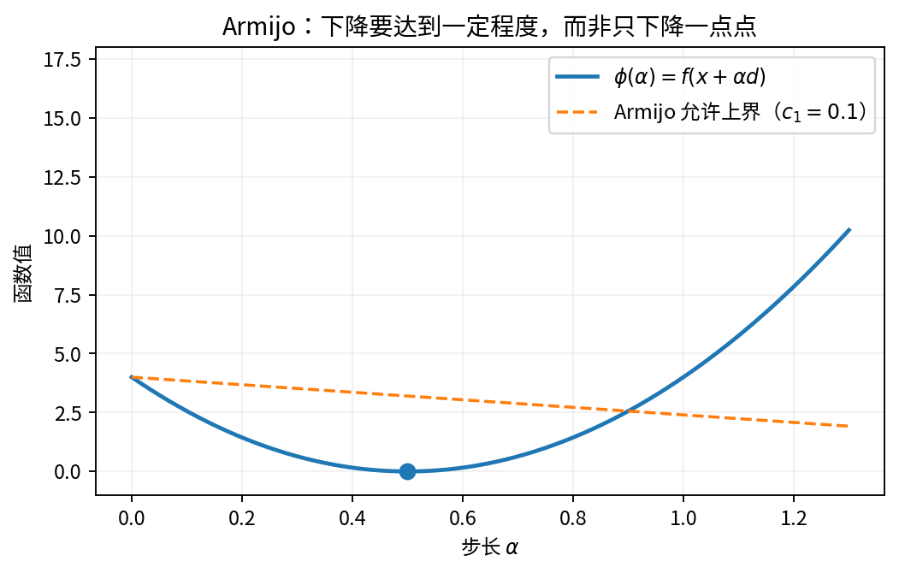

学完梯度后，我们知道在一点 $x_k$ 可以找个方向 $d_k$ 使函数下降。可是只知道“往东走会下坡”并不等于“往东走十公里也会下坡”。往往走一小步是对的，走得太远却跨过谷底。于是一次迭代被拆成两个决定：**选方向 $d_k$，再选步长 $\alpha_k$**，更新

$$
x_{k+1}=x_k+\alpha_k d_k,\qquad \alpha_k>0.
$$

几个下标先说清楚：$k$ 表示**第几轮迭代**，$x_k$ 是当前所在位置，$d_k$ 是本轮决定的方向，$\alpha_k$ 是本轮采用的步长，$x_{k+1}$ 是下一轮的位置。它们并不是不同种类的函数，只是为了把很多轮变化记录下来。如果固定了 $x_k$、$d_k$，我们只需研究一个变量 $\alpha$：

$$
\phi(\alpha)=f(x_k+\alpha d_k).
$$

此时 $\phi$（希腊字母 phi，读“fai”）叫**沿线函数**：只改变步长 $\alpha$，原来的多个坐标会一起变化。原来 $n$ 个变量的问题，沿这条方向就变成了一个变量的问题。它不是另一道新题，而是把原题限制在一条直线上看。线搜索要做的是选择合适的 $\alpha$，并非重新决定 $d_k$。

例如 $f(x)=(x-2)^2$，从 $x_0=0$ 朝 $d=4$ 走，沿线函数为 $\phi(\alpha)=(4\alpha-2)^2$。当 $\alpha=0.5$ 时恰好到 $x=2$，函数值为 0；当 $\alpha=1$ 时到 $x=4$，函数值又回到 4。这个例子一次说明了步长为什么重要。

## 精确线搜索与不精确线搜索

**精确线搜索**就是让 $\phi(\alpha)$ 尽量取得该搜索域上的最小值。如果 $\phi$ 可微且最优点在内部，常常可以求导并令 $\phi'(\alpha)=0$。上例有

$$
\phi'(\alpha)=2(4\alpha-2)\cdot4=32\alpha-16.
$$

令导数为零，得 $\alpha=1/2$。这是因为该函数是开口向上的二次函数，驻点就是全局最小点。对于复杂函数，沿线求精确极小可能比优化原问题还费时，所以实践中更常只要求“下降得够多”，而不是“这一条线上的最低点”。

还有一个易混淆的地方：只有当 $d$ 是下降方向时，小的正步长才会保证函数值下降。若 $f$ 可微，则方向导数为

$$
\phi'(0)=\nabla f(x_k)^Td_k.
$$

上式里从多元函数变成单变量导数，用到**链式法则**。例如 $f(x,y)=x^2+4y^2$，从 $(1,1)$ 沿 $d=(-2,-8)$ 移动，坐标变成 $(1-2\alpha,1-8\alpha)$；沿线函数是 $(1-2\alpha)^2+4(1-8\alpha)^2$。在 $\alpha=0$ 求导得 $-4-64=-68$；而起点 $(1,1)$ 处的梯度 $(2,8)$ 与方向做内积，$2(-2)+8(-8)=-68$，结果一致。一般情况下，链式法则就给出 $\phi'(0)=\nabla f(x_k)^Td_k$。当它小于零，我们才称 $d_k$ 是严格下降方向。若大于零，首先应该修正方向；不应指望靠不断缩小步长来解决方向错误。

## 先圈住谷底，再逐渐缩小区间

有些算法只需要计算函数值，不要求导数，但通常要先知道一个包含极小点的区间。这是**进退法**（也常称扩展搜索/区间搜索）的动机。

以 $\phi(\alpha)=(\alpha-2)^2$ 为例，从 $\alpha=0$、试探步长 $h=0.5$ 开始，计算：

| 试探点 | $0$ | $0.5$ | $1.5$ | $3.5$ |
|---|---:|---:|---:|---:|
| 函数值 | $4$ | $2.25$ | $0.25$ | $2.25$ |

过程是：先从 $0$ 走到 $0.5$，这一步增加 $0.5$；函数变低，就把下一次试探增量扩大为 $1$，于是从 $0.5$ 到 $1.5$；再把增量扩大为 $2$，从 $1.5$ 到 $3.5$。前两次函数都下降，最后一次反而上升。于是至少在这条单峰曲线的局部搜索情形中，已找到左右两边较高、中间较低的“括谷”点，极小点就在相关区间内。**进退法只负责寻找区间，不负责把极小值算到足够精确。** 若函数非单峰，单凭三个点不能保证圈住全局最小点。这里的**单峰**是指：在考察区间内，函数大体先下降、到达一个谷底、然后再上升，而不是出现多个分开的谷底。只要明白这个词，后面黄金分割法保留哪一半就容易理解了。

接着看黄金分割法。假设当前区间为 $[a,b]$，长度 $L=b-a$，希望取两个内部点，比较它们的函数值后丢弃一端的区间。特别希望**下一轮能复用本轮的一个点**，少算一次函数值。注意下面把内部试探点叫 $c,d$，其中 $d$ **只是区间中的一个数字**，不是前面表示多维搜索方向的向量 $d_k$；两个记号只在各自小节内有效。取常数 $r\in(1/2,1)$，放置

$$
c=b-rL,\qquad d=a+rL,\qquad a<c<d<b.
$$

例如在 $[0,1]$ 中，若 $r\approx0.618$，则 $c\approx0.382$、$d\approx0.618$。如果 $\phi(c)\le\phi(d)$，在**单峰**前提下可以保留 $[a,d]$；否则保留 $[c,b]$。

为什么恰好是 $0.618$？假设保留左区间 $[a,d]$，新区间长度是 $rL$，旧点 $c=a+(1-r)L$ 变成新区间内部较靠右的试探点。为了让它在新区间里仍处在原来“右内点”的相对位置，需要

$$
c-a=r(d-a).
$$

左边是 $(1-r)L$，右边是 $r\cdot rL=r^2L$；约去 $L$ 得

$$
1-r=r^2,\quad r^2+r-1=0,\quad r=\frac{\sqrt5-1}{2}\approx0.618.
$$

正根才符合 $0<r<1$。这不是神秘常数，而是**让区间反复缩小时复用试探点**所需的比例。

这里最好真的算一轮，而不是只看位置图。继续取 $\phi(\alpha)=(\alpha-2)^2$，开始区间 $[0,5]$，两点为 $c=5(1-r)\approx1.910$、$d=5r\approx3.090$。分别代入原函数：$\phi(c)\approx0.0081$，$\phi(d)\approx1.1885$。因为左内点的函数值更小，我们把右端从 $5$ 缩到 $3.090$，保留 $[0,3.090]$。

下一轮新右内点恰好是旧点 $c\approx1.910$，所以**它的函数值不用重算**；只需另算新的左内点约 $1.180$，其函数值约 $0.672$。现在 $0.672>0.0081$，于是保留 $[1.180,3.090]$。你已经实际看到了“比较数值 → 去掉一侧 → 复用旧点”。

只要函数在所考虑区间内单峰，每轮保留区间，长度大约乘以 $0.618$；当 $b-a\le\varepsilon$ 就能以区间长度作为停止条件。若用函数值差停止，可能因为函数非常平坦而过早停下，两者不要混淆。

还有一种**导数二分法**：如果已知 $\phi'(a)<0$、$\phi'(b)>0$，且在区间内导数连续且满足合适的单峰/单调性条件，就查看中点导数。中点导数负说明仍在下降，继续找右半边；中点导数正说明已在上升，继续找左半边。例如仍用 $\phi(\alpha)=(\alpha-2)^2$，导数是 $\phi'(\alpha)=2(\alpha-2)$。在区间 $[0,5]$，左端导数为 $-4$、右端为 $6$。中点 $2.5$ 的导数为 $1>0$，说明此处已经在谷底右边，先保留 $[0,2.5]$；新中点 $1.25$ 的导数为 $-1.5<0$，继续保留 $[1.25,2.5]$。注意它与黄金分割不同：这里比较的是**斜率正负**，而不是两个函数值。

## 为什么三点插值可以“猜”一个更好的位置

黄金分割法不利用函数形状，只稳健地缩小区间。另一种想法是：既然已经算过三个点，能不能用这三个点拼出一条抛物线，直接去抛物线的最低点？这叫**三点二次插值法**。

假设不知道原函数公式，只知道：

$$
\phi(0)=4.25,\qquad \phi(1)=2.25,\qquad\phi(3)=4.25.
$$

令近似抛物线为 $q(\alpha)=A\alpha^2+B\alpha+C$。代入三个点：

$$
C=4.25,\qquad A+B=-2,\qquad9A+3B=0.
$$

由第二式 $B=-2-A$，代入第三式得 $9A+3(-2-A)=0$，即 $6A=6$，所以 $A=1$、$B=-3$。因此

$$
q(\alpha)=\alpha^2-3\alpha+4.25,\qquad q'(\alpha)=2\alpha-3.
$$

这里的 $A,B,C$ 是**待求系数**，不是矩阵；三个已知数据点给出三个方程，才能把三项都确定。$q'$ 是拟合抛物线的导数，并不是原函数 $\phi$ 的导数。如果我们是在 $[0,3]$ 内寻找单峰函数的最低点，新的试探位置 $1.5$ 在区间内，接下来应真正计算 $\phi(1.5)$，再和旧点函数值比较、维护一组三点括谷数据。令 $q'=0$ 得拟合抛物线的最低点 $\alpha_*=1.5$，在该点求**真实函数值**，再按所用三点算法的更新规则替换旧试探点并继续。记住这个过程只是“拟合—试探—更新”，不是说原函数肯定就是一条抛物线。

可能失败的情况很具体：三个点太接近造成数值不稳定；拟合二次项 $A\le0$，根本没有开口向上的最小点；算出的 $\alpha_*$ 跑到允许区间外。**单纯三点抛物线法没有 Brent 法那种黄金分割保底机制**，不能把两者混成一个算法。实际实现至少应检查区间、分母/曲率和迭代上限，必要时明确报告失败。

**插值点算出来之后，到底怎么更新三个试探点？** 之前只是计算了候选点 $1.5$，不能在这里直接宣布“算法结束”。通常要维护三个按顺序排列的点 $a<m<b$，且中点函数值不高于两个端点，即 $\phi(m)\le\phi(a),\phi(b)$；这叫**三点括谷状态**。拟合抛物线后得到新候选点 $u$，需要计算**真实的** $\phi(u)$，根据 $u$ 在中点哪侧、以及 $\phi(u)$ 与 $\phi(m)$ 的大小，更新三点。例如 $m<u<b$：若 $\phi(u)<\phi(m)$，更新为 $(m,u,b)$；否则更新为 $(a,m,u)$。如果 $a<u<m$，则对称地更新。这样能让算法下一轮仍有可用的三个点。

用一组不是完全二次函数的数据验证：让真实函数为 $\phi(\alpha)=(\alpha-1.5)^2+2+0.02\alpha(\alpha-1)(\alpha-3)$。它恰好在 $0,1,3$ 三点取得上面的 $4.25,2.25,4.25$；二次插值仍然给 $u=1.5$，但真正代回得到 $\phi(1.5)=1.9775$，比旧中点 $m=1$ 的 $2.25$ 更小，于是三点从 $(0,1,3)$ 更新为 $(1,1.5,3)$，并继续拟合。这个例子说明**拟合曲线的极小点只是下一次试探位置**，不一定是真函数的极小点。如果候选点不在允许区间内、太靠近旧点或拟合曲率不合格，必须按所使用的实现规则处理失败或改用受保护的策略；不能把没有保护机制的纯抛物线法说成 Brent 法。

为了避免“下一轮”又被一笔带过，**继续用刚才完全相同的真实函数做第二轮**。第一轮以后，我们保留的三点是 $(a,m,b)=(1,1.5,3)$，对应的真实函数值为

$$
\phi(1)=2.25,\qquad \phi(1.5)=1.9775,\qquad\phi(3)=4.25.
$$

再设新的二次插值多项式 $q_2(\alpha)=A\alpha^2+B\alpha+C$。把这三个已知值代入，形成三条方程：

$$
\begin{cases}
A+B+C=2.25,\\
2.25A+1.5B+C=1.9775,\\
9A+3B+C=4.25.
\end{cases}
$$

第一式从第二式中减去，得 $1.25A+0.5B=-0.2725$；第一式从第三式中减去，得 $8A+2B=2$。第一条乘 4 后为 $5A+2B=-1.09$，两式相减得 $3A=3.09$，所以 $A=1.03$；进而 $B=-3.12$、$C=4.34$。这样第二轮的拟合抛物线就是

$$
q_2(\alpha)=1.03\alpha^2-3.12\alpha+4.34.
$$

对它求导：$q_2'(\alpha)=2.06\alpha-3.12$。令导数为 0，得到新的候选点

$$
u=\frac{3.12}{2.06}=\frac{156}{103}\approx1.514563.
$$

**不能直接使用拟合函数的 $q_2(u)$ 代替真实函数值！** 必须再代入原函数，得到 $\phi(u)\approx1.977059$。因为 $1.5<u<3$ 且 $\phi(u)<\phi(1.5)=1.9775$，按照前面右侧改进的分支，下一组三点更新为 $(1.5,\,1.514563,\,3)$，中间那个点仍然具有较小的函数值。注意此时新点与旧中点距离很小，实际代码应检查插值点过近以及精度停止条件，防止不断计算几乎一样的点。

四种更新情况可以汇总为一张表；这里始终假定 $a<u<b$，旧三点满足 $\phi(m)\le\phi(a),\phi(b)$：

| 候选点位置 | 真实函数值比较 | 新的 $(a,m,b)$ | 为什么这样留 |
|---|---|---|---|
| $m<u<b$ | $\phi(u)<\phi(m)$ | $(m,u,b)$ | 新点更低，成为新中点 |
| $m<u<b$ | $\phi(u)\ge\phi(m)$ | $(a,m,u)$ | 新点较高，缩小右边区间 |
| $a<u<m$ | $\phi(u)<\phi(m)$ | $(a,u,m)$ | 新点更低，成为新中点 |
| $a<u<m$ | $\phi(u)\ge\phi(m)$ | $(u,m,b)$ | 新点较高，缩小左边区间 |

若 $u=m$、候选点超出区间、曲率不合格，或者数值无法比较，则不能盲目套这四行。这些都是**三点括谷状态下的更新规则**；不同实验实现可能有自己的边界判定，验收真实代码时还应以代码为准。

## 不必找最低点：Armijo 与 Wolfe

在大型优化中，沿线精确寻找最低点往往太贵。Armijo 回溯只要求下降达到一条可以接受的标准：

$$
f(x+\alpha d)\le f(x)+c_1\alpha\nabla f(x)^Td,\qquad 0<c_1<1.
$$

因为 $\nabla f(x)^Td<0$，右边比 $f(x)$ 小，所以这是“下降必须达到一定量”的要求。一个常见做法是先试 $\alpha=1$，如果不满足，就反复令 $\alpha\leftarrow\rho\alpha$，例如 $\rho=1/2$，直到满足或到达安全下限。

仍用上面的 $f(x)=(x-2)^2$、$x=0,d=4$，取 $c_1=0.1$。此时 $f(0)=4$，$\nabla f(0)d=(-4)(4)=-16$。Armijo 上界为 $4-1.6\alpha$：

- $\alpha=1$ 时，实际值 $f(4)=4$，上界 $2.4$，不合格。
- $\alpha=1/2$ 时，实际值 $f(2)=0$，上界 $3.2$，合格。

你可能问：只要求足够下降，是不是会接受无限接近 0 的步长？确实，Armijo 本身主要保证下降，而不能单独阻止所有过小的步长。**Wolfe 条件**进一步检查新点的方向导数。标准弱 Wolfe 条件除了 Armijo，还要求

$$
\nabla f(x+\alpha d)^Td\ge c_2\nabla f(x)^Td,\qquad 0<c_1<c_2<1.
$$

例如在刚才的 Armijo 例子中取 $c_2=0.9$，弱 Wolfe 要求新点沿原方向的导数 $\nabla f(x+\alpha d)^Td$ 至少达到 $0.9(-16)=-14.4$。若步长极小，取 $\alpha=0.001$，新位置是 $0.004$，新方向导数约为 $-15.968$，**不满足** $-15.968\ge-14.4$；虽然这样的微小步长可以通过 Armijo，却被 Wolfe 的第二条规则拦下。取 $\alpha=0.5$ 时新位置是 $2$，方向导数为 $0$，同时满足这两个条件。$c_2$ 是**曲率条件常数**，用来规定新斜率必须变化到什么程度。它防止我们在仍有很大下降潜力时就停得太早。强 Wolfe 则常把第二个条件改成 $|\nabla f(x+\alpha d)^Td|\le c_2|\nabla f(x)^Td|$，也避免走到明显越过谷底、斜率过大的位置。**Armijo 与 Wolfe 是接受步长的判据，不是搜索方向公式。**

最后提一下信赖域思想：它不像线搜索那样先固定方向再找步长，而是在当前点附近建立一个局部近似模型，只允许在半径 $\Delta$ 内寻找改进位置。这里 $\Delta$（读作 delta）叫**信赖域半径**：意思是“我只相信模型在当前位置周围这么大的一块区域内够准确”，不是一个随意加在函数中的新参数。模型预测好，扩大信赖域；预测差，缩小信赖域。因此二者不能简单理解成同一种算法换了个步长公式。

**回顾**：进退法解决“谷底大概在哪个区间”，黄金分割和二分法解决“如何逐渐缩小区间”，三点插值解决“怎样利用形状猜极小点”，Armijo/Wolfe 解决“怎样用便宜的判据找到够好的步长”。[下一讲](04、最速下降、牛顿与共轭梯度.md)会把这些工具装进真正的多元优化算法中。

**自己检查**：① 为什么方向正确却可能越走越高？② 黄金分割的 $0.618$ 与复用旧点有什么关系？③ Armijo 的右边为什么比 $f(x)$ 小？
