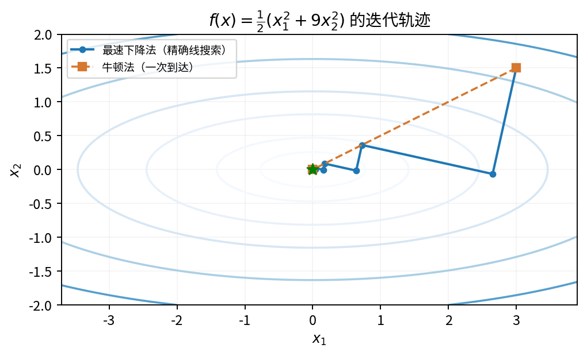

[上一讲](03、线搜索与步长.md)学会了决定步长。这一讲转回一个更根本的问题：**我们应该往哪个方向走？** 同样是找最低点，最速下降法只看一阶坡度，牛顿法借助二阶曲率，拟牛顿法用迭代得到的信息近似曲率，共轭梯度法则试着避免重复修正已处理过的方向。这不是四组孤立公式，而是不断改进搜索效率的过程。

## 最速下降：每次都沿眼前最陡的坡往下

先说明本篇会反复出现的符号 **$\alpha$（希腊字母 alpha，常读“阿尔法”）**。它不是新的坐标，也不是梯度，而是**步长系数**，决定沿着选定方向走多少。比如我们人在二维平面的 $x=(3,1.5)^T$，已经选定方向 $d=(-3,-13.5)^T$，下一点写成

$$
x_{\mathrm{new}}=x+\alpha d.
$$

当 $\alpha=0$，位置不变；当 $\alpha=0.1$，新位置是 $(2.7,0.15)^T$；当 $\alpha=1$，位置是 $(0,-12)^T$。注意 $d$ 的两个分量不同，$\alpha$ 只是同时按同样的比例缩放这两个分量，**不是把两个坐标直接都减去 $\alpha$**。对于下降方向，我们通常先考虑 $\alpha\ge0$，避免沿反方向走。

这里有两个独立问题：**方向 $d$ 告诉我们往哪里走，步长 $\alpha$ 告诉我们走多远。** 找步长的过程叫**线搜索**：把当前点与方向固定，把多元函数变成只有 $\alpha$ 一个变量的函数。第三篇讲过这个想法，但在这里我们重新用同一组数字算完整一遍，不需要先记住步长公式。

对于可微函数 $f(x)$，在当前点 $x_k$ 的**梯度**记为 $g_k=\nabla f(x_k)$，它是各偏导数组成的向量。以欧氏长度衡量单位方向时，**最速下降法**选 $d_k=-g_k$。更新式为

$$
x_{k+1}=x_k+\alpha_kd_k=x_k-\alpha_k g_k.
$$

下标 $k$ 是“第 $k$ 轮”的意思：$x_k$ 是现在的位置，$g_k$ 是这里的梯度，$d_k$ 是此轮的方向，$\alpha_k$ 是此轮选出的步长，$x_{k+1}$ 是更新后的点。负梯度确实是局部下降方向，因为 $g_k^Td_k=-\|g_k\|_2^2<0$（只要 $g_k\ne0$）；但这只保证**足够小**的正步长会下降，并不代表任选步长都安全。

下面固定一个函数，后面所有计算都围绕它进行：

$$
f(x_1,x_2)=\frac12(x_1^2+9x_2^2),\qquad
Q=\begin{pmatrix}1&0\\0&9\end{pmatrix}.
$$

这是**二次函数**，即变量的最高次数是二。$Q$ 叫这个函数的 **Hessian 矩阵**：把二阶偏导数按行列排成的表。这里 $\partial^2 f/\partial x_1^2=1$、$\partial^2 f/\partial x_2^2=9$，交叉二阶偏导为 $0$，所以得到上面的 $Q$。写成 $f(x)=\frac12x^TQx$ 只是换一种简写：$Qx=(x_1,9x_2)^T$，再左乘 $x^T=(x_1,x_2)$ 就得到 $x_1^2+9x_2^2$。

先分别对两个变量求偏导：

$$
\frac{\partial f}{\partial x_1}=x_1,\qquad
\frac{\partial f}{\partial x_2}=9x_2,
\qquad
g(x)=\begin{pmatrix}x_1\\9x_2\end{pmatrix}.
$$

从 $x_0=(3,1.5)^T$ 出发，代入得梯度 $g_0=(3,13.5)^T$，所以搜索方向 $d_0=-g_0=(-3,-13.5)^T$。**方向已经确定，接下来只剩一件事：选 $\alpha$。**

将 $x_0+\alpha d_0$ 写成两个坐标的形式：

$$
x(\alpha)=\begin{pmatrix}3\\1.5\end{pmatrix}+
\alpha\begin{pmatrix}-3\\-13.5\end{pmatrix}
=\begin{pmatrix}3-3\alpha\\1.5-13.5\alpha\end{pmatrix}.
$$

把这两个坐标代入**原来的目标函数**，得到只关于 $\alpha$ 的一元函数 $\phi(\alpha)$（$\phi$ 读“fai”，这里只是给这个新函数起个名字）：

$$
\begin{aligned}
\phi(\alpha)
&=f(3-3\alpha,\;1.5-13.5\alpha)\\
&=\frac12\left[(3-3\alpha)^2+9(1.5-13.5\alpha)^2\right].
\end{aligned}
$$

接下来不要跳过平方展开。按 $(a-b)^2=a^2-2ab+b^2$，

$$
\begin{aligned}
(3-3\alpha)^2
&=9-18\alpha+9\alpha^2,\\
(1.5-13.5\alpha)^2
&=2.25-40.5\alpha+182.25\alpha^2,\\
9(1.5-13.5\alpha)^2
&=20.25-364.5\alpha+1640.25\alpha^2.
\end{aligned}
$$

把两项相加，再乘以 $\frac12$：

$$
\boxed{\phi(\alpha)=14.625-191.25\alpha+824.625\alpha^2.}
$$

我们现在面对的不是一个神秘的矩阵公式，而是普通的一元二次函数。**求导**就是求它的变化率。这里用到的三条最基本规则是：常数求导为 $0$，$c\alpha$ 求导为 $c$，$c\alpha^2$ 求导为 $2c\alpha$。因此

$$
\begin{aligned}
\phi'(\alpha)
&=\underbrace{0}_{14.625\text{ 的导数}}
-\underbrace{191.25}_{-191.25\alpha\text{ 的导数的绝对值}}
+\underbrace{2\times824.625\alpha}_{824.625\alpha^2\text{ 的导数}}\\
&=-191.25+1649.25\alpha.
\end{aligned}
$$

**为什么令导数为零？** 因为在一条光滑、开口向上的抛物线上，最低点的切线是水平的，也就是该点的一阶导数为 $0$。导数为负时，增加 $\alpha$ 会让函数下降；导数为正时，再增加 $\alpha$ 就会上升。两种变化的分界点就是我们要找的步长。因此解方程：

$$
-191.25+1649.25\alpha=0
\quad\Longrightarrow\quad
1649.25\alpha=191.25
\quad\Longrightarrow\quad
\boxed{\alpha_* =\frac{191.25}{1649.25}=\frac{85}{733}\approx0.11596.}
$$

但“导数等于零”**本身只能确定驻点**（斜率为零的点），不能自动说它是最低点。本例再求一次导数，$\phi''(\alpha)=1649.25>0$，证明抛物线开口向上，所以这个驻点确实是沿该方向的**唯一最低点**；而且 $\alpha_*>0$，符合正向搜索的要求。如果二阶导数小于零，驻点就可能是最高点；如果为零，还要进一步判断。

找到步长后，再代回位置更新式：

$$
\begin{aligned}
x_1
&=x_0+\alpha_*d_0\\
&=\begin{pmatrix}3\\1.5\end{pmatrix}
+\frac{85}{733}\begin{pmatrix}-3\\-13.5\end{pmatrix}\\
&=\begin{pmatrix}\frac{1944}{733}\\-\frac{48}{733}\end{pmatrix}
\approx\begin{pmatrix}2.6521\\-0.0655\end{pmatrix}.
\end{aligned}
$$

顺便验算函数值：出发点 $f(3,1.5)=14.625$，新点 $f(x_1)=2592/733\approx3.5362$，确实下降了。**整轮步骤**就是“求梯度 $\to$ 取负梯度为方向 $\to$ 写 $\phi(\alpha)$ $\to$ 求导解步长 $\to$ 更新位置”，你可以照这个顺序独立重做一次。

现在再看教科书常用的简写公式，就不会觉得它是凭空出现的。对任何对称正定 $Q$ 的二次函数 $f(x)=\frac12x^TQx$，设梯度 $g=Qx$，沿固定方向 $d$ 移动时，

$$
\begin{aligned}
f(x+\alpha d)
&=\frac12(x+\alpha d)^TQ(x+\alpha d)\\
&=\frac12x^TQx
+\frac12\alpha x^TQd
+\frac12\alpha d^TQx
+\frac12\alpha^2d^TQd\\
&=f(x)+\alpha g^Td+\frac12\alpha^2d^TQd.
\end{aligned}
$$

第二个等号是把两个括号各项相乘；最后一步因为 $Q$ 对称，有 $x^TQd=d^TQx=g^Td$，所以两项一次项合并。对 $\alpha$ 求导时，$f(x)$、$g$、$d$ 和 $Q$ 都已经固定，是常量：

$$
\phi'(\alpha)=g^Td+\alpha d^TQd.
$$

令它为零，解出

$$
\boxed{\alpha_*=-\frac{g^Td}{d^TQd}}.
$$

因为 $Q$ 正定且 $d\ne0$，有 $d^TQd>0$，所以这条线上的二次函数开口向上。若最速下降法取 $d=-g$，则

$$
\boxed{\alpha_* =\frac{g^Tg}{g^TQg}}.
$$

把本例数字代回：$g^Tg=3^2+13.5^2=191.25$；$Qg=(3,121.5)^T$，于是 $g^TQg=3\times3+13.5\times121.5=1649.25$。仍得到 $\alpha_*=191.25/1649.25$，和逐项展开、求导的结果完全相同。**分式只是完整求导过程的快捷写法，不适用于任意函数。**

为什么会这样？由于 $x_2$ 方向曲率是 $x_1$ 方向的九倍，靠梯度行走时很容易在狭长谷地两侧反复横跳。下一轮又朝新的梯度方向走，有时会把前面已经处理得不错的方向重新改动。这是最速下降法可能很慢的一个根源。

## 牛顿法：根据弯曲程度决定方向

如果只看梯度，好像只知道脚下的坡度。如果还知道 Hessian，就可以估计附近的曲面形状。把 [01 的二阶泰勒式](01、数学基础、泰勒展开与凸性.md)当成当前点附近的模型：

$$
m_k(s)=f(x_k)+g_k^Ts+\tfrac12s^TH_ks.
$$

我们不再直接说“往负梯度走”，而是问：**这个二次近似模型的最低点相对当前位置在哪里？** 这里的 $s$ 叫**位移向量**，表示从当前点 $x_k$ 到下一候选点移动了多少；$g_k$ 是当前梯度，$H_k$ 是当前 Hessian。$m_k$ 叫**局部模型**：它不是原函数，而是我们用泰勒展开在当前位置附近造出来的近似二次函数。找它的最低点，比直接找复杂原函数的最低点容易。先注意一个一元类比：$m(s)=3+2s+4s^2$ 的导数是 $2+8s$。多元时“$2s$ 的导数”变成向量 $g$，“二次项的导数”变成 $Hs$（这里 $H$ 对称）。对位移 $s$ 求梯度：

$$
\nabla_s m_k(s)=g_k+H_ks.
$$

这一步同样不能直接跳到“令梯度为零”。继续用刚才的 $x_0=(3,1.5)^T$：由于 $g_0=(3,13.5)^T$，$H_0=Q=\operatorname{diag}(1,9)$（其中 $\operatorname{diag}(1,9)$ 读作“对角矩阵”，也就是 $\begin{pmatrix}1&0\\0&9\end{pmatrix}$，只有主对角线上是 1 和 9），令位移 $s=(s_1,s_2)^T$，模型可以逐项写成

$$
m_0(s_1,s_2)=14.625+3s_1+13.5s_2+\frac12s_1^2+\frac92s_2^2.
$$

这里对 $s_1$ 求偏导时，把 $s_2$ 当常数；对 $s_2$ 求偏导时，把 $s_1$ 当常数：

$$
\frac{\partial m_0}{\partial s_1}=3+s_1,
\qquad
\frac{\partial m_0}{\partial s_2}=13.5+9s_2.
$$

让两个偏导都为零，解得 $s_1=-3$、$s_2=-1.5$。因为此例 Hessian 正定，模型开口向上，这才是模型最低点。多维时把“每个偏导都为零”收在一起，就是 $g_k+H_ks=0$，即 $H_ks=-g_k$。所以牛顿方向不是背出来的，而是**对局部二次模型求梯度、令零并解方程**。对于一般非线性目标，模型仅在当前点附近近似原函数，不能由此断言一步就到真实最低点。

如果 $H_k$ 正定，模型有唯一极小点。因此令梯度为零得线性方程 $H_ks=-g_k$，于是

$$
\boxed{H_kd_k=-g_k,\qquad x_{k+1}=x_k+\alpha_kd_k.}
$$

基本牛顿法通常取 $\alpha_k=1$；阻尼牛顿法还会用线搜索选 $\alpha_k$。这才是牛顿公式的来历：**并非凭空记下 $-H^{-1}g$，而是把局部二次模型求极小。** 代码里不需要真的计算矩阵逆，求解线性方程 `H @ d = -g` 更稳健。

对于上面 $Q=\operatorname{diag}(1,9)$ 的二次函数，从 $(3,1.5)$ 出发，解

$$
\begin{pmatrix}1&0\\0&9\end{pmatrix}\begin{pmatrix}d_1\\d_2\end{pmatrix}=-\begin{pmatrix}3\\13.5\end{pmatrix}
$$

得到 $d=(-3,-1.5)$；取 $\alpha=1$ 一步到达原点。**对于 Hessian 为常数且正定的二次函数，牛顿法从任何起点都可一步到达唯一极小点。** 一般非线性函数中 Hessian 随位置变化，通常需要多轮。

这也解释牛顿法的风险。若 $H$ 不正定，局部二次模型未必有最低点，解出的方向可能不是下降方向；若 $H$ 奇异，线性方程可能无唯一解；计算和存储大型 Hessian 也很费资源。实践中常使用阻尼、修正 Hessian、线搜索或信赖域技术。**不要把“算出驻点”当成“必然得到最小值”**。

## 拟牛顿：不反复计算真实的二阶导数

牛顿法懂曲率，但代价高。拟牛顿的直觉是：连续两轮迭代已经告诉我们“位置改变多少”和“梯度改变多少”，这些观察本身就包含曲率信息。

记

$$
s_k=x_{k+1}-x_k,\qquad y_k=g_{k+1}-g_k.
$$

二次函数有 $y_k=Hs_k$，非二次函数在局部也近似满足。拟牛顿法维护一个矩阵 $B_k\approx H_k$，希望更新后至少满足**割线条件** $B_{k+1}s_k=y_k$；或维护逆 Hessian 近似 $M_k\approx H_k^{-1}$，使 $M_{k+1}y_k=s_k$。

例如明确取 $f(x)=2x^2$，它的导数是 $g(x)=4x$。某步从 $x=0.5$ 走到 $x=1$，位置变化 $s=1-0.5=0.5$，梯度从 $g(0.5)=2$ 增加到 $g(1)=4$，梯度变化 $y=4-2=2$。那么这段路上的平均“梯度变化率”约为 $y/s=4$，可以把它当成曲率估计；其逆是 $s/y=0.25$。多维时我们想做同样的事，但一个数字不够，需要用矩阵记录不同方向上的变化。

**割线条件**这一名字来自一元函数里“两个位置的斜率差，近似反映二阶导数”：$y\approx Hs$。在一维用 $H\approx y/s=4$ 就够了；多维则要求一个矩阵乘以 $s$ 尽可能解释观察到的 $y$。这里还有两个容易混的矩阵：$B$ 近似 Hessian 本身；$M$ 近似 Hessian 的**逆**，即一种把梯度换算成位移方向的工具。用 $M=0.25$，对梯度 $g=4$，得到方向 $d=-0.25\times4=-1$。所以这样就不必每一步都计算完整二阶导数：方向取 $d_k=-M_kg_k$。最常见的两种更新是 BFGS 与 DFP。为了避免突然被公式淹没，先只理解它们的共同目标：**借助 $s,y$ 修正矩阵，同时尽量保留此前学到的曲率信息。**

**下面的更新矩阵公式属于进阶对照。** 第一次学习可以先跳过两条长式，记住“由位置变化 $s$ 与梯度变化 $y$ 来估计曲率、再决定方向”的思路；准备实验代码验收时再回来看。若要核对真实代码，下面给出逆 Hessian 形式。读这些公式前认清最后几个符号：$I$ 是**单位矩阵**（对角线上是 1、其余为 0，乘任意向量不改变它）；$sy^T$ 是**外积**，得到一个矩阵，例如 $s=(1,2)^T$、$y=(3,4)^T$ 时 $sy^T=\begin{pmatrix}3&4\\6&8\end{pmatrix}$；$\rho$ 是一个临时系数，专门把式子写短，定义为 $1/(y^Ts)$。我们前面的一维例子有 $s=0.5,y=2$，所以 $y^Ts=1$，$\rho=1$。设 $\rho_k=(y_k^Ts_k)^{-1}$，则 BFGS 是

$$
M_{k+1}=(I-\rho_ks_ky_k^T)M_k(I-\rho_ky_ks_k^T)+\rho_ks_ks_k^T.
$$

DFP 是

$$
M_{k+1}=M_k+\frac{s_ks_k^T}{s_k^Ty_k}-\frac{M_ky_ky_k^TM_k}{y_k^TM_ky_k}.
$$

真正算一遍一维例子，会更清楚这两种方法的目标。假设旧逆估计 $M_0=1$，刚才观测到 $s=0.5,y=2$。代入逆 BFGS，两个括号都变成 $1-\rho sy=1-1\times0.5\times2=0$，故 $M_1=0+\rho s^2=0.25$。代入逆 DFP，$M_1=1+0.5^2/(0.5\times2)-1^2\times2^2/(2\times1\times2)=1+0.25-1=0.25$。在一维两者都恢复了真实 Hessian $4$ 的逆数 $1/4$；多维时的更新方式才会显著不同。这些式子不建议一次死记。先看共同的条件 $y_k^Ts_k>0$，称为**曲率条件**。若 $M_k$ 对称正定，满足曲率条件且更新计算正确，BFGS 和 DFP 的标准逆更新能够保持正定。若分母过小、曲率条件不满足，不能无条件更新；代码通常需要跳过、重启或借助适当线搜索。此处的符号 $M$ 专指**逆 Hessian 近似**，避免把直接 Hessian $B$ 与逆 Hessian 混淆。

## 共轭梯度：不要总在旧方向上返工

对于正定二次函数 $f(x)=\tfrac12x^TQx+c^Tx$，梯度为 $g=Qx+c$。普通最速下降每轮只有 $-g$，而共轭梯度会将上轮方向适当混进来：

$$
d_0=-g_0,\qquad d_{k+1}=-g_{k+1}+\beta_kd_k.
$$

下面 FR 例题中的 $\alpha_0,\alpha_1$ 仍是**每轮沿当前方向移动的步长**。因为目标也是正定二次函数，它们由本篇前面推导的 $\phi'(\alpha)=0$ 确定；方向变了，步长也必须重新计算。

这里不是随意叠加旧方向，而是希望新方向与旧方向在 $Q$ 描述的几何下“互不干扰”，即 $d_i^TQd_j=0$（$i\ne j$），称为 **$Q$-共轭**。在正定二次目标、精确运算和精确线搜索的理想前提下，线性共轭梯度法至多 $n$ 步可以找到最小点。非线性情况不要直接套用这个有限步结论。

FR 公式选

$$
\beta_k^{FR}=\frac{g_{k+1}^Tg_{k+1}}{g_k^Tg_k}.
$$

现在给一个真正能逐轮复算的例子。取 $Q=\operatorname{diag}(1,4)$，$c=0$，$x_0=(2,1)^T$，则 $g_0=(2,4)^T$，$d_0=(-2,-4)^T$。精确线搜索：

$$
\alpha_0=\frac{g_0^Tg_0}{g_0^TQg_0}=\frac{20}{68}=\frac5{17}.
$$

于是

$$
x_1=(2,1)^T+\tfrac5{17}(-2,-4)^T=(\tfrac{24}{17},-\tfrac3{17})^T.
$$

新梯度 $g_1=(24/17,-12/17)^T$，于是

$$
\beta_0^{FR}=\frac{(24/17)^2+(-12/17)^2}{2^2+4^2}=\frac{36}{289}.
$$

方向变为

$$
d_1=-g_1+\tfrac{36}{289}d_0=(-\tfrac{480}{289},\tfrac{60}{289})^T.
$$

这里把最后一步也算出来，避免结论凭空出现。由 $g_1=(24/17,-12/17)$ 和 $d_1=(-480/289,60/289)$，算得 $g_1^Td_1=-12240/4913$，而 $d_1^TQd_1=14400/4913$，所以 $\alpha_1=12240/14400=17/20$。代入坐标更新：$x_2=x_1+(17/20)d_1=(0,0)^T$。如果想验证方向真的没有重复：$Qd_1=(-480/289,240/289)^T$，$d_0^TQd_1=(-2)(-480/289)+(-4)(240/289)=0$，这就是**$Q$-共轭**在这道题中的具体含义。它没有改变问题的最小点，却以“尽量不重走老路”的方式求到了它。计算较多，但每个数字都来自上一轮，不是新的神秘规则。

需要特别区分三个名称：FR 使用梯度范数平方比；PRP 使用

$$
\beta_k^{PRP}=\frac{g_{k+1}^T(g_{k+1}-g_k)}{g_k^Tg_k},
$$

而 PRP+ 通常取 $\max(0,\beta_k^{PRP})$，防止使用负的参数。非线性共轭梯度还常结合重启和 Wolfe 等线搜索。因此，**老师题指定 FR，就用 FR；实验三代码若采用 PRP+，不能互换公式**。本套老师 FR 原题及两轮计算在 [07](07、老师作业与补充练习.md)。

**迭代什么时候停止？** 这在推导完更新式后必须回答。实际计算常用 $\|g_k\|\le\varepsilon$（梯度足够小）、$\|x_{k+1}-x_k\|\le\varepsilon_x$（步长很小）、函数值变化很小、或达到最大迭代次数。$\varepsilon$ 是**容许误差阈值**，是算法输入，不是数学上的精确零。只看位移很小并不能证明找到最优点：例如线搜索把步长压得极小时，也会导致几乎不移动。对于有约束问题，梯度在边界最优点未必为零，应改用相应的 KKT 残差或可行性/驻点判据。

**牛顿方向为什么也要检查是否下降？** 例如 $f(x)=-x^2$ 在 $x=1$ 时梯度为 $-2$、Hessian 为 $-2$，牛顿方程 $(-2)d=-(-2)$ 得 $d=-1$，方向导数 $g\,d=(-2)(-1)=2>0$。这反而是**上升方向**。因此数值程序不能仅凭“解出了 $Hd=-g$”就认定方向可用；需要检查 $g^Td<0$，必要时改用负梯度等修正方案。

**把四种方法放在一起看**：最速下降便宜、方向直观但可能慢；牛顿直接利用曲率但要算 Hessian/解线性方程；拟牛顿从迭代数据近似曲率；共轭梯度让相邻方向携带历史信息，特别适合大型正定二次问题或某些非线性问题。它们都可以与适用的线搜索结合，而不是彼此替代线搜索。

**自己检查**：① 为什么最速下降法的“最速”不保证最快收敛？② 牛顿公式中的线性方程从哪来？③ FR 与 PRP+ 的 $\beta$ 可以混用吗？

[下一篇：约束边界、KKT 与有效集法](05、约束最优性与二次规划.md)
