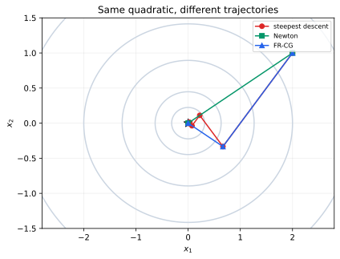

已经在 [03 篇](03、线搜索与步长.md) 算过“方向给定时走多远”。现在补剩下的问题：题目没告诉你往哪儿走，方向怎么求？

先修是梯度、Hessian、正定二次型和线搜索。学完应能从设计动机推导三种方向，手算完整迭代，区分考试里的 FR 与实验里的 PRP+，并判断牛顿方向什么时候可能不是下降方向。

今天三种算法用同一个起点，方便你对着看。

$$
f(x_1,x_2)=\tfrac12x_1^2+x_2^2,\qquad x^{(0)}=(2,1)^T.
$$

按第 1 天的偏导做法，梯度 $g(x)=(x_1,2x_2)^T$，Hessian $Q=\begin{pmatrix}1&0\\0&2\end{pmatrix}$。当前位置用 $x^{(k)}$ 表示整个点，$g_k=g(x^{(k)})$ 是在该点重新算出的梯度。上标 $(k)$ 表示轮次，$x_1,x_2$ 表示坐标。

## 1. 最速下降：把现在的梯度翻过来

**例题。** 用最速下降和精确线搜索求 $x^{(1)}$。

1. 在 $x^{(0)}=(2,1)^T$ 代入梯度，得到 $g_0=(2,2)^T$。把两项变号，取 $d_0=(-2,-2)^T$。
2. 沿这一方向定步长。这正好是 03 篇做过的题。$-g_0^Td_0=8$，$d_0^TQd_0=12$，所以 $\alpha_0=8/12=2/3$。
3. 先算位移 $\alpha_0d_0=(-4/3,-4/3)^T$，再加到 $(2,1)^T$ 上，得到

   $$
   x^{(1)}=(2-\tfrac43,\,1-\tfrac43)^T=(\tfrac23,-\tfrac13)^T.
   $$

为什么先取反？这里 $g_0=(2,2)^T$，说明两个坐标各自往正方向挪一点，目标都往上。用内积算，沿负梯度的起始斜率是 $g_0^Td_0=-8$，确实往下。一般地，在固定方向向量长度时，负梯度方向使起始斜率最小，所以叫“最速下降”。走完这一步会重新看坡度。比如在 $x^{(1)}$，新梯度为 $g_1=(2/3,-2/3)^T$，再走时会用 $(-2/3,2/3)^T$。

“最速”必须说明长度用什么量。这里固定 $\lVert d\rVert_2=1$，由 Cauchy–Schwarz 不等式

$$
g^Td\ge-\lVert g\rVert_2\lVert d\rVert_2=-\lVert g\rVert_2,
$$

等号在 $d=-g/\lVert g\rVert_2$ 时取得。若改用 $1$ 范数或无穷范数，最速方向一般不是简单的 $-g$。

正定二次函数配精确线搜索时，相邻梯度彼此正交。狭长椭圆谷地中，负梯度会在谷地两侧反复转向，于是图上出现“之”字形；每一步都局部最陡，却可能在通往最低点的长轴方向推进很慢。

**什么时候停。** 题目只问第一步，写到 $x^{(1)}$ 就交卷。要求一直迭代时，每轮先查梯度长度是否达到了题目给的误差要求。若梯度已经是零，手算可直接停，免得下一轮出现 $0/0$。要证明这个点是最低点，再结合目标的性质判断。这里目标是正定二次函数，因此梯度为零时就是唯一最低点。

## 2. 基本牛顿法：用二阶信息算这一步的整个位移

**例题。** 仍从 $(2,1)^T$ 出发，改用基本牛顿法。

第 2 天的泰勒式可以算出移动 $d=(d_1,d_2)^T$ 后的函数值。也可直接检验：把新坐标 $(2+d_1,1+d_2)$ 代入原式，分别展开平方并合并同类项：

$$
f(x^{(0)}+d)=3+2d_1+2d_2+\tfrac12d_1^2+d_2^2.
$$

把 $d_1,d_2$ 当成要选的两个新数，分别求偏导，让两个坡度都变成 0。

$$
2+d_1=0,\qquad 2+2d_2=0.
$$

解得 $d_1=-2,d_2=-1$。整个 $(-2,-1)^T$ 加到 $(2,1)^T$，一步到 $(0,0)^T$。

把刚才的两个方程收在一起，写成 $Qd=-g_0$。对一般函数，在当前点用 $H_k=\nabla^2 f(x^{(k)})$ 写同样的方向方程：

$$
H_kd_k=-g_k,\qquad x^{(k+1)}=x^{(k)}+d_k.
$$

基本牛顿法把算出的 $d_k$ 全部用上，所以步长因子为 1。我们在这道题一步走到底，是因为二次模型就是原函数，算出的新梯度准确等于 $g_k+Qd_k=0$。一般函数的 Hessian 可能随位置改变，需要在下一点重算。

一般推导是先写当前点的二阶模型

$$
m_k(d)=f(x^{(k)})+g_k^Td+\tfrac12d^TH_kd.
$$

对位移 $d$ 求梯度，得到 $\nabla_dm_k(d)=g_k+H_kd$。令模型驻点为零便得 $H_kd=-g_k$。若 $H_k\succ0$，该驻点是模型的唯一最低点，并且 $g_k^Td=-d^TH_kd<0$，所以非零牛顿方向是下降方向。若 Hessian 奇异，方程可能无唯一解；若 Hessian 不正定，模型驻点可能是鞍点或最高点，单位步长还可能把点送得过远。

### 2.1 交叉项让两个方程连在一起时

**例题。** $f(x_1,x_2)=\tfrac12x_1^2+x_1x_2+x_2^2-2x_1$，从 $(0,0)^T$ 做一步牛顿。偏导得 $g=(x_1+x_2-2,\ x_1+2x_2)^T$，在起点为 $(-2,0)^T$。二阶矩阵是 $\begin{pmatrix}1&1\\1&2\end{pmatrix}$。把 $Qd=-g$ 展成两行：

$$
d_1+d_2=2,\qquad d_1+2d_2=0.
$$

第二行减第一行得到 $(d_1+2d_2)-(d_1+d_2)=0-2$，即 $d_2=-2$。代回第一行 $d_1-2=2$，得到 $d_1=4$。所以新点是 $(4,-2)^T$。检查时可以代回两行，或把新点代入梯度，两项都应为 0。老师的三变量牛顿题多了一行，消元的想法一样。

## 3. FR 共轭梯度：第一步照旧，第二步把旧方向用上

FR 是 Fletcher–Reeves 的缩写。题目给正定二次目标时，先按最速下降走第一步。区别从 $x^{(1)}$ 的新方向开始。

**例题。** 回到开头的 $f(x_1,x_2)=\tfrac12x_1^2+x_2^2$。求 FR 的 $x^{(1)}$ 和 $x^{(2)}$。

### 第一步，把已会的算一遍

$g_0=(2,2)^T$，$d_0=(-2,-2)^T$，$\alpha_0=2/3$，到 $x^{(1)}=(2/3,-1/3)^T$。代入 $g(x)=(x_1,2x_2)^T$，得到 $g_1=(2/3,-2/3)^T$，还没有到零。

### 第二步先算怎么把两个方向放在一起

$\beta_0$ 表示旧方向 $d_0$ 在新方向里放多少。FR 指定用两个梯度**长度的平方**之比。先算新的，再除以旧的。

$$
g_1^Tg_1=(\tfrac23)^2+(-\tfrac23)^2=\tfrac89,\qquad
g_0^Tg_0=2^2+2^2=8,\qquad
\beta_0=\frac{8/9}{8}=\tfrac19.
$$

负的新梯度是 $(-2/3,2/3)^T$，再加上旧方向的 $1/9$，得到

$$
d_1=-g_1+\beta_0d_0
=(-\tfrac23,\tfrac23)^T+(-\tfrac29,-\tfrac29)^T
=(-\tfrac89,\tfrac49)^T.
$$

这里“共轭”也能算出来。先乘 $Q$ 得 $Qd_1=(-8/9,8/9)^T$，再和 $d_0$ 做内积。$(-2)(-8/9)+(-2)(8/9)=0$。这叫 $Q$ 共轭。带上 $Q$，是因为两个坐标方向的弯曲程度不同。

为什么要让它等于 0？第一步精确线搜索后有 $g_1^Td_0=0$。对二次函数，沿新方向走 $\alpha$ 后的梯度为 $g_1+\alpha Qd_1$，再看旧方向导数：

$$
d_0^T(g_1+\alpha Qd_1)=d_0^Tg_1+\alpha d_0^TQd_1=0.
$$

因此新一步不会破坏旧方向上已经取得的一维最优性，这就是共轭方向减少“重复搜索”的原因。若从 $d_1=-g_1+\beta_0d_0$ 出发，强制 $d_0^TQd_1=0$，就得到

$$
\beta_0=\frac{g_1^TQd_0}{d_0^TQd_0}
=\frac{4/3}{12}=\frac19,
$$

与本题 FR 的梯度平方比相同。这个相同依赖正定二次目标和精确线搜索；一般非线性题不能据此把各种 $\beta$ 当成同一个公式。

### 方向定好后，沿它再做一次精确线搜索

这次使用当前的 $g_1,d_1$，仍用通式。先算

$$
\begin{aligned}
-g_1^Td_1&=-[(\tfrac23)(-\tfrac89)+(-\tfrac23)(\tfrac49)]=\tfrac89,\\
d_1^TQd_1&=(-\tfrac89)(-\tfrac89)+(\tfrac49)(\tfrac89)=\tfrac{32}{27},\\
\alpha_1&=\frac{8/9}{32/27}=\tfrac34.
\end{aligned}
$$

所以 $x^{(2)}=(2/3,-1/3)^T+(3/4)(-8/9,4/9)^T=(0,0)^T$。验算 $g_2=0$，可以停。

第一次背公式时，用这一句顺下来：**走到新点 → 算新梯度 → 算平方比 → 换方向 → 重新定步长。** 以 $k$ 号点为起点时，$\beta_k=g_{k+1}^Tg_{k+1}/(g_k^Tg_k)$，然后 $d_{k+1}=-g_{k+1}+\beta_kd_k$。正定二次题用精确线搜索和精确运算，$n$ 个变量至多走 $n$ 步。一般非线性题仍可用 FR 方向递推，步长按题目给的线搜索方式另求。

有限步结论的条件缺一不可：目标是 $n$ 维正定二次函数、使用精确线搜索、运算无舍入误差。一般非线性函数、非精确线搜索或浮点误差下，方向会逐渐失去严格共轭性，通常需要重启。

常见非线性共轭梯度只改变 $\beta_k$：

$$
\beta_k^{FR}=\frac{g_{k+1}^Tg_{k+1}}{g_k^Tg_k},\qquad
\beta_k^{PRP}=\frac{g_{k+1}^T(g_{k+1}-g_k)}{g_k^Tg_k},\qquad
\beta_k^{PRP+}=\max(0,\beta_k^{PRP}).
$$

PRP 利用梯度变化，PRP+ 把负值截为 0，相当于必要时重启成负梯度。往年卷和老师作业明确使用 FR，不得用 PRP+ 替换。

**只比较三个公式的数值。** 假设旧、新梯度分别为 $g_0=(1,0)^T$、$g_1=(1/4,0)^T$，则

$$
\beta^{FR}=\frac1{16},\qquad
\beta^{PRP}=\frac{(1/4)(1/4-1)}{1}=-\frac3{16},\qquad
\beta^{PRP+}=0.
$$

三者会给出不同新方向。这个小例子只用于辨认更新公式，不声称这对梯度来自前面的精确二次迭代。

**第 4 天过关。** 盖住上面的解答，只写 $f=\tfrac12x_1^2+x_2^2$ 和 $x^{(0)}=(2,1)^T$。最速下降和牛顿各做一步，FR 做两步。对照答案：最速下降的 $x^{(1)}=(2/3,-1/3)^T$，牛顿的 $x^{(1)}=(0,0)^T$，FR 的 $x^{(2)}=(0,0)^T$。接下来做 [老师第 4 章作业](07、老师作业与补充练习.md)。如果还不会算 $\beta_0$，先把两个梯度写在一起，各自平方再求和。

## 补读一｜牛顿方向可能往上走

**例题。** $f(t)=-t^2$，从 $t=1$ 开始。$g=-2,H=-2$，解 $Hd=-g$ 得 $d=-1$。沿这个位移到 0，函数从 $-1$ 升到 0。这里的曲率朝下，二次模型的驻点是最高点。

一种修正是给 Hessian 加上一定大小的正量。这个例子取 $H+3=1$，新方向 $d=2$，起始斜率变为 $gd=-4$，是下降方向。一般修正曲率后还可配合线搜索。教材 §3.2 可继续查阻尼牛顿与修正牛顿。

## 补读二｜拟牛顿用走过的一步估计曲率

**例题。** $f(t)=t^2$，从 $t=0$ 移到 $t=1$。位置改变量 $s=1-0=1$，梯度改变量 $y=2-0=2$。若用 $M_+$ 表示新的逆曲率近似，希望 $M_+y=s$，因此这里应为 $1/2$，恰好是实际二阶导数 2 的倒数。

多维中把 $s$ 和 $y$ 换成两个向量。DFP 和 BFGS 都想让 $M_+y=s$，只是更新整张矩阵的方式不同。设 $M$ 为旧的逆 Hessian 近似，具体公式如下，第一次复习可以先认出其中的 $s$ 和 $y$。

$$
\begin{aligned}
\text{DFP}\quad M_+&=M+\frac{ss^T}{s^Ty}-\frac{Myy^TM}{y^TMy},\\
\text{BFGS}\quad M_+&=(I-\rho sy^T)M(I-\rho ys^T)+\rho ss^T,\qquad \rho=\frac1{y^Ts}.
\end{aligned}
$$

把它们放回刚才的一元题，若取旧 $M=1$，DFP 算出 $1+1/2-1=1/2$；BFGS 代入 $\rho=1/2$ 后，前半边变成 0，剩 $1/2$。进一步的多维推导见教材 §3.3。

两个公式都含 $s^Ty$ 的分母。若希望正定的逆 Hessian 近似在更新后仍正定，需要曲率条件 $s^Ty>0$。这不是装饰条件：分母太小会造成巨大数值误差，非正则可能破坏下降性。

## 三种方向的横向比较

| 方法 | 使用信息 | 每轮主要成本 | 优点 | 常见风险 |
|---|---|---|---|---|
| 最速下降 | 梯度 | 一次梯度＋线搜索 | 简单、方向容易保证下降 | 病态谷地中之字形、收敛慢 |
| 基本牛顿 | 梯度、Hessian | 构造并解牛顿方程 | 极小点附近通常很快；二次函数一步到驻点 | Hessian 奇异/不定、单位步长过大、每轮成本高 |
| FR 共轭梯度 | 梯度、上一方向 | 梯度＋线搜索，存储少 | 正定二次精确条件下有限步 | 非线性或数值误差下需重启，依赖线搜索质量 |
| BFGS/DFP | 梯度与迭代差分 | 矩阵更新＋线搜索 | 不直接求真实 Hessian | 曲率条件失败、矩阵存储成本 |

对照实验源码。实验二的[最速下降](/downloads/optimization/实验二_最速下降法和牛顿法/code/methods/steepest_descent.py)对给定正定 $Q$ 使用精确步长，对非二次目标使用 Armijo；[基本牛顿](/downloads/optimization/实验二_最速下降法和牛顿法/code/methods/newton.py)固定 $\alpha=1$。实验三将 [BFGS](/downloads/optimization/实验三_拟牛顿法和共轭梯度法/code/methods/bfgs.py)、[DFP](/downloads/optimization/实验三_拟牛顿法和共轭梯度法/code/methods/dfp.py) 和 [PRP+](/downloads/optimization/实验三_拟牛顿法和共轭梯度法/code/methods/conjugate_gradient.py) 拆到独立文件，均配 Armijo；PRP+ 每 $n$ 步重启，发现非下降方向也会重启。这里的 $H$ 是**逆 Hessian 近似**。工作区的 `原始实验包` 仅是旧归档。

站内对应导读为[实验二](../最优化方法实验/03、实验二：最速下降法与牛顿法.md)和[实验三](../最优化方法实验/04、实验三：拟牛顿法与共轭梯度法.md)。

## 理解检查

1. 为什么 Hessian 正定能保证非零牛顿方向下降？
2. “FR 在 $n$ 步内到解”能否用于实验三的一般非线性 PRP+？
3. 最速下降每步都最陡，为什么仍可能慢？

核对答案

1. 由 $H d=-g$ 得 $g^Td=-d^THd<0$。
2. 不能。有限步性质针对正定二次函数、FR、精确线搜索和精确运算；实验三算法与条件都不同。
3. 它只优化当前位置的初始斜率，不利用不同方向曲率；狭长谷地中会横穿谷地反复转向，沿长轴推进很少。

## 本章闭环

无约束问题允许沿任意方向移动；有约束问题即使负梯度能下降，也可能立即走出可行域。下一章用拉格朗日乘子和 KKT 把“被边界挡住”写成方程，再由有效集法管理当前固定的边界。

[返回五天路线](00、考试重点与复习路线.md)
