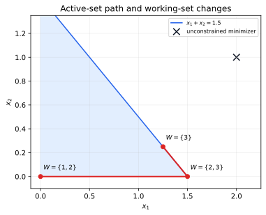
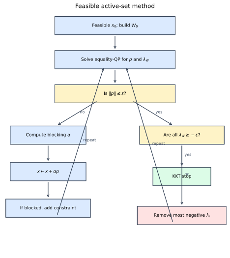

无约束最优点常满足梯度为零，但有约束时，真正能走的方向被边界裁掉了。本章先用拉格朗日乘子表达边界的“反作用”，再把 KKT 条件变成有效集法的增删规则。先修是梯度、凸性、线性方程和下降方向。

学完应能：统一约束符号；逐项解释 KKT 四组条件；区分必要条件与充分条件；计算阻挡步长；在 $p=0$ 时用乘子决定停止还是删除约束。

## 1. 有约束时，梯度不为零也可能已经走到最低处

**例题。** 在 $x\ge0$ 的条件下最小化 $f(x)=(x+1)^2$。

- 平方要为 0，需要 $x=-1$，但负数不能选。
- 从允许的最左边 $x=0$ 往右试。$f(0)=1$、$f(1)=4$、$f(2)=9$。因为对 $x\ge0$，$x+1$ 至少是 1，所以平方最小就是 1。
- 最优点为 $x_*=0$，可是 $f'(0)=2$。这个斜率说明往右会升高。往左虽然能降低，但会离开许可范围。

在候选点上恰好取等号的约束叫**有效约束**，也可以理解成“这条限制正好卡住你”。在 $x=0$，$x\ge0$ 取等号。在 $x=1$，它还留有 1 的余量。

## 2. KKT 将“边界卡住了”写成方程

**例题。** 用 KKT 检查上一题。按课堂写法，把约束写成 $c(x)=x\ge0$。给这条限制分一个新未知量 $\lambda$，叫**乘子**。它用来调节边界项的大小，让边界提供的作用与目标的坡度相抵；具体数值要和 $x$ 一起由条件解出来。把它和目标放到同一个式子里：

$$
L(x,\lambda)=(x+1)^2-\lambda x.
$$

$L$ 叫拉格朗日函数。先暂时把 $\lambda$ 当成常数，对 $x$ 求导。需要四件事同时成立。

| 要检查什么 | 上一题具体怎么写 | 直白地看 |
|---|---|---|
| 驻点条件 | $2(x+1)-\lambda=0$ | 让边界项抵消目标在这里的坡度 |
| 原问题可行 | $x\ge0$ | 允许站在这个点 |
| 不等式乘子非负 | $\lambda\ge0$ | 约束按 $\ge0$ 写时配套的符号 |
| 互补松弛 | $\lambda x=0$ | 还有余量时，乘子必须为零 |

最后一个等式给了两条路。若 $x>0$，只能令 $\lambda=0$，第一行得 $x=-1$，跟前提冲突。若 $x=0$，第一行给出 $\lambda=2$，代回四行都满足。因此 $(x,\lambda)=(0,2)$ 是这道题的一组 KKT 解。这里目标是凸函数且约束是线性的，所以它也给出了全局最优点。

一般题可能有多条不等式 $c_i(x)\ge0$ 和多条等式 $h_j(x)=0$。每条分一个乘子，把上面的 $L$ 换成 $f-\sum_i\lambda_i c_i-\sum_j\mu_j h_j$，仍对 $x$ 求梯度。每条不等式分别写 $\lambda_i\ge0$ 与 $\lambda_i c_i(x)=0$。等式的乘子 $\mu_j$ 正负皆可。若题目直接用 $g_i(x)\le0$，可以变成 $c_i(x)=-g_i(x)\ge0$，这样整套符号不用重记。

约束写法、拉格朗日函数和乘子符号必须成套使用：

| 不等式写法 | 拉格朗日项 | 乘子符号 | 互补条件 |
|---|---|---|---|
| $c_i(x)\ge0$ | $-\lambda_i c_i(x)$ | $\lambda_i\ge0$ | $\lambda_i c_i(x)=0$ |
| $g_i(x)\le0$ | $+\lambda_i g_i(x)$ | $\lambda_i\ge0$ | $\lambda_i g_i(x)=0$ |

两行是同一件事，因为可取 $c_i=-g_i$。最常见错误是只把不等号翻转，却不改拉格朗日函数中的符号。

### 有效约束的乘子也可能为零

**例题。** 在 $x\ge0$ 上最小化 $f(x)=x^2$。最优点仍在 $x=0$，驻点式 $2x-\lambda=0$ 给出 $\lambda=0$。约束已经取等号，乘子也可以为零。记清互补式真正给的是：**余量为正时，乘子一定为零**。

常见题里，局部最优点要满足 KKT 还需要适当的约束规范条件。比如 LICQ，就是有效不等式与等式约束的梯度合在一起线性无关。刚才一元例子只有一个有效约束，梯度是 $1$，因此满足。

要分清两种逻辑：在约束规范成立时，局部最优 $\Rightarrow$ KKT，是**必要性**；在最小化凸问题中，若 $f$ 凸、写成 $g_i\le0$ 的不等式函数凸、等式约束仿射，则 KKT $\Rightarrow$ 全局最优，是**充分性**。严格凸目标还给唯一最优点。一般非凸问题找到 KKT 点只说明它是候选点，可能仍需二阶条件或其他比较。

## 3. 等式约束二次规划可以先把一个坐标代掉

二次规划常写 QP。目标里有平方项，约束是一次式。先练只有一条等式的题。

**例题。** 最小化 $\tfrac12(x_1^2+2x_2^2)$，要求 $x_1+x_2=3$。

**做法一。** 用等式写 $x_1=3-x_2$，代入目标，变成 $f(x_2)=\tfrac12(3-x_2)^2+x_2^2$。打开括号得到 $\tfrac92-3x_2+\tfrac32x_2^2$。求导等于 0，得 $-3+3x_2=0$，所以 $x_2=1,x_1=2$。

**做法二。** 用上节刚学的乘子。写 $L=\tfrac12(x_1^2+2x_2^2)-\mu(x_1+x_2-3)$。分别对 $x_1,x_2$ 求偏导并令其为 0，得到 $x_1=\mu,\ 2x_2=\mu$。再加约束 $x_1+x_2=3$。前两行说明 $x_1=2x_2$，第三行给出 $3x_2=3$，所以还是得到 $(2,1)$，同时 $\mu=2$。

如果题面给的是矩阵形式 $\tfrac12x^TQx+c^Tx$、$Ax=b$，就把刚才的“偏导等于零”和“满足等式”写为 $Qx+c-A^T\mu=0,\ Ax=b$，然后联立解。教科书也是把这两行叠起来。只有一两个变量时，先展开成普通方程更好算。

## 4. 有效集法每次只把一部分边界固定住

一个点可能同时碰到好几条边界。有效集法先把选中的边界当作等式，用第 3 节的办法找位移，实际走的时候还要看看其他边界什么时候会挡住。当前暂时钉住的约束编号叫**工作集** $W$。

下面的流程图把“方向是否为零”分成两条支路。路径图展示本例走过哪些边界，流程图展示一般算法每轮如何判断。

**例题。** 把位置 $(x_1,x_2)$ 尽量靠近 $(2,1)$，最小化

$$
f=\tfrac12[(x_1-2)^2+(x_2-1)^2],
$$

同时满足三条约束：

| 编号 | 要求 | 看成图上的边界 |
|---|---|---|
| 1 | $x_1\ge0$ | 不能走到纵轴左边 |
| 2 | $x_2\ge0$ | 不能走到横轴下边 |
| 3 | $\tfrac32-x_1-x_2\ge0$ | 两坐标之和最多 $3/2$ |

从 $(0,0)$ 出发。两轴的限制都刚好碰到，先取 $W=\{1,2\}$。以下每一步都从当前位置开始重新看。

### 第一步，两条边都固定住时走不了

固定 $x_1=0$ 和 $x_2=0$，当然只能取位移 $p=(0,0)^T$。此处目标梯度是 $(-2,-1)^T$。第一条边界的梯度是 $(1,0)^T$，第二条是 $(0,1)^T$，所以用 $\lambda_1(1,0)^T+\lambda_2(0,1)^T$ 配出目标梯度时，逐坐标比较得到 $\lambda_1=-2,\lambda_2=-1$。这都不符合 KKT。负乘子提示固定该边界可能挡住下降；有效集法可先移出一个负乘子对应的边界。本例按最负的选约束 1，留下 $W=\{2\}$。

### 第二步，只固定横轴，第 3 条会挡路

固定 $x_2=0$ 后，目标变成 $\tfrac12[(x_1-2)^2+1]$，希望走到 $x_1=2$，也就是位移 $p=(2,0)^T$。如果走这一步的比例为 $\alpha$，新位置就是 $(2\alpha,0)^T$。第 3 条要求 $2\alpha\le3/2$，所以最多走 $\alpha=3/4$。到 $(3/2,0)$ 时碰到第 3 条，将它加入工作集，$W=\{2,3\}$。

### 第三步，又被钉住，看看该放开哪一条

固定 $x_2=0$ 且 $x_1+x_2=3/2$，此时位移还是 0。新点的梯度为 $(-1/2,-1)^T$。约束 2 的梯度为 $(0,1)^T$，约束 3 的梯度为 $(-1,-1)^T$。配成

$$
(-1/2,-1)^T=\lambda_2(0,1)^T+\lambda_3(-1,-1)^T.
$$

第一项坐标给 $-\lambda_3=-1/2$，第二项给 $\lambda_2-\lambda_3=-1$，所以 $\lambda_3=1/2,\lambda_2=-1/2$。移除约束 2，当前只钉住斜边。

### 第四步，沿斜边挪到最低点

沿 $x_1+x_2=3/2$ 移动，若第二坐标增加 $t$，第一坐标就减 $t$。新位置为 $(3/2-t,t)$。直接代回目标：

$$
\begin{aligned}
f(3/2-t,t)&=\tfrac12[(-1/2-t)^2+(t-1)^2]\\
&=\tfrac58-\tfrac12t+t^2.
\end{aligned}
$$

让导数 $-1/2+2t=0$，得 $t=1/4$。位移 $(-1/4,1/4)$ 走完仍在许可范围。新点是 $(5/4,1/4)$。此时在斜边上继续走，已经找不到更低的位置，等式子问题给出的位移为 0。新梯度 $(-3/4,-3/4)^T$ 正好是第 3 条约束梯度的 $3/4$ 倍，乘子为正。其余两条还有余量，乘子取 0。KKT 四条都成立，可以停。代回原目标得到 $f_*=\tfrac9{16}$。

### 把这道题的方法写成通用步骤

1. 在工作集里的各条边界上找最佳位移 $p$。比如斜边保持等号，就要求 $p_1+p_2=0$。
2. $p$ 非零时，先试完整一步 $\alpha=1$。对于工作集外的不等式 $a_i^Tx-b_i\ge0$，如果 $a_i^Tp<0$，余量会变小，最多走 $(a_i^Tx-b_i)/(-a_i^Tp)$。取最小允许步长。碰上新边界而停时，就把它加入 $W$。
3. $p$ 为零时，用各条边界的梯度拼出目标梯度，解出乘子。若不等式乘子都非负且原约束可行，就得到 KKT 点。对本节这样目标凸、约束线性的 QP，它也是全局最优点，可以停止；一般非凸问题还须另作最优性判断。出现负乘子，就移出对应边界继续。

第 2 步的式子直接来自可行性。沿 $x+\alpha p$ 后，第 $i$ 条余量是

$$
a_i^T(x+\alpha p)-b_i=(a_i^Tx-b_i)+\alpha a_i^Tp.
$$

当 $a_i^Tp<0$ 时它随 $\alpha$ 下降，令余量等于 0 就得到阻挡步长。若 $a_i^Tp\ge0$，这条约束不会在正方向上阻挡本步。

$p=0$ 只表示“在当前工作集全被当成等式时，等式子问题无可走方向”，并不自动表示原问题最优。负乘子说明某条被固定的不等式应当放开；只有乘子符号也正确时才满足 KKT。

负乘子为何对应“可放开”？在工作集梯度线性无关时，若释放第 $i$ 条边界，可找一个方向 $p$：保持其余工作约束不变，即 $a_j^Tp=0\ (j\ne i)$，同时让第 $i$ 条余量增加，即 $a_i^Tp>0$。由当前梯度平衡 $g=\sum_{j\in W}\lambda_ja_j$，

$$
g^Tp=\sum_{j\in W}\lambda_j a_j^Tp=\lambda_i a_i^Tp.
$$

若 $\lambda_i<0$，右侧小于 0，释放它就可能出现可行下降方向。这说明删除规则来自方向导数，而不是凭经验“试着删一条”。退化或工作集梯度相关时，还需要数值容差和并列规则处理。

**第 5 天过关。** 从 $(0,0)$ 重算，能讲出工作集为什么从 $\{1,2\}$ 变成 $\{2\}$，又为什么加入 3，就掌握了有效集法最容易卡住的部分。接下来打开 [往年 A 卷题目版](09、往年A卷题目版.md)计时做卷。

## 补读｜二阶条件只检查还允许的方向

**例题。** 在 $x_2=0$ 的约束下最小化 $f(x_1,x_2)=x_1^2-x_2^2$。如果没有这条约束，沿 $x_2$ 方向移动会让目标越来越低。但现在所有允许位移只能写成 $d=(a,0)^T$。在 $(0,0)$ 的梯度为零，沿这些位移的二次型为

$$
d^T\begin{pmatrix}2&0\\0&-2\end{pmatrix}d=2a^2>0\quad(a\ne0).
$$

也可以直接代 $x_2=0$，问题变成求 $x_1^2$ 的最低点，正好在 $(0,0)$。

一般约束题先找**临界方向**。它满足等式的一阶变化为零，有效不等式的一阶变化朝许可方向，并且目标的一阶变化为零。也就是在一阶看不出升降、又允许尝试的方向里查二阶。满足 LICQ 的局部极小点在这些方向上的拉格朗日 Hessian 二次型非负。在一个 KKT 点，若所有非零临界方向上的二次型都严格为正，得到严格局部极小。上例约束是线性的，约束项的二阶导数是零，所以直接用目标的 Hessian 就够。

## 失败情形、实验对照与理解检查

有效集法还可能遇到退化：多个约束同时阻挡、活动约束梯度线性相关、零步长换集或乘子几乎为零。实现时需要一致的并列规则和数值容差，不能靠“看起来等于零”作精确判断。

实验四的实现见 [active_set.py](/downloads/optimization/实验四_一般二次规划的有效集方法/code/methods/active_set.py)，固定使用 $Ax\ge b$。初始工作集取余量在容差内的约束；方向为零时删除最负乘子对应的约束；方向非零时取 $\alpha=\min(1,\text{阻挡步长})$，被阻挡则加入相应约束。输出还检查原始可行、乘子非负、驻点残差和互补松弛。理论例题与代码符号一致；工作区的 `原始实验包` 仅用于历史归档。

也可以先阅读站内的[实验四代码导读](../最优化方法实验/05、实验四：二次规划有效集法.md)。

1. 活动约束的乘子为什么可以是 0，而非活动约束的乘子一定是 0？
2. 找到一组 KKT 解，什么时候能直接宣布全局最优？
3. 有效集子问题得到 $p=0$ 后，为什么不能立即停止？

核对答案

1. 互补条件只要求乘积为 0。活动约束余量已经为 0，乘子可为任意满足符号和驻点的值；非活动约束余量为正，只能让乘子为 0。
2. 在相应凸性条件下：目标凸、不等式按 $g_i\le0$ 时函数凸、等式仿射；严格凸还能给唯一性。一般非凸题不行。
3. 它只说明被当前工作集固定后走不了；还需检查乘子。若有负乘子，释放该不等式后可能出现下降方向。

## 本章闭环

到这里，理论主线已经闭合：梯度给一阶变化，Hessian 给曲率，线搜索定步长，KKT 处理边界，有效集把 KKT 变成可执行规则。下一步用 [09、往年 A 卷题目版](09、往年A卷题目版.md) 自测，再到 [06、逐题解析](06、往年A卷逐题解析.md) 定位最早出错的一步。

[返回五天路线](00、考试重点与复习路线.md)
