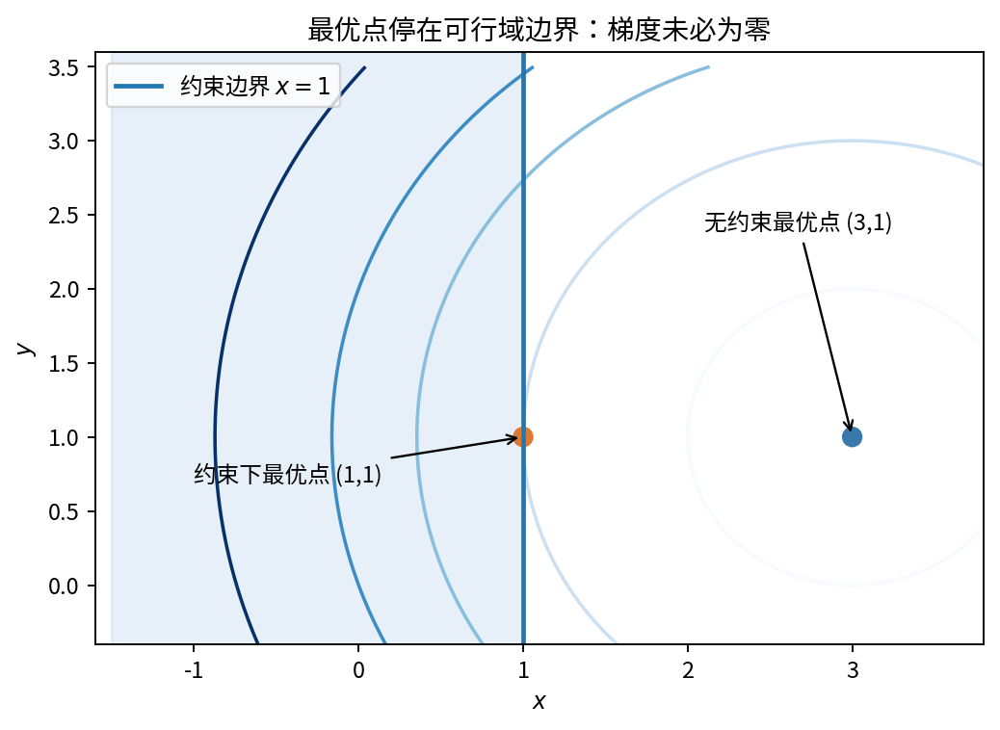

到现在，我们处理的都是可以向任何方向移动的最小化问题。但现实中总有边界：预算不能超支、产量不能为负、机器不能超载。最好的位置可能紧贴边界。这时再说“梯度不为零，所以不是最优点”，就会错。

## 最优点停在墙上

看一个简单的二维函数

$$
f(x,y)=(x-3)^2+(y-1)^2,
$$

没有约束时最低点是 $(3,1)$。现在加一堵墙 $x\le1$。你只能在左侧活动，最好的位置自然是墙上的 $(1,1)$，这时

$$
\nabla f(1,1)=(-4,0)^T\ne0.
$$

这不矛盾：梯度指向**局部上升最快**的方向（这里是负 $x$ 方向），而负梯度 $(4,0)$ 才指向局部下降最快的方向，但负梯度会穿过墙，变成不可行方向。**约束最优点不要求所有方向都不能下降，只要求可行方向中没有可以继续下降的方向。**

这里还会遇到两个新词：**可行点**是满足全部约束的点，例如 $(1,1)$ 满足 $x\le1$，$(2,1)$ 则不满足；**活动约束**是当前刚好取等号的约束，例如最优点 $(1,1)$ 使 $x-1=0$，这堵墙正在限制移动。还有余量的约束叫**非活动约束**。这引出了拉格朗日乘子。把墙写成 $g(x,y)=x-1\le0$，约定对所有不等式都采用 $g_i\le0$ 的形式。构造

$$
L(x,y,\lambda)=f(x,y)+\lambda g(x,y),\qquad\lambda\ge0.
$$

这里 $L$ 叫**拉格朗日函数**：先把目标 $f$ 与约束 $g$ 合在一个表达式里，方便统一研究边界处的最优条件；$\lambda$（读 lambda）叫**拉格朗日乘子**，是约束旁的一个待求系数，不是事先知道的数。比如乘子是 4，表示在驻点条件里需要四份约束法向量，才能抵消目标梯度。$\lambda\ge0$ 来自这里的约束写法和最小化问题，不是所有问题都不加区分地套这个符号。

注意乘子符号取决于你如何写约束：若改写成 $g\ge0$，通常也要连同拉格朗日函数的符号一起调整。**不能只改不等号而继续沿用旧的乘子正负判断。**

在最优点 $(1,1)$ 处，目标梯度是 $(-4,0)$，约束梯度是 $(1,0)$。令

$$
\nabla f+\lambda\nabla g=0
$$

得到 $(-4,0)+\lambda(1,0)=0$，所以 $\lambda=4$。从几何上看，目标函数想把位置往墙外推，约束的法向量恰好抵消了这种趋势。乘子不是随便加上去的魔法数字，它衡量了当前边界对最优性的重要程度，在合适的正则条件下还具有灵敏度意义。

为什么这时要求 $\lambda\ge0$？我们规定墙写成 $g\le0$，因此 $\nabla g$ 指向“更容易违反约束”的那一侧。在本例中 $g=x-1$，其导数是正的 1；目标的负梯度想让 $x$ 往右走，恰好就是被这堵墙禁止的方向。正乘子 $\lambda=4$ 给出指向右侧的约束法向量，和目标梯度抵消。如果一边改约束的写法，一边不改拉格朗日函数的符号，就会得到错误的乘子判断。

## KKT 的四句话到底说什么

考虑

$$
\min f(x)\quad\text{s.t.}\quad g_i(x)\le0,\quad h_j(x)=0.
$$

定义 $L=f+\sum_i\lambda_i g_i+\sum_j\mu_j h_j$，其中 $\lambda_i\ge0$、等式乘子 $\mu_j$ 不限制符号。KKT 条件是：

**原始可行性**：$g_i(x)\le0$ 且 $h_j(x)=0$。解释：答案不能违反题目的限制。

**驻点条件**：

$$
\nabla f(x)+\sum_i\lambda_i\nabla g_i(x)+\sum_j\mu_j\nabla h_j(x)=0.
$$

解释：在最优点，目标函数的变化趋势可以被活动约束的法向影响抵消。

**对偶可行性**：$\lambda_i\ge0$。解释：在我们选定的 $g_i\le0$ 约定中，活动不等式的法向作用只能按正确方向组合，不能反过来“鼓励”违反约束。

**互补松弛**：$\lambda_i g_i(x)=0$。这里“**松弛**”就是“没有碰到边界，还留有余量”。例如 $x\le1$，在 $x=0$ 时还剩 1 个单位的活动空间；而 $x=1$ 时余量为 0。**互补松弛**说的是“余量还没用尽的墙，乘子必须是 0”，写成两个数的乘积为零。这最容易被死记硬背，实际上很直观：如果某条约束还留有余地，即 $g_i(x)<0$，它此刻没有挡住你，所以乘子必须是 0；如果乘子 $\lambda_i>0$，那条约束必须正好卡在边界 $g_i(x)=0$。也允许两者都为 0。

检验前面的墙：在 $(1,1)$，$g=0$；乘子 $\lambda=4\ge0$；梯度抵消；所以四组条件都满足。并且本例的 $f$ 是严格凸函数、可行域凸，找到的 KKT 点就是唯一全局最优解。

**非常重要的成立条件**：KKT 并不对所有非凸或退化的约束问题自动给出全局最优。这里有两个经常突然出现在教材里的名称，先用最小例子认清：

**LICQ** 是英文“线性无关约束资格条件”的缩写。它要求在候选点，把所有**等式约束的梯度**与所有**正在取等号的不等式约束的梯度**放在一起后，这些向量线性无关。所谓“线性无关”，简单说就是没有某一条可以由其他几条的倍数或加减组合得到。例如平面上两堵墙 $x\le1$ 和 $2x\le2$ 在 $x=1$ 同时活动，法向量分别是 $(1,0)^T$ 与 $(2,0)^T$，第二个就是第一个的两倍，所以不满足 LICQ。**不满足 LICQ 不等于最优点不存在**，只是不能依赖这条条件自动保证 KKT 乘子的必要性。

**Slater 条件**是凸优化中常见的正则性条件：在满足等式约束的同时，存在一点使所有需要严格满足的凸不等式都留有严格余量。只有 $x\le1$ 时，$x=0$ 严格满足，因为 $0<1$；但若还要求 $x\ge1$，可行点只能是 $x=1$，就找不到同时严格满足两边的不等式的点。不要把 Slater 当成“所有题都必须满足才能有最优解”：它常用于保证强对偶及乘子存在等结论的条件，而不是最优点存在的定义。

在适当可微和约束资格条件（例如 LICQ）下，局部最优点满足 KKT **必要条件**；对可微凸优化，若目标函数与不等式约束函数凸、等式约束仿射，那么**一个可行且满足 KKT 的点**具有全局最优性，这是**充分条件**。若想保证凸问题的最优点一定有 KKT 乘子，Slater 是常见的附加条件之一。不要混淆“最优点必满足 KKT”和“满足 KKT 必最优”。此外，本篇 $g_i(x)$ 指**第 $i$ 个约束函数**，而下一段 $g_k=\nabla f(x_k)$ 指**第 $k$ 次迭代的目标函数梯度**，二者虽然都写字母 $g$，却不是同一个量。

## 二次规划和等式约束：把问题变成线性方程

如果目标是

$$
f(x)=\tfrac12x^TQx+c^Tx,\qquad Q=Q^T\succ0,
$$

并且有线性等式 $Ax=b$，那么构造 $L=\tfrac12x^TQx+c^Tx+\mu^T(Ax-b)$。求梯度为零并结合约束，得到

$$
\begin{pmatrix}Q&A^T\\A&0\end{pmatrix}\begin{pmatrix}x\\\mu\end{pmatrix}=\begin{pmatrix}-c\\b\end{pmatrix}.
$$

这张矩阵第一次出现时值得拆开看，不需要把它当作新名词硬记。原函数的梯度为 $Qx+c$；对等式约束的乘子求导或直接保留原等式 $Ax=b$。驻点等式是 $Qx+c+A^T\mu=0$，也就是 $Qx+A^T\mu=-c$。把它和 $Ax=b$ 上下排在一起，第一行系数是 $Q,A^T$，第二行系数是 $A,0$，右边分别是 $-c,b$，自然就得到上面的“大方阵”。左边的大矩阵叫 KKT 矩阵。它只是将“目标驻点”和“等式必须满足”两类条件写在一起，不必一开始把它看成新算法。这里的 $Q^T$ 代表矩阵转置；$Q=Q^T$ 表示矩阵对称。符号 $Q\succ0$ 读作“$Q$ **正定**”，即对每一个非零向量 $v$ 都有 $v^TQv>0$。它保证这个二次目标沿任意非零方向都有正曲率，从而在非空的线性等式可行域上有唯一极小点。上面的大矩阵可由驻点方程和约束方程拼成，并不代表把整张表里的数字全部乘起来。如果 $A$ 的行线性无关、约束相容且 $Q\succ0$，KKT 线性方程的解唯一；若 $A$ 行相关，乘子可能不唯一，不能只因为目标正定就断言整个 KKT 矩阵可逆。

例如最小化 $(x-2)^2+(y-2)^2$，约束 $x+y=2$。消去 $y=2-x$，得到 $f(x)=(x-2)^2+x^2$。求导 $4x-4=0$，所以 $x=y=1$。

我们现在还可以把同一个数值例题亲手填进 KKT 矩阵。展开 $f=(x-2)^2+(y-2)^2$ 得 $x^2+y^2-4x-4y+8$，所以 $Q=\begin{pmatrix}2&0\\0&2\end{pmatrix}$、$c=(-4,-4)^T$，约束 $x+y=2$ 则给出 $A=(1,1)$、$b=2$。驻点和约束三个方程合在一起是

$$
\begin{pmatrix}2&0&1\\0&2&1\\1&1&0\end{pmatrix}
\begin{pmatrix}x\\y\\\mu\end{pmatrix}=
\begin{pmatrix}4\\4\\2\end{pmatrix}.
$$

逐行读就是 $2x+\mu=4$、$2y+\mu=4$、$x+y=2$。前两式相减得 $x=y$，再由第三式得 $x=y=1$，进而 $\mu=2$。你看到的 KKT 矩阵，就是把刚才熟悉的三个方程写在一张表里。这与消元求得的结果一致。使用简单消元是为了先理解，KKT 矩阵则适合更多变量。

## 有效集法：猜哪些墙真的挡住了最优解

不等式约束的问题难在：事先不知道最优点究竟会顶住哪一堵墙。**有效集法（工作集法）**把这个未知选择变成迭代过程。它先假定一部分约束恰好取等号，临时将这些约束看成等式来求搜索方向，边走边调整自己的猜测。

设当前点为 $x_k$、工作集为 $W_k$、梯度为 $g_k$、二次目标 Hessian 为 $Q\succ0$。只允许沿工作集中约束的切向移动，求子问题

$$
\min_p\quad\tfrac12p^TQp+g_k^Tp,\qquad A_{W_k}p=0.
$$

等式 $A_Wp=0$ 表示：**沿这个方向走，当前认为必须贴住的墙仍保持贴住**。这里的**工作集** $W_k$ 是当前暂时固定的那些约束的编号集合。例如工作集有“$y=0$”这一堵墙时，方向必须满足 $p_y=0$；如果同时固定 $x+y=2$，方向还必须满足 $p_x+p_y=0$。向量 $p$ 是**这轮准备移动的方向/位移**，与无约束算法的 $d$ 类似；$A_W$ 就是把这些活动约束的系数行拿出来拼成的矩阵。例如只固定 $y=0$ 时，$A_W=(0,1)$，所以 $A_Wp=0$ 等价于 $p_y=0$。子问题可以像上一段那样写成 KKT 线性方程求解。

**子问题为什么突然换成关于 $p$ 的函数？** 这里不能直接背公式。设原来的二次目标是

$$
f(x)=\tfrac12x^TQx+c^Tx,
$$

其中 $Q$ 是对称矩阵，$c$ 是原目标中的一次项系数。当前位置 $x_k$ 已知，准备完整走一个位移 $p$ 后到达 $x_k+p$。我们真正要最小化的是**新位置的目标值** $f(x_k+p)$，而不是凭空创造另一个函数。代入并展开：

$$
\begin{aligned}
f(x_k+p)
&=\tfrac12(x_k+p)^TQ(x_k+p)+c^T(x_k+p)\\
&=\tfrac12x_k^TQx_k+\tfrac12x_k^TQp
 +\tfrac12p^TQx_k+\tfrac12p^TQp+c^Tx_k+c^Tp.
\end{aligned}
$$

因为 $Q$ 对称，两个交叉项是相同的标量，合起来为 $x_k^TQp$。前后相减时，原位置的 $f(x_k)=\frac12x_k^TQx_k+c^Tx_k$ 被抵消，于是

$$
\begin{aligned}
f(x_k+p)-f(x_k)
&=x_k^TQp+c^Tp+\tfrac12p^TQp\\
&=(Qx_k+c)^Tp+\tfrac12p^TQp\\
&=g_k^Tp+\tfrac12p^TQp,
\end{aligned}
$$

其中 $g_k=Qx_k+c=\nabla f(x_k)$。由于当前位置的 $f(x_k)$ 是常数，**让新目标值尽可能小**，就等价于**让右边这个目标变化量尽可能小**。这才得到了 $\min_p\,\frac12p^TQp+g_k^Tp$。

那条 $A_{W_k}p=0$ 也有具体来源：若工作集里某堵墙原来是 $a_i^Tx=b_i$，并且当前位置已经贴在墙上，即 $a_i^Tx_k=b_i$，要求移动后仍贴墙，就有 $a_i^T(x_k+p)=b_i$，两式相减得到 $a_i^Tp=0$。把所有工作集等式上下排起来，才变成 $A_{W_k}p=0$。

最后将这套推导**代回本篇原来的数字**。设 $f(x,y)=(x-2)^2+(y-2)^2$，从 $x_k=(0,0)^T$ 出发：将列向量 $x=(x,y)^T$ 代入，它可写成 $\frac12x^T(2I)x+(-4,-4)x+8$（也就是 $x^2+y^2-4x-4y+8$），因此 $Q=\begin{pmatrix}2&0\\0&2\end{pmatrix}$、$g_k=(-4,-4)^T$。令 $p=(p_1,p_2)^T$，则

$$
\tfrac12p^TQp+g_k^Tp=p_1^2+p_2^2-4p_1-4p_2.
$$

分别求偏导得到 $2p_1-4=0$、$2p_2-4=0$，所以**不考虑其他墙时**完整位移是 $p=(2,2)^T$。它正是下一段阻挡约束例子所使用的 $p$，不是凭空给出的数。

假如 $p\ne0$，理论模型告诉我们该移动；但其他未放进工作集的墙可能挡住道路，因此要限制步长。对于统一写成 $a_i^Tx\le b_i$ 的不等式，沿 $x+\alpha p$ 移动要求

$$
a_i^Tx+\alpha a_i^Tp\le b_i.
$$

若 $a_i^Tp>0$，这条约束给出上限

$$
\alpha\le\frac{b_i-a_i^Tx}{a_i^Tp}.
$$

若 $a_i^Tp\le0$，移动时不会朝着该墙的违约方向走，因此它不提供正步长上限。这里还要交代数字 1 的来源：我们的二次子问题已经直接求出了“如果不受其他墙阻挡，想走的**完整位移** $p$”，于是 $\alpha=1$ 表示把 $p$ 全部走完，$\alpha=1/2$ 表示只走一半；因此本轮最多先试完整步长 1，而不允许任意放大 $p$。比较所有阻挡约束给出的上限，并和完整步长 1 比较，取最小允许值。**只有当某条约束真的限制了本轮步长，才需要把它加入工作集**；不是每次前进都随意加入一条约束。

有了步长公式，还要见一次**阻挡约束使 $\alpha<1$** 的例子，才不会把“找最大可行步长”误认为永远走完整步。仍以

$$
 f(x,y)=(x-2)^2+(y-2)^2
$$

为目标，另设一条墙 $x+y\le1$，从可行点 $(0,0)$ 出发，暂时不固定任何工作集约束。无墙时的二次子问题建议位移 $p=(2,2)$，全步长 $\alpha=1$ 会走到 $(2,2)$，但明显违反 $x+y\le1$。按公式计算：$a=(1,1)^T,b=1,x=(0,0)^T$，因此

$$
 \alpha\le\frac{b-a^Tx}{a^Tp}=\frac{1-0}{2+2}=\frac14.
$$

只能先走 $x+\frac14p=(\frac12,\frac12)$，此处恰好满足 $x+y=1$，所以这条约束成为阻挡约束并加入工作集。注意这里的 $p=(2,2)$ 是*完整位移*，$\alpha=\frac14$ 才是本轮实际走的比例；二者不能混。

如果解出 $p=0$ 呢？这表示在当前被固定的那些墙的切向平面里已经无法改进。但某堵墙可能是猜错的。此时用当前工作集的乘子判断：对 $g_i\le0$ 的约定，如果所有工作集不等式乘子都非负，凸二次规划中满足 KKT，可以停止；若存在负乘子，说明松开相应的墙可能改善目标，应删除一条负乘子约束重新求方向。等式约束的乘子不按这个规则删。

用一个二维例子把它串起来：

$$
\min (x-2)^2+(y-2)^2,\qquad x+y\le2,\ x\ge0,\ y\ge0.
$$

从 $(0,0)$ 开始，两条非负约束都卡在边界。如果把它们都固定为等式，就无法动弹，得到 $p=0$。但此刻目标梯度 $(-4,-4)$，两个对应的乘子都是负的（按 $-x\le0,-y\le0$ 的约定），说明至少有一条墙不该一直固定。假设先放开 $x\ge0$，沿 $y=0$ 增大 $x$：如果没有其他约束，最佳点想走到 $x=2$；恰好到 $(2,0)$ 时碰到 $x+y=2$，于是把这条墙加入工作集。

此刻若同时固定 $y=0$ 和 $x+y=2$，又会得到 $p=0$；检查乘子发现 $y\ge0$ 的对应乘子为负，因此释放这条墙。接下来沿 $x+y=2$ 向 $(1,1)$ 走，得到真正最优点。终点 $x+y=2$ 的乘子为正，另两条非负约束不活动，算法停止。

把刚才的两轮写成数值，而不是只靠“加墙、拆墙”四个字猜：起点 $(0,0)$ 处梯度为 $(-4,-4)$，固定 $x=0$ 和 $y=0$ 时只能取 $p=0$。对约束 $-x\le0,-y\le0$，驻点条件为 $(-4,-4)+\lambda_x(-1,0)+\lambda_y(0,-1)=0$，解得 $\lambda_x=\lambda_y=-4$，故至少要拆一堵墙。

先拆掉 $x=0$ 这堵墙，仍让 $y=0$：沿 $x$ 方向将 $f(x,0)=(x-2)^2+4$ 最小化，导数为 $2(x-2)$，所以理想的完整位移是 $p=(2,0)$。但是 $x+y\le2$ 在沿此位移时要求 $0+\alpha(2)\le2$，于是 $\alpha\le1$。走完后到 $(2,0)$，刚好碰到 $x+y=2$，就把它纳入工作集。

现在同时固定 $y=0$、$x+y=2$，能满足的方向只有 $p=0$。在 $(2,0)$，目标梯度是 $(0,-4)$；两堵墙的法向量分别是 $(0,-1)$ 和 $(1,1)$，驻点条件 $(0,-4)+\lambda_y(0,-1)+\lambda_s(1,1)=(0,0)$ 给出 $\lambda_s=0,\lambda_y=-4$。所以拆掉 $y=0$，保留 $x+y=2$。沿这条斜墙移动时写 $p=(-t,t)$，目标函数沿 $t$ 变化为 $2t^2-4t+4$，去掉不影响最小点的常数 4 后求导为 $4t-4$，故 $t=1$，方向 $p=(-1,1)$；完整走一步就到 $(1,1)$。此处目标梯度 $(-2,-2)$，墙的法向量 $(1,1)$，乘子 $\lambda_s=2\ge0$，因此停止。

这段过程有三个关键判断：**方向不为零就找阻挡约束；方向为零就查乘子；乘子全合格才停止。**

实际有效集法还会遇到退化、并列阻挡约束、非满秩工作集和浮点误差，所以真实代码需要容差和确定性的选取规则。本例是凸二次规划的教学演示，不代表所有非凸约束问题都能照此流程保证全局收敛。

**自己检查**：① 为何 $(1,1)$ 对“墙 $x\le1$”的例子是最优，尽管梯度非零？② $\lambda_i g_i=0$ 为什么不意味着 $\lambda_i$ 和 $g_i$ 都必须为零？③ 有效集法什么时候“加墙”，什么时候“拆墙”？

[下一篇：把方法组合起来做题](06、往年A卷逐题解析.md)
