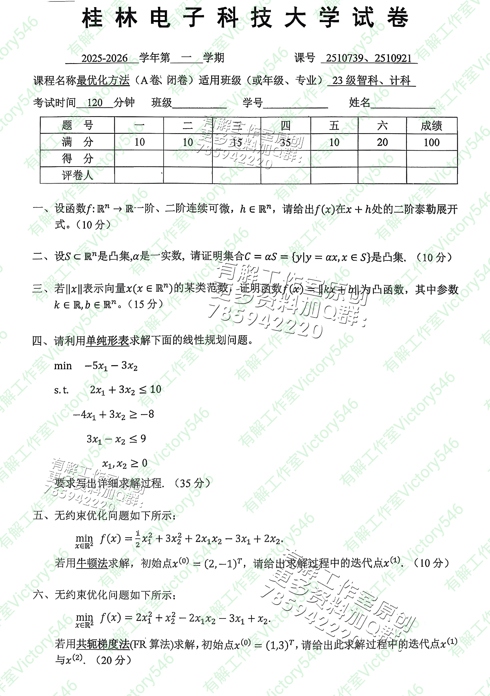

**试卷信息：** 桂林电子科技大学；2025—2026 学年第一学期；《最优化方法》（A 卷，闭卷）；考试时间 120 分钟；适用班级：23 级智科、计科；满分 100 分。

**来源与校对说明：** 以下题目根据用户提供的整页试卷图片转录，保留题号、分值、目标函数、约束及初始点。为便于阅读，数学公式转换成 LaTeX 排版；扫描件有水印，但核心题干可辨认。请以随包附带的图片作为最终核对依据。

这份解析只解上面的<strong>同一张 A 卷</strong>，不使用原创题替代。建议先做完 [原题版](09、往年A卷题目版.md)，再根据题号核对。

每题按“原题—标准答案—详细解析”排版。**标准答案只写必要的数学步骤、表格和结论**；术语解释与解题动机放在详细解析中。

## 一、二阶泰勒展开（10 分）

**原题：** 设函数 $f:\mathbb R^n\to\mathbb R$ 一阶、二阶连续可微，$h\in\mathbb R^n$，请给出 $f(x)$ 在 $x+h$ 处的二阶泰勒展开式。（10 分）

**标准答案**

$$
f(x+h)=f(x)+\nabla f(x)^Th+\frac12h^T\nabla^2f(x)h+o(\|h\|^2),\qquad h\to0.
$$

**详细解析**

先理解题目中的几个记号。$x$ 是当前点，$h$ 是从当前点到附近另一个点的一段位移；$\nabla f(x)$ 称为<strong>梯度</strong>，由各个变量的一阶偏导数组成；$\nabla^2 f(x)$ 称为 **Hessian 矩阵（Hessian Matrix）**，里面记录了各个二阶偏导数。

当 $h\to0$ 时，**二阶泰勒展开（Second-Order Taylor Expansion）**（Peano 余项形式）是：

$$
\boxed{f(x+h)=f(x)+\nabla f(x)^Th+\frac12h^T\nabla^2f(x)h+o(\|h\|^2).}
$$

三个主要项分别是“原来的函数值”“由斜率预测的一阶变化”和“由曲率带来的二阶修正”。其中 $o(\|h\|^2)$ 是<strong>高阶小量</strong>，它表示余项与 $\|h\|^2$ 的比值在 $h\to0$ 时趋于 0，而不是说余项恒等于零。

为什么二阶项是 $\frac12$？从一维的 $A+Bh+Ch^2$ 出发，连续求导两次，二次项变成 $2C$。为了使二阶导数等于 $f''(x)$，必须取 $C=f''(x)/2$。多元情形的 $h^THh$ 对应各个方向上的二次变化，也同样有这个系数。

**考试时可以直接写方框中的公式。** 进一步的推导见 [01 数学基础](01、数学基础、泰勒展开与凸性.md)。

## 二、证明 $\alpha S$ 是凸集（10 分）

**原题：** 设 $S\subseteq\mathbb R^n$ 是凸集，$\alpha$ 是一实数，证明 $C=\alpha S=\{y\mid y=\alpha x,\ x\in S\}$ 是凸集。

**标准答案**

任取 $u,v\in C$，则存在 $a,b\in S$ 使 $u=\alpha a,\ v=\alpha b$。对任意 $t\in[0,1]$，

$$
tu+(1-t)v= t\alpha a+(1-t)\alpha b=\alpha[ta+(1-t)b].
$$

由 $S$ 的凸性知 $ta+(1-t)b\in S$，故 $tu+(1-t)v\in C$。因此 $C$ 是凸集。

**详细解析**

先解释<strong>凸集（Convex Set）</strong>：从集合中随便取两个点，连接这两点的整条线段还在集合内，就称这个集合为凸集。$\alpha S$ 的意思是把 $S$ 中每个点的全部坐标同时乘以同一个实数 $\alpha$；它不表示只把某个点乘一次。

要证明 $C$ 凸，不能只画一个图或试几个数字，而要对任意两个点成立。任取 $u,v\in C$，根据 $C$ 的定义，一定存在 $a,b\in S$，使得 $u=\alpha a$、$v=\alpha b$。

再任取 $t\in[0,1]$。考察 $u,v$ 连线上的点：

$$
\begin{aligned}
tu+(1-t)v
&=t\alpha a+(1-t)\alpha b\\
&=\alpha\bigl(ta+(1-t)b\bigr).
\end{aligned}
$$

因为 $S$ 是凸集，$ta+(1-t)b\in S$。所以这整个表达式是“$S$ 中某个点乘以 $\alpha$”，按定义就在 $\alpha S=C$ 中。于是 $C$ 为凸集。

这个证明对 $\alpha<0$、$\alpha=0$ 也成立：当 $\alpha=0$ 且 $S$ 非空时，$C=\{0\}$，同样凸。若 $S$ 为空，空集通常也约定为凸集。

## 三、证明 $f(x)=\|kx+b\|$ 为凸函数（15 分）

**原题：** 若 $\|x\|$ 表示向量 $x\in\mathbb R^n$ 的某类范数，证明 $f(x)=\|kx+b\|$ 为凸函数，其中 $k\in\mathbb R$、$b\in\mathbb R^n$。

**标准答案**

任取 $u,v\in\mathbb R^n$ 及 $t\in[0,1]$。由范数的三角不等式和绝对齐次性，

$$
\begin{aligned}
f(tu+(1-t)v)
&=\|k[tu+(1-t)v]+b\|\\
&=\|t(ku+b)+(1-t)(kv+b)\|\\
&\le t\|ku+b\|+(1-t)\|kv+b\|\\
&=tf(u)+(1-t)f(v).
\end{aligned}
$$

故 $f$ 为凸函数。

**详细解析**

<strong>范数（Norm）</strong>可以理解成衡量向量“大小”的规则，比如二维向量 $(3,4)$ 的欧氏范数是 $5$。本题中的范数不一定是欧氏范数；不过任何范数都具有以下两条关键性质：

- **三角不等式（Triangle Inequality）**：$\|p+q\|\le\|p\|+\|q\|$，意思是两段位移相加后的长度不超过两段各自长度的和。
- **绝对齐次性（Absolute Homogeneity）**：$\|ap\|=|a|\|p\|$，意思是把向量放大 $|a|$ 倍，范数也放大 $|a|$ 倍。

<strong>凸函数（Convex Function）</strong>需要证明的是：对任意 $u,v\in\mathbb R^n$ 和 $t\in[0,1]$，都有 $f(tu+(1-t)v)\le tf(u)+(1-t)f(v)$。

难点不是范数，而是常数向量 $b$ 怎么放进两个括号。因为 $t+(1-t)=1$，可以把一份 $b$ 拆成 $tb+(1-t)b$，因此：

$$
\begin{aligned}
k(tu+(1-t)v)+b
&=ktu+k(1-t)v+tb+(1-t)b\\
&=t(ku+b)+(1-t)(kv+b).
\end{aligned}
$$

现在先用三角不等式，再用齐次性：

$$
\begin{aligned}
f(tu+(1-t)v)
&=\|t(ku+b)+(1-t)(kv+b)\|\\
&\le\|t(ku+b)\|+\|(1-t)(kv+b)\|\\
&=t\|ku+b\|+(1-t)\|kv+b\|\\
&=tf(u)+(1-t)f(v).
\end{aligned}
$$

第三行能够去掉绝对值，是因为 $0\le t\le1$ 使 $t$ 和 $1-t$ 均非负。该式对任意 $u,v,t$ 成立，所以 $f$ 是凸函数。注意 $k$ 可以是负数，不影响证明。

## 四、用单纯形表求线性规划（35 分）

**原题：**

$$
\begin{aligned}
\min\quad & -5x_1-3x_2\\
\mathrm{s.t.}\quad &2x_1+3x_2\le 10,\\
&-4x_1+3x_2\ge -8,\\
&3x_1-x_2\le 9,\\
&x_1,x_2\ge 0.
\end{aligned}
$$

**标准答案**

令 $Z=-f=5x_1+3x_2$。第二条约束乘 $-1$，得 $4x_1-3x_2\le8$。引入非负松弛变量：

$$
\begin{aligned}
2x_1+3x_2+s_1&=10,\\
4x_1-3x_2+s_2&=8,\\
3x_1-x_2+s_3&=9.
\end{aligned}
$$

按最大化问题 $\sigma_j=c_j-z_j$ 计算。初始表：

| 基 | $c_B$ | $x_1$ | $x_2$ | $s_1$ | $s_2$ | $s_3$ | $b$ |
|---|---:|---:|---:|---:|---:|---:|---:|
| $s_1$ | 0 | 2 | 3 | 1 | 0 | 0 | 10 |
| $s_2$ | 0 | 4 | -3 | 0 | 1 | 0 | 8 |
| $s_3$ | 0 | 3 | -1 | 0 | 0 | 1 | 9 |
| $\sigma$ | | 5 | 3 | 0 | 0 | 0 | $Z=0$ |

$x_1$ 入基，$\min(10/2,8/4,9/3)=2$，$s_2$ 出基，主元为 $4$。令 $R_2'=R_2/4$、$R_1'=R_1-2R_2'$、$R_3'=R_3-3R_2'$：

| 基 | $c_B$ | $x_1$ | $x_2$ | $s_1$ | $s_2$ | $s_3$ | $b$ |
|---|---:|---:|---:|---:|---:|---:|---:|
| $s_1$ | 0 | 0 | $9/2$ | 1 | $-1/2$ | 0 | 6 |
| $x_1$ | 5 | 1 | $-3/4$ | 0 | $1/4$ | 0 | 2 |
| $s_3$ | 0 | 0 | $5/4$ | 0 | $-3/4$ | 1 | 3 |
| $\sigma$ | | 0 | $27/4$ | 0 | $-5/4$ | 0 | $Z=10$ |

$x_2$ 入基，$\min(6/(9/2),3/(5/4))=4/3$，$s_1$ 出基，主元为 $9/2$。令 $R_1'=R_1/(9/2)$，其余两行分别加 $\tfrac34R_1'$、减 $\tfrac54R_1'$，得：

| 基 | $c_B$ | $x_1$ | $x_2$ | $s_1$ | $s_2$ | $s_3$ | $b$ |
|---|---:|---:|---:|---:|---:|---:|---:|
| $x_2$ | 3 | 0 | 1 | $2/9$ | $-1/9$ | 0 | $4/3$ |
| $x_1$ | 5 | 1 | 0 | $1/6$ | $1/6$ | 0 | 3 |
| $s_3$ | 0 | 0 | 0 | $-5/18$ | $-11/18$ | 1 | $4/3$ |
| $\sigma$ | | 0 | 0 | $-3/2$ | $-1/2$ | 0 | $Z=19$ |

全部检验数非正，最优解为

$$
\boxed{x^*=(3,\tfrac43)^T,\qquad f_{\min}=-19.}
$$

**详细解析**

这道题要求“利用<strong>单纯形表（Simplex Tableau）</strong>”，因此只通过画可行域猜出答案不够。我们先一步步建立表格，再通过<strong>检验数（Reduced Cost）</strong>判断什么时候停。

**先把极小化改成极大化。** 令 $Z=5x_1+3x_2$，则原目标 $f=-Z$，使 $Z$ 最大的点也会使 $f$ 最小。第二条原约束两侧乘 $-1$ 时，不等号必须翻转：$4x_1-3x_2\le8$。所以标准化后的三条约束都是“$\le$”。

接着增加三个<strong>松弛变量（Slack Variable）</strong> $s_1,s_2,s_3$。松弛变量就是“还有多少额度没用完”，例如 $s_1=10-2x_1-3x_2$。它们必须不小于零：

$$
\begin{aligned}
2x_1+3x_2+s_1&=10,\\
4x_1-3x_2+s_2&=8,\\
3x_1-x_2+s_3&=9,\\
x_1,x_2,s_1,s_2,s_3&\ge0.
\end{aligned}
$$

把目标函数写为 $Z=5x_1+3x_2+0s_1+0s_2+0s_3$。每个变量在目标函数前面的数字叫<strong>目标系数（Objective Coefficient）</strong>，因此 $(c_j)=(5,3,0,0,0)$。松弛变量只是剩余量，本身不贡献利润，所以系数为零。

表格中的“**基变量（Basic Variable）**”是当前用每一条方程直接求出的变量。刚开始取 $x_1=x_2=0$，便得到 $s_1=10,s_2=8,s_3=9$；因此初始基是 $s_1,s_2,s_3$。基变量对应的目标系数叫 $c_B$，最开始全是零。

我们统一使用<strong>最大化问题</strong>的检验数 $\sigma_j=c_j-z_j$。其中 $c_j$ 是目标函数的原系数，$z_j$ 是当前基变量在调整过程中造成的目标变化；计算方法是“拿当前每行的 $c_B$ 乘那一行本列的系数，再全部相加”。如果某个非基变量的检验数为正，说明可以尝试增加它来改善 $Z$。

<strong>初始单纯形表</strong>如下。右端 $b$ 列直接抄三个等式右侧的 $10,8,9$，中间各列直接抄等式中对应变量的系数。最下面的检验数行，因为所有 $c_B=0$，所以 $z_j=0$，$\sigma_j=c_j$：

| 基变量 | $c_B$ | $x_1$ | $x_2$ | $s_1$ | $s_2$ | $s_3$ | 右端 $b$ |
|---|---:|---:|---:|---:|---:|---:|---:|
| $s_1$ | 0 | **2** | 3 | 1 | 0 | 0 | 10 |
| $s_2$ | 0 | **4** | -3 | 0 | 1 | 0 | 8 |
| $s_3$ | 0 | **3** | -1 | 0 | 0 | 1 | 9 |
| $\sigma_j=c_j-z_j$ | | **5** | 3 | 0 | 0 | 0 | $Z=0$ |

检验数最大的正数是 $5$，因此让 $x_1$ **入基**（它将从 0 开始增加）。但增加多少不能随意，必须让所有基变量继续非负。沿 $x_1$ 列做<strong>最小比值检验（Minimum Ratio Test）</strong>：第一行允许增加 $10/2=5$，第二行 $8/4=2$，第三行 $9/3=3$。最先耗尽的是第二行，因而 $s_2$ **出基**。第二行第 $x_1$ 列的数 $4$ 叫<strong>主元（Pivot Element）</strong>，就是本轮行变换的中心。

**第一轮换基。** 主元行先除以 4，得到新的第二行

$$
R_2'=(1,-\tfrac34,0,\tfrac14,0\mid2).
$$

这里 $R_2$ 是第二行的简写，竖线右边是 $b$。再用 $R_1\leftarrow R_1-2R_2'$、$R_3\leftarrow R_3-3R_2'$ 把 $x_1$ 列的其他位置消成零。于是：

| 基变量 | $c_B$ | $x_1$ | $x_2$ | $s_1$ | $s_2$ | $s_3$ | 右端 $b$ | $x_2$ 比值 |
|---|---:|---:|---:|---:|---:|---:|---:|---:|
| $s_1$ | 0 | 0 | **9/2** | 1 | -1/2 | 0 | 6 | **4/3** |
| $x_1$ | 5 | 1 | -3/4 | 0 | 1/4 | 0 | 2 | 不参与（负系数） |
| $s_3$ | 0 | 0 | 5/4 | 0 | -3/4 | 1 | 3 | 12/5 |
| $\sigma_j=c_j-z_j$ | | 0 | **27/4** | 0 | -5/4 | 0 | $Z=10$ | |

这张表里最容易困惑的是 **$27/4$ 从哪里来**。当前基变量是 $(s_1,x_1,s_3)$，其目标系数 $c_B=(0,5,0)$。在 $x_2$ 列，三行数字为 $(9/2,-3/4,5/4)$，所以

$$
\begin{aligned}
z_{x_2}&=0\cdot\frac92+5\cdot\left(-\frac34\right)+0\cdot\frac54=-\frac{15}{4},\\
\sigma_{x_2}&=c_{x_2}-z_{x_2}=3-\left(-\frac{15}{4}\right)=\frac{27}{4}.
\end{aligned}
$$

它的含义是：现在让 $x_2$ 增加时，为维持方程中的约束，$x_1$ 也要跟着变化，因此总利润的增加幅度并不只是它原来的目标系数 3，而是包含了联动变化后的 $27/4$。

**第二轮换基。** 正检验数对应 $x_2$，它入基。最小比值是 $6/(9/2)=4/3$，小于 $3/(5/4)=12/5$，故 $s_1$ 出基；负的 $-3/4$ 不能拿来做比值，因为它不会随着 $x_2$ 增加而压缩这一行的剩余额度。主元是 $9/2$。

第一行除以 $9/2$，变为

$$
R_1'=(0,1,\tfrac29,-\tfrac19,0\mid\tfrac43).
$$

再让 $R_2\leftarrow R_2+\frac34R_1'$、$R_3\leftarrow R_3-\frac54R_1'$，得到最终表：

| 基变量 | $c_B$ | $x_1$ | $x_2$ | $s_1$ | $s_2$ | $s_3$ | 右端 $b$ |
|---|---:|---:|---:|---:|---:|---:|---:|
| $x_2$ | 3 | 0 | 1 | 2/9 | -1/9 | 0 | **4/3** |
| $x_1$ | 5 | 1 | 0 | 1/6 | 1/6 | 0 | **3** |
| $s_3$ | 0 | 0 | 0 | -5/18 | -11/18 | 1 | 4/3 |
| $\sigma_j=c_j-z_j$ | | 0 | 0 | -3/2 | -1/2 | 0 | $Z=19$ |

最后一行没有正检验数，因此已经不存在通过增加一个非基变量来继续提高目标值的方向；这时才满足本约定下的单纯形法最优停止规则。

最终取非基变量 $s_1=s_2=0$，从右端读到 $x_1=3$、$x_2=4/3$、$s_3=4/3$。

$$
\boxed{x^*=\left(3,\frac43\right)^T,\qquad f_{\min}=-5(3)-3\cdot\frac43=-19.}
$$

代回原题验算：$2\cdot3+3\cdot\frac43=10$；$-4\cdot3+3\cdot\frac43=-8$；$3\cdot3-\frac43=23/3\le9$。三条约束都符合要求。

特别注意：有的教材直接用<strong>极小化</strong>问题的 $c_j-z_j$，这时选负检验数；本题从头到尾先转成了<strong>极大化</strong>，所以选正检验数，最后才把 $Z=19$ 换回原目标的 $-19$。这两个约定不能混在同一张表里。

## 五、牛顿法求 $x^{(1)}$（10 分）

**原题：**

$$
\min_{x\in\mathbb R^2} f(x)=\tfrac12x_1^2+3x_2^2+2x_1x_2-3x_1+2x_2,\qquad x^{(0)}=(2,-1)^T.
$$

**标准答案**

$$
\nabla f(x)=\begin{pmatrix}x_1+2x_2-3\\2x_1+6x_2+2\end{pmatrix},\qquad
H=\begin{pmatrix}1&2\\2&6\end{pmatrix}.
$$

在 $x^{(0)}=(2,-1)^T$，有 $g_0=(-3,0)^T$。由 $Hd_0=-g_0$：

$$
\begin{cases}p+2q=3,\\2p+6q=0\end{cases}
\Longrightarrow d_0=(9,-3)^T.
$$

$$
\boxed{x^{(1)}=x^{(0)}+d_0=(11,-4)^T.}
$$

**详细解析**

先求<strong>梯度</strong>，即分别对 $x_1$ 和 $x_2$ 求偏导后排成一列：

$$
\nabla f(x)=\begin{pmatrix}x_1+2x_2-3\\2x_1+6x_2+2\end{pmatrix}.
$$

再求 **Hessian 矩阵**，即对梯度中的两个分量再分别求偏导：

$$
H=\nabla^2f(x)=\begin{pmatrix}1&2\\2&6\end{pmatrix}.
$$

<strong>牛顿法（Newton's Method）</strong>不是直接把梯度减掉，而是找一个方向 $d$，满足 $Hd=-g$。这里 $g$ 表示当前点的梯度，$H$ 则给出不同方向的曲率信息。代入 $x^{(0)}=(2,-1)^T$：

$$
 g_0=\begin{pmatrix}2-2-3\\4-6+2\end{pmatrix}=\begin{pmatrix}-3\\0\end{pmatrix}.
$$

令 $d=(p,q)^T$，解线性方程组

$$
\begin{cases}
p+2q=3,\\2p+6q=0.
\end{cases}
$$

把第一式乘 2，再用第二式减去它，得到 $2q=-6$，故 $q=-3$，代回第一式得 $p=9$。于是方向 $d=(9,-3)^T$。基本牛顿法使用全步长 $\alpha=1$，因此

$$
\boxed{x^{(1)}=x^{(0)}+d=(2,-1)^T+(9,-3)^T=(11,-4)^T.}
$$

**验算：** 把 $(11,-4)$ 代回梯度，两个分量都为零。此外 $H$ 对称，左上角 $1>0$、行列式 $1\cdot6-2\cdot2=2>0$，因此 $H$ 正定；这道正定二次问题的驻点是唯一全局最小点。题目只要求第一步，写到 $x^{(1)}$ 并验算即可。

## 六、FR 共轭梯度法求 $x^{(1)},x^{(2)}$（20 分）

**原题：**

$$
\min_{x\in\mathbb R^2}f(x)=2x_1^2+x_2^2-2x_1x_2-3x_1+x_2,\qquad x^{(0)}=(1,3)^T.
$$

**标准答案**

$$
Q=\begin{pmatrix}4&-2\\-2&2\end{pmatrix},\quad c=(-3,1)^T,\quad g(x)=Qx+c.
$$

第 0 轮：

$$
\begin{aligned}
g_0&=(-5,5)^T,\quad d_0=-g_0=(5,-5)^T,\\
Qd_0&=(30,-20)^T,\\
\alpha_0&=-\frac{g_0^Td_0}{d_0^TQd_0}=\frac{50}{250}=\frac15,\\
x^{(1)}&=(1,3)^T+\tfrac15(5,-5)^T=\boxed{(2,2)^T}.
\end{aligned}
$$

第 1 轮：

$$
\begin{aligned}
g_1&=(1,1)^T,\qquad
\beta_0^{FR}=\frac{g_1^Tg_1}{g_0^Tg_0}=\frac1{25},\\
d_1&=-g_1+\beta_0d_0=(-\tfrac45,-\tfrac65)^T,\\
Qd_1&=(-\tfrac45,-\tfrac45)^T,\\
\alpha_1&=-\frac{g_1^Td_1}{d_1^TQd_1}=\frac54,\\
x^{(2)}&=x^{(1)}+\alpha_1d_1=\boxed{(1,\tfrac12)^T}.
\end{aligned}
$$

**详细解析**

题目指定 **FR（Fletcher–Reeves） 算法**。它属于<strong>共轭梯度法（Conjugate Gradient Method）</strong>：第一轮朝负梯度方向走；以后新方向不仅看当前负梯度，也包含一定比例的上一轮方向。对于这道正定二次函数，以下采用常见的<strong>精确线搜索</strong>：在选定方向上，找到让函数值最小的步长。

为了不反复求二阶导数，把目标写成 $f(x)=\frac12x^TQx+c^Tx$ 的形式。$Q$ 就是 Hessian 矩阵，$c$ 是线性项的系数列向量：

$$
Q=\begin{pmatrix}4&-2\\-2&2\end{pmatrix},\qquad c=\begin{pmatrix}-3\\1\end{pmatrix}.
$$

因此 $g(x)=Qx+c=(4x_1-2x_2-3,\,-2x_1+2x_2+1)^T$。

**第 0 轮：** 在 $x^{(0)}=(1,3)^T$，

$$
g_0=\begin{pmatrix}-5\\5\end{pmatrix},\qquad d_0=-g_0=\begin{pmatrix}5\\-5\end{pmatrix}.
$$

对于正定二次函数，沿任意下降方向 $d$ 的精确线搜索步长为 $\alpha=-g^Td/(d^TQd)$。这里 $Qd_0=(30,-20)^T$，因此

$$
\alpha_0=-\frac{(-5,5)(5,-5)^T}{(5,-5)(30,-20)^T}=\frac{50}{250}=\frac15.
$$

更新位置：

$$
\boxed{x^{(1)}=x^{(0)}+\alpha_0d_0=(1,3)^T+\tfrac15(5,-5)^T=(2,2)^T.}
$$

**第 1 轮：** 新位置的梯度是

$$
g_1=Qx^{(1)}+c=\begin{pmatrix}1\\1\end{pmatrix}.
$$

FR 中的权重 $\beta_0$ 不是随便选的，它是“新梯度长度的平方 / 旧梯度长度的平方”：

$$
\beta_0^{\mathrm{FR}}=\frac{g_1^Tg_1}{g_0^Tg_0}=\frac{1^2+1^2}{(-5)^2+5^2}=\frac2{50}=\frac1{25}.
$$

新方向需要把负梯度与上一轮方向相加：

$$
d_1=-g_1+\beta_0d_0=\begin{pmatrix}-1\\-1\end{pmatrix}+\frac1{25}\begin{pmatrix}5\\-5\end{pmatrix}=\begin{pmatrix}-4/5\\-6/5\end{pmatrix}.
$$

先算矩阵乘法 $Qd_1=(-4/5,-4/5)^T$。故

$$
\alpha_1=-\frac{g_1^Td_1}{d_1^TQd_1}
=-\frac{-2}{8/5}=\frac54.
$$

第二次更新：

$$
\boxed{x^{(2)}=x^{(1)}+\alpha_1d_1=(2,2)^T+\tfrac54(-4/5,-6/5)^T=(1,1/2)^T.}
$$

**验算：** $g(1,1/2)=(0,0)^T$。这说明在这道题中两轮就到了驻点。Hessian $Q$ 对称且 $4>0$、$\det Q=4\cdot2-(-2)^2=4>0$，所以目标函数严格凸，这个驻点也是唯一的全局最小点。

注意不要把 FR 的 $\beta$ 公式换成 PRP 或 PRP+；它们是不同版本。题目只写 FR，没有单独规定步长规则，所以本解答明确采用适用于这类正定二次问题的精确线搜索。

---

**原卷做题提醒：** 第 1～3 题是证明与公式题；第 4 题要求完整单纯形表而不仅是答案；第 5 题只要求牛顿第一步；第 6 题要求 FR 的连续两步。若你想补练其他题型，另见 [原创综合例题](06、综合例题与解析.md) 和 [原创自测](09、独立自测题.md)，它们不属于原卷。
