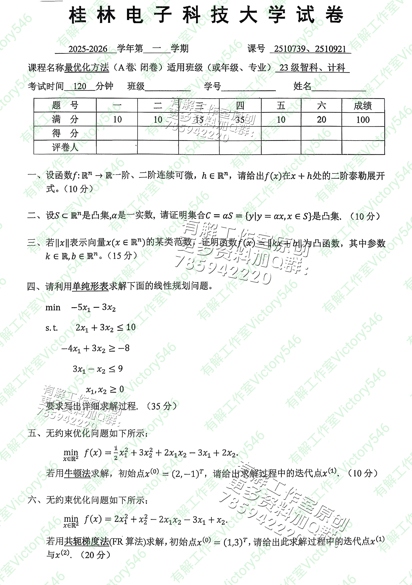

**试卷信息：** 桂林电子科技大学；2025—2026 学年第一学期；《最优化方法》（A 卷，闭卷）；考试时间 120 分钟；适用班级：23 级智科、计科；满分 100 分。

**来源与校对说明：** 以下题目根据用户提供的整页试卷图片转录，保留题号、分值、目标函数、约束及初始点。为便于阅读，数学公式转换成 LaTeX 排版；扫描件有水印，但核心题干可辨认。请以随包附带的图片作为最终核对依据。

这份是<strong>仅保留原题的自测版</strong>。正式动笔时，可以不看下面的解析文件。六道题分值依次为 10、10、15、35、10、20 分，合计 100 分。

## 一、二阶泰勒展开（10 分）

设函数 $f:\mathbb R^n\to\mathbb R$ 一阶、二阶连续可微，$h\in\mathbb R^n$，请给出 $f(x)$ 在 $x+h$ 处的二阶泰勒展开式。（10 分）

## 二、证明集合 $\alpha S$ 是凸集（10 分）

设 $S\subseteq\mathbb R^n$ 是凸集，$\alpha$ 是一实数，请证明集合 $C=\alpha S=\{y\mid y=\alpha x,\ x\in S\}$ 是凸集。（10 分）

## 三、证明范数复合函数的凸性（15 分）

若 $\|x\|$ 表示向量 $x$（$x\in\mathbb R^n$）的某类范数，证明函数 $f(x)=\|kx+b\|$ 为凸函数，其中参数 $k\in\mathbb R$，$b\in\mathbb R^n$。（15 分）

## 四、单纯形表求解线性规划（35 分）

请利用单纯形表求解下面的线性规划问题，要求写出详细求解过程。（35 分）

$$
\begin{aligned}
\min\quad & -5x_1-3x_2\\
\mathrm{s.t.}\quad &2x_1+3x_2\le 10,\\
&-4x_1+3x_2\ge -8,\\
&3x_1-x_2\le 9,\\
&x_1,x_2\ge 0.
\end{aligned}
$$

## 五、牛顿法第一步（10 分）

无约束优化问题如下所示：

$$
\min_{x\in\mathbb R^2} f(x)=\frac12x_1^2+3x_2^2+2x_1x_2-3x_1+2x_2.
$$

若用牛顿法求解，初始点 $x^{(0)}=(2,-1)^T$，请给出求解过程中的迭代点 $x^{(1)}$。（10 分）

## 六、FR 共轭梯度法前两步（20 分）

无约束优化问题如下所示：

$$
\min_{x\in\mathbb R^2}f(x)=2x_1^2+x_2^2-2x_1x_2-3x_1+x_2.
$$

若用共轭梯度法（FR 算法）求解，初始点 $x^{(0)}=(1,3)^T$，请给出求解过程中的迭代点 $x^{(1)}$ 与 $x^{(2)}$。（20 分）

---

做完以后再看 [第 06 篇原卷逐题解析](06、往年A卷逐题解析.md)，或先核对 [答案与验算清单](09、往年A卷答案与核对.md)。

想练其他类型的题目可阅读 [原创自测题](09、独立自测题.md)，但原创题<strong>不属于这张 A 卷</strong>。
