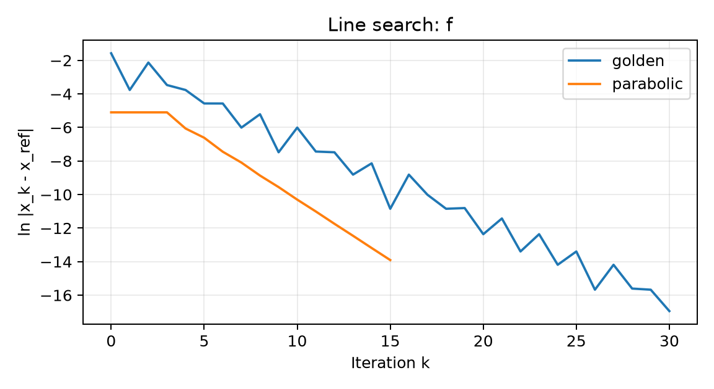
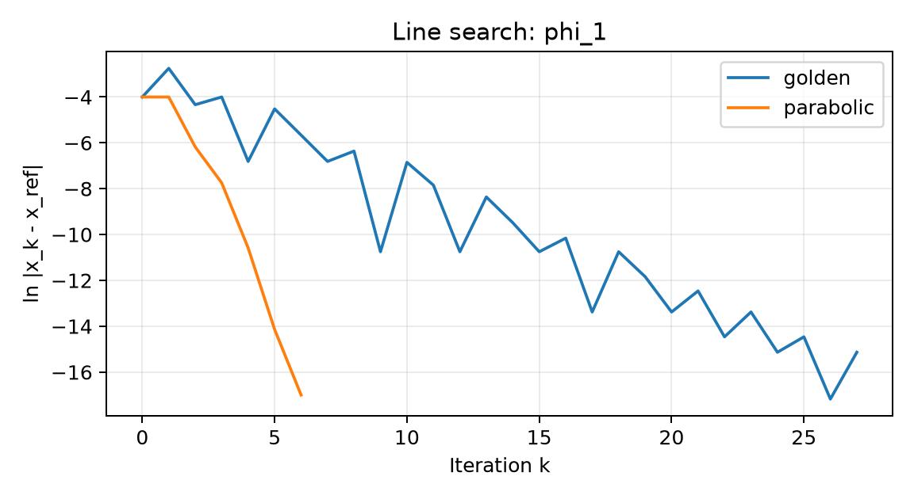

本实验要理解的是：**在一条线上，怎样找到更好的点，以及怎样比较不同搜索方法。** 主要考查区间更新、步长选择、停止条件和实验结果解释。

实际源码：[实验一 main.py](/downloads/optimization/实验一_线搜索方法/code/main.py)。`scalar_f` 在第 30 行，`phi` 在第 48 行；`bracket/golden/parabolic/armijo` 分别从第 98、133、163、231 行开始。行号对应本次读取的版本。

## 一、线搜索到底在搜索什么

对于多维问题，已知当前点 $x_k$ 和方向 $d_k$，定义：

$$\psi(\alpha)=f(x_k+\alpha d_k).$$

尽管 $x_k$ 有很多分量，现在变化的只有标量 $\alpha$。于是多维选步长变成一维问题：

$$\min_{\alpha\ge0}\psi(\alpha).$$

精确线搜索尝试求沿线最小点；非精确线搜索只要求步长满足下降等条件。**“精确”是数学上的搜索目标，不是浮点程序能输出无限精度。**

### 配套例题：把二维目标化成一元函数

设 $f(x_1,x_2)=x_1^2+2x_2^2$，当前 $x=(1,1)^T$，方向 $d=(-2,-4)^T$。

$$\psi(\alpha)=(1-2\alpha)^2+2(1-4\alpha)^2=3-20\alpha+36\alpha^2.$$

令 $\psi'(\alpha)=-20+72\alpha=0$，得 $\alpha_*=5/18$。于是新点为：

$$x_+=\begin{pmatrix}4/9\\-1/9\end{pmatrix}.$$

这一步只是沿给定直线的最优点，不一定是整个二维问题的最优点。

## 二、实验的两个原始目标函数

第一个目标：

$$f(x)=\frac{\ln(1+x+x^2+e^{x+x^2})}{1+x^2}+\ln(1+2e^{x-7}).$$

试探范围限制在 $[-20,20]$；先用进退法构造区间，再比较黄金分割、三点抛物线法以及负梯度结合 Armijo。

第二个目标：

$$\phi(x)=2e^{\sin(\pi x^5/6)}+3x^2+2x.$$

当前实验使用区间 $[1.29,1.72]$。三角函数与高次项使它不适合不加分析地当成全实轴单峰函数。

其导数为：

$$\phi'(x)=2e^{\sin t}\cos t\frac{5\pi x^4}{6}+6x+2,\qquad t=\frac{\pi x^5}{6}.$$

### 实验原题：参考点应怎样表述

当前结果中：

$$x_{f,\rm ref}\approx-0.6939120175418682,$$

$$x_{\phi,\rm ref}\approx1.486715284567222.$$

正确说法是“$\phi$ 在本实验指定区间中的参考极小点约为 1.4867152846”。不能只凭这次局部区间搜索就声称它是全实轴唯一全局最优点。

参考点通过导数零点的独立高精度求根得到；求根器是核验工具，不代替所实现的搜索算法。

## 三、进退法：先找到搜索区间

进退法解决的是“往哪边找，以及区间有多大”，还没有精细求出极小点。

基本过程：

1. 从初始点 $x_0$ 和初始试探步长 $h$ 出发。
2. 正向试探若不下降，改为反向。
3. 沿下降方向前进，并把步长成倍扩大。
4. 出现函数值回升，保留前后的三个点。

得到的三点通常满足：

$$a<m<b,\qquad f(m)\le f(a),\quad f(m)\le f(b).$$

它说明采样上出现了“先降后升”，但仅靠三个函数值不能证明区间内部没有其他波谷。后续区间排除仍需适当的单峰结构。

### 实验原题：从 $0$ 和 $0.1$ 出发

当前 `bracket(scalar_f)` 默认 $x_0=0$、$h=0.1$。反向后，采样点按以下方向推进：

$$0\rightarrow-0.1\rightarrow-0.3\rightarrow-0.7\rightarrow-1.5.$$

注意新增步长分别为 $-0.1,-0.2,-0.4,-0.8$，不是每次固定减 0.1。

检测到回升后，返回按位置排序的三点：

$$(a,m,b)=(-1.5,-0.7,-0.3).$$

所以后续区间为 $[-1.5,-0.3]$，中间较优点为 $-0.7$。这里的“中间点”是三点排序中的中间点，不一定是区间的算术中点；本例算术中点是 $-0.9$。

## 四、黄金分割法：为什么是 0.618

令：

$$\tau=\frac{\sqrt5-1}{2}\approx0.618034,\qquad\tau^2=1-\tau.$$

在 $[a,b]$ 取两个内部点：

$$c=b-\tau(b-a),\qquad d=a+\tau(b-a),\quad c<d.$$

若 $f(c)\le f(d)$，在适当单峰前提下保留 $[a,d]$；否则保留 $[c,b]$。黄金比例的好处不是数字特殊好背，而是**新区间里有一个旧试点恰好可继续使用**，每轮只需增加一次函数计算。

```text
初始区间： a -------- c -------- d -------- b
若 f(c) <= f(d)：
保留区间： a -------- c -------- d
下一轮复用旧 c 及其函数值，只新增另一个内部点
```

### 配套例题：手算一次黄金分割

令 $f(x)=(x-1)^2$，初始区间 $[0,4]$。

$$c\approx1.527864,\qquad d\approx2.472136.$$

$$f(c)\approx0.27864<f(d)\approx2.16718.$$

所以新区间是 $[0,2.472136]$，不是 $[1.527864,4]$。考试最容易错的是把“函数值更小的一侧”与“删除哪一段”写反。

## 五、黄金分割的停止条件和次数

若每次有效收缩后区间长度乘 $\tau$，则：

$$L_k=\tau^kL_0.$$

要求 $L_k\le\varepsilon$，所需收缩次数为：

$$k\ge\frac{\ln(\varepsilon/L_0)}{\ln\tau}.$$

由于 $\ln\tau<0$，从不等式推导时必须注意除以负数会改变方向。最后向上取整。

程序返回区间中点；只要参考极小点始终被包含，则位置误差不超过 $L_k/2$。区间越来越短，不代表各轮中点的实际位置误差一定逐轮变小。

### 实验原题：为什么是 30 次

对第一个函数，$L_0=1.2$、$\varepsilon=10^{-6}$：

$$k\ge\frac{\ln(10^{-6}/1.2)}{\ln\tau}\approx29.09.$$

因此至少收缩 30 次。当前结果是 30 次、32 次目标函数调用；两次初始化后，每轮新增一次。

最终区间长度约 $6.45\times10^{-7}$，中点约 $-0.6939119740$，实际位置误差约 $4.35\times10^{-8}$。

## 六、三点抛物线插值：利用函数形状

黄金分割只通过大小比较排除区间；三点法进一步利用三个点拟合局部曲率。

取 $x_1<x_2<x_3$，满足中心函数值不大于两端。拟合：

$$q(x)=A(x-x_2)^2+B(x-x_2)+C.$$

令：

$$h_L=x_1-x_2,\quad h_R=x_3-x_2,$$

$$s_L=\frac{f_1-f_2}{h_L},\qquad s_R=\frac{f_3-f_2}{h_R}.$$

由 $s_L=Ah_L+B$、$s_R=Ah_R+B$ 得：

$$A=\frac{s_R-s_L}{h_R-h_L},\qquad B=s_L-Ah_L.$$

若 $A>0$，抛物线的极小点为：

$$\bar x=x_2-\frac B{2A}.$$

这与直接三点顶点公式等价，但坐标平移有助于减少接近大数平方相减产生的数值误差。

### 配套例题：一轮预测到真正的极小点

令 $f(x)=(x-0.37)^2+2$，取三点 $(-1,0,1)$。

$$f_1=3.8769,\quad f_2=2.1369,\quad f_3=2.3969.$$

$$s_L=-1.74,\quad s_R=0.26,\quad A=1,\quad B=-0.74.$$

所以：

$$\bar x=0-\frac{-0.74}{2}=0.37.$$

原函数本来就是二次函数，因此三点能够准确恢复它。对于一般非二次函数，只是局部近似，不能保证一次求到极小点。

## 七、三点怎样更新，以及为什么区间很宽也会停

如果 $\bar x<x_2$：

- 新点更优：保留 $(x_1,\bar x,x_2)$。
- 新点更差：保留 $(\bar x,x_2,x_3)$。

如果 $\bar x>x_2$：

- 新点更优：保留 $(x_2,\bar x,x_3)$。
- 新点更差：保留 $(x_1,x_2,\bar x)$。

当前程序用：

$$|\bar x-x_2|<10^{-6}$$

停止，比较的是**本轮更新前的中心与新拟合点**，不是区间长度。CSV 中普通行存的是更新后的三点，不能机械地把每行 `x_bar-x2` 当成更新前步长。

当前实现是三点插值，**没有黄金分割保底，不是 Brent 混合法**。拟合不向上开口、顶点越界或初始中心不符合括区间条件时会报错。

### 实验原题：15 次并不表示区间缩到 $10^{-6}$

第一个函数的三点插值更新 15 次，返回约 $-0.6939129289$，位置误差约 $9.11\times10^{-7}$。停止时区间仍约为 0.394。

两者不矛盾：停止条件是相邻拟合点变化很小，不是整个区间很小。它也说明仅凭这个停止条件无法普遍保证位置误差，因此实验另外与独立参考点比较。

## 八、Armijo 回溯：不求最好，但求充分下降

Armijo 是一种非精确线搜索准则：

$$f(x+\alpha d)\le f(x)+c_1\alpha g^Td.$$

本代码默认：

$$c_1=10^{-4},\qquad\rho=0.5,\qquad\alpha_0=1.$$

不满足就令 $\alpha\leftarrow\rho\alpha$，依次尝试 $1,1/2,1/4,\ldots$。因为 $g^Td<0$，右端比当前值更小，要求实际下降至少达到线性预测的一定比例。

**Armijo 只选步长，不决定方向，也不是单独完整的求极小点算法。** 当前实验把它放在 $d=-g$ 的外层迭代中。

### 配套例题：一次回溯过程

设 $f(x)=x^2$、$x=1$、$g=2$、$d=-2$，则 $g^Td=-4$。

先试 $\alpha=1$：

$$f(-1)=1>1-4\times10^{-4}=0.9996,$$

不满足。改试 $\alpha=1/2$：

$$f(0)=0\le1-2\times10^{-4}=0.9998,$$

接受。注意第一步函数值没有降低，所以即使新点与当前点等高，也不满足充分下降。

## 九、稳定计算：为什么不直接写巨大指数

定义：

$$\operatorname{logaddexp}(a,b)=\ln(e^a+e^b).$$

令 $m=\max(a,b)$，则等价写成：

$$\ln(e^a+e^b)=m+\ln(e^{a-m}+e^{b-m}).$$

指数的参数不大于 0，可避免先算出溢出的巨大数。`scalar_f` 用这个等价形式，不是在更改目标函数。

### 配套例题：真实结果有限，中间量却会溢出

计算 $\ln(e^{1000}+e^{999})$。

直接求 $e^{1000}$ 可能在双精度下溢出为无穷；但改写后：

$$1000+\ln(1+e^{-1})\approx1000.3132617.$$

因此“数学表达式有限”不等于“任意计算顺序都安全”。

## 十、实验结果与比较方法

| 对象 | 方法 | 更新次数 | 目标函数调用数 | 最终位置误差 |
|---|---|---:|---:|---:|
| $f$ | 黄金分割 | 30 | 32 | $4.35\times10^{-8}$ |
| $f$ | 三点插值 | 15 | 17 | $9.11\times10^{-7}$ |
| $f$ | 负梯度＋Armijo | 4 | 未按前两者同口径计数 | $9.45\times10^{-10}$ |
| $\phi$ | 黄金分割 | 27 | 29 | $2.68\times10^{-7}$ |
| $\phi$ | 三点插值 | 6 | 8 | $4.15\times10^{-8}$ |

Armijo 外层梯度容差为 $10^{-8}$；其他多维实验一般为 $10^{-6}$。三者的停止标准和导数开销并不完全相同，比较时必须交代。

原目录的收敛图：





纵轴是 $\ln|x_k-x_{\rm ref}|$，越低表示位置误差越小。曲线有平台或局部上升，不等于算法写错；黄金分割保证的是区间收缩，三点法也可能多轮保留同一个中心。

### 配套例题：为什么 4 次不一定比 15 次快

若方法 A 更新 4 次，每轮需昂贵梯度；方法 B 更新 15 次，只需一次便宜的标量函数求值，不能只按 4 和 15 判断耗时。

当前实验也如此：负梯度＋Armijo 记录轨迹、计算梯度并试探函数值，其每轮成本不同于纯函数值搜索。

## 十一、50 次计时和样本方差

每种方法预热 5 次后，随机交错测量 50 次。三种方法共 150 条原始记录。

$$\bar t=\frac1{50}\sum_{i=1}^{50}t_i,\qquad s^2=\frac1{49}\sum_{i=1}^{50}(t_i-\bar t)^2.$$

均值反映平均耗时，方差反映波动。时间单位为 ms，方差单位为 $\mathrm{ms}^2$。计时不包含括区间、绘图、独立参考点求解和写盘，但包含求解器内部的轨迹记录。

### 配套例题：方差为什么有平方单位

某方法三次耗时为 $1,2,3\ \mathrm{ms}$，则均值为 $2\ \mathrm{ms}$，样本方差为：

$$s^2=\frac{(1-2)^2+(2-2)^2+(3-2)^2}{3-1}=1\ \mathrm{ms}^2.$$

方差不是 $1\ \mathrm{ms}$。若比较稳定性，可再看标准差 $s$，它才与时间具有相同单位。

## 本实验背诵版

进退法找区间；黄金分割在适当单峰区间内用固定比例排除区间并复用函数值；三点抛物线法拟合局部二次模型后取顶点；Armijo 通过回溯选择满足充分下降的步长。当前三点法不带黄金分割保底，以新拟合点与当前中心之差停止；停止条件与实际位置误差不同，需独立核验。比较算法要同时考虑精度、函数和导数开销、更新次数及重复计时，不能只看迭代数。
