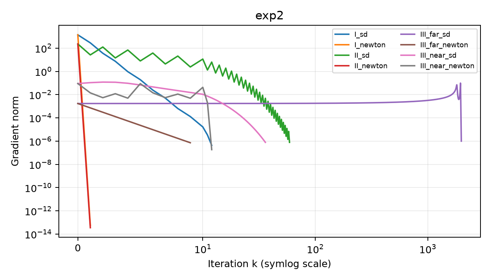

本实验的主线是：**同一个目标，方向选法不同，速度和可靠性会怎样变化。** I、II 用于比较正定二次型上的速度；III 用于说明一般非线性问题中初值和曲率的重要性。

源码：[实验二 main.py](/downloads/optimization/实验二_最速下降法和牛顿法/code/main.py)。`f1/f2/f3` 分别在第 29、45、71 行，`optimize` 在第 175 行。

## 一、先把 I、II 的原题写清楚

问题 I：

$$f_1(x)=\frac12(21x_1^2+8x_1x_2+15x_2^2)+2x_1+3x_2.$$

问题 II：

$$f_2(x)=\frac12(21x_1^2+8x_1x_2+x_2^2)+2x_1+3x_2.$$

二者都使用初值 $x_0=(-30,100)^T$，均可写成：

$$f(x)=\frac12x^TQx+c^Tx,\qquad c=(2,3)^T.$$

$$Q_1=\begin{pmatrix}21&4\\4&15\end{pmatrix},\qquad Q_2=\begin{pmatrix}21&4\\4&1\end{pmatrix}.$$

两题首个顺序主子式都是 21，行列式分别为 299 和 5，所以都正定，都有唯一全局最优点。

### 实验原题：先算参考解，再评价算法

由 $Qx_*+c=0$：

$$x_{1,*}=\begin{pmatrix}-18/299\\-55/299\end{pmatrix}\approx\begin{pmatrix}-0.060200669\\-0.183946488\end{pmatrix},$$

$$x_{2,*}=\begin{pmatrix}2\\-11\end{pmatrix}.$$

将 $c=-Qx_*$ 代回，可用：

$$f_*=-\frac12c^TQ^{-1}c=\frac12c^Tx_*.$$

于是 I 的最优值为 $-201/598$，II 的最优值为 $-29/2=-14.5$。这些解析结果可以独立检查迭代输出，而不是仅信任程序状态。

## 二、为什么负梯度叫“最速下降”

固定方向长度 $\|d\|_2=1$，希望一阶变化 $g^Td$ 最小。由柯西不等式：

$$g^Td\ge-\|g\|_2\|d\|_2=-\|g\|_2.$$

取 $d=-g/\|g\|_2$ 时达到下界。实际算法通常直接取：

$$d_k=-g_k,$$

把方向长度吸收到步长里。

“最速”指**当前位置、欧氏范数、无穷小一阶近似下**下降最快，不意味着有限步后全局最快，也不意味着总迭代次数最少。

### 配套例题：在单位方向中比较

若 $g=(3,4)^T$，则负梯度单位方向是 $(-3/5,-4/5)^T$，一阶变化率为 $-5$。沿负 $x_1$ 轴变化率只有 $-3$，沿负 $x_2$ 轴只有 $-4$。

因此负梯度在当前局部比较中最好，但它没有考虑远处的弯曲程度。

## 三、二次函数的精确步长怎么推导

对称正定二次函数沿 $d$ 的展开是精确等式：

$$f(x+\alpha d)=f(x)+\alpha g^Td+\frac12\alpha^2d^TQd.$$

对 $\alpha$ 求导：

$$\psi'(\alpha)=g^Td+\alpha d^TQd.$$

因为 $d^TQd>0$，令导数为零得到唯一沿线极小点：

$$\boxed{\alpha_*=-\frac{g^Td}{d^TQd}}.$$

最速下降中 $d=-g$，化为：

$$\boxed{\alpha_*=\frac{g^Tg}{g^TQg}}.$$

代码里的 `-gx @ d / curvature` 对应一般方向公式。不能对所有非二次函数直接套用固定 $Q$ 的公式；III 改用 Armijo。

### 配套例题：完整手算一步

$$f(x)=\frac12(x_1^2+4x_2^2),\quad x_0=(1,1)^T,\quad Q=\operatorname{diag}(1,4).$$

$$g_0=(1,4)^T,\quad d_0=(-1,-4)^T.$$

$$\alpha_0=\frac{1^2+4^2}{1+4\times4^2}=\frac{17}{65}.$$

所以：

$$x_1=\begin{pmatrix}48/65\\-3/65\end{pmatrix}.$$

初始函数值为 $5/2$；更新后为 $90/325\approx0.276923$，明显降低，但还没有到原点。

## 四、相邻梯度为什么正交，为什么出现锯齿

精确线搜索的一阶条件是：

$$g_{k+1}^Td_k=0.$$

最速下降中 $d_k=-g_k$，因此：

$$g_{k+1}^Tg_k=0.$$

这说明相邻梯度在欧氏内积下正交。狭长谷地中，负梯度往往主要指向横穿谷地的方向，于是容易反复穿越两侧，产生锯齿。

注意这个正交结论依赖精确沿线极小条件；不能要求 Armijo 回溯下也严格成立。

### 配套例题：用刚才的结果验证正交

上一题有：

$$g_1=Qx_1=(48/65,-12/65)^T.$$

所以：

$$g_1^Tg_0=48/65-48/65=0.$$

这不表示两个迭代点正交，也不表示 $d_i^TQd_j=0$；后者是下一实验的共轭概念。

## 五、条件数为什么影响最速下降速度

对称正定矩阵的二范数条件数为：

$$\kappa_2(Q)=\frac{\lambda_{\max}(Q)}{\lambda_{\min}(Q)}.$$

条件数接近 1 时，不同方向曲率相近；很大时等高线狭长，最速下降更容易折返。对于 SPD 二次型、精确线搜索，可用最坏情况目标差界理解：

$$\frac{f(x_{k+1})-f_*}{f(x_k)-f_*}\le\left(\frac{\kappa-1}{\kappa+1}\right)^2.$$

这是上界，不是每一步必定等于该比率，也不能仅凭条件数精确预测所有初值的迭代数。

### 实验原题：I 和 II 的区别不在“有没有最优解”

$$\lambda(Q_1)=13,23,\qquad\kappa(Q_1)=23/13\approx1.769.$$

$$\lambda(Q_2)=11\pm2\sqrt{29},\qquad\kappa(Q_2)\approx94.790.$$

当前代码从同一个初值出发，I 的最速下降更新 12 次，II 更新 59 次。II 慢的主要结构原因是曲率差异大，而不是它非凸或无下界。

## 六、牛顿方向从二阶模型来

在当前点建立二阶模型：

$$m_k(d)=f(x_k)+g_k^Td+\frac12d^TG_kd.$$

当 $G_k\succ0$ 时，模型的唯一极小点满足：

$$G_kd_k=-g_k.$$

基本牛顿法取：

$$x_{k+1}=x_k+d_k.$$

代码用 `np.linalg.solve(hess(x), -gx)` 解线性方程组，不显式求逆。当 Hessian 不定时，解出的仅是二次模型驻点，不一定是模型极小点，方向也未必下降。

### 实验原题：I、II 为什么只更新一次

对于二次函数，$G_k=Q$ 恒定：

$$d_k=-Q^{-1}(Qx_k+c)=-x_k-Q^{-1}c.$$

所以：

$$x_{k+1}=x_k+d_k=-Q^{-1}c=x_*.$$

在精确算术且正确解方程的条件下，无论初值如何，都一次到解。数值程序的结果接近解析解，只有浮点舍入差异。不要把这个结论推广到所有非线性目标。

## 七、一般牛顿法为什么不能无条件保证下降

若 $G\succ0$ 且 $g\ne0$：

$$g^Td=-g^TG^{-1}g<0.$$

若 $G$ 不定，上式不一定为负。另外即使方向下降，全步长 1 也可能过大。

常见改进是正定修正后结合线搜索：

$$(G_k+\mu_kI)d_k=-g_k,$$

选足够的 $\mu_k$ 使矩阵正定，再用 Armijo 等方法选步长。只加线搜索却不处理非下降方向，并不能自动修复不定 Hessian。

### 配套例题：牛顿法可能走向极大点

$$f(x)=-x^2,\quad x_0=1.$$

$g=-2$、$G=-2$，解 $Gd=-g$ 得 $d=-1$，全步后到达 $x_1=0$。函数值由 $-1$ 升到 0，而 0 是极大点。

因此“解了牛顿方程”不等于“做了最小化”。本实验保留基本牛顿法，正是为了观察这种风险，而不是偷偷替换成改进算法。

## 八、问题 III：先降维，再用链式法则

原题为：

$$t=(x_1+3)^2+\frac{x_2^2}{2}\ge0,\qquad f_3(x)=h(t)=\frac{\ln(1+t+e^t)}{1+t}.$$

设 $u=1+t$、$L=\ln(u+e^t)$。则：

$$h'=\frac{L'}u-\frac L{u^2},\qquad h''=\frac{L''}u-\frac{2L'}{u^2}+\frac{2L}{u^3}.$$

为了避免 $e^t$ 溢出，代码取 $r=e^{-t}$，写成：

$$L=t+\ln(1+ur),\quad L'=\frac{1+r}{1+ur},\quad L''=\frac{(t-1)r-r^2}{(1+ur)^2}.$$

再设：

$$v=\nabla t=\begin{pmatrix}2(x_1+3)\\x_2\end{pmatrix},\qquad\nabla^2t=\begin{pmatrix}2&0\\0&1\end{pmatrix}.$$

得到：

$$\boxed{g_3=h'(t)v},\qquad\boxed{G_3=h''(t)vv^T+h'(t)\nabla^2t}.$$

Hessian 的第二项不能漏掉；只写 $h''vv^T$ 相当于漏用了二阶链式法则。

### 实验原题：在候选最优点检查曲率

在 $x=(-3,0)^T$，$t=0$、$v=0$，有：

$$h(0)=\ln2,\qquad h'(0)=1-\ln2>0.$$

因此：

$$g_3=0,\qquad G_3=(1-\ln2)\operatorname{diag}(2,1)\succ0.$$

这先证明它是严格局部极小点。要证明唯一全局最优，还需要下一节的不等式。

## 九、III 的全局最优点如何证明

希望证明对全部 $t\ge0$：

$$\frac{\ln(1+t+e^t)}{1+t}\ge\ln2.$$

等价于证明 $1+t+e^t\ge2^{1+t}$。定义：

$$F(t)=1+t+e^t-2e^{t\ln2}.$$

有：

$$F(0)=0,\qquad F'(0)=2-2\ln2>0,$$

$$F''(t)=e^t-2(\ln2)^2e^{t\ln2}>0\quad(t\ge0).$$

最后一个不等式来自 $e^{t(1-\ln2)}\ge1>2(\ln2)^2$。因此 $F'$ 在非负半轴始终为正，$F(t)>0$ 对所有 $t>0$ 成立。

所以只有 $t=0$ 取等号，即：

$$\boxed{x_*=(-3,0)^T,\qquad f_* =\ln2}.$$

### 实验原题：为什么不是“一整条椭圆都是最优”

$t=t_0>0$ 的集合确实是一条椭圆，同一条椭圆上函数值相同；但这些值严格大于 $\ln2$。真正最优对应 $t=0$，椭圆退化成单点 $(-3,0)$。

“等值线上的点有相同函数值”与“等值线上的点都是全局最优”是两回事。

## 十、两个初值的结果应该怎样解释

| 方法 | 初值 | 更新次数 | 最终函数值 | 判断 |
|---|---|---:|---:|---|
| 最速下降＋Armijo | $(-10,10)$ | 1987 | $0.693147180562$ | 接近正确最优解 |
| 最速下降＋Armijo | $(-3.5,0.5)$ | 36 | $0.693147180561$ | 接近正确最优解 |
| 基本牛顿 | $(-10,10)$ | 9 | $0.999943917772$ | 小梯度停止，但不是最优解 |
| 基本牛顿 | $(-3.5,0.5)$ | 12 | $0.693147180560$ | 接近正确最优解 |

远初值牛顿最终点约为：

$$(-96.9411,134.2016)^T,$$

其梯度范数约 $7.26\times10^{-7}$，虽然小于容差，但目标值比 $\ln2$ 大约 0.3068。最终 Hessian 有负特征值，也不支持局部极小判断。更重要的是它并未真正找到有限位置的精确驻点，只是触发了小梯度数值停止。

当 $t\to\infty$：

$$h(t)=\frac{t+\ln(1+(1+t)e^{-t})}{1+t}\to1.$$

远区函数变平，梯度可以很小，所以“看上去不再变化”不代表“已经正确”。

### 实验原题：老师问“9 次比 1987 次好在哪里”

不能回答“牛顿更快，所以更好”。9 次那条轨迹没有得到正确极小值，与正确解不是同质量结果，不能直接用更新次数比较效率。

正确答法是：基本牛顿在远初值下失败，小梯度只是停止标准；最速下降在这个初值下虽然较慢，但达到了正确目标值。近初值牛顿的成功也不能证明任意初值都成功。

图中纵轴为梯度范数的对数刻度，横轴使用对称对数尺度以容纳长轨迹。**图只展示一阶指标**，应与目标值、最优点和曲率一起阅读。

## 本实验背诵版

最速下降取负梯度方向，正定二次型上可推导精确步长；精确线搜索使相邻梯度正交，条件数大时容易锯齿。牛顿法通过二阶模型解方向方程，对正定二次型全步一次到解，但一般非线性问题上不保证下降或从任意初值成功。III 的唯一全局最优点是 $(-3,0)$，最优值为 $\ln2$；远初值牛顿的小梯度停止属于非最优停止，必须如实说明。
