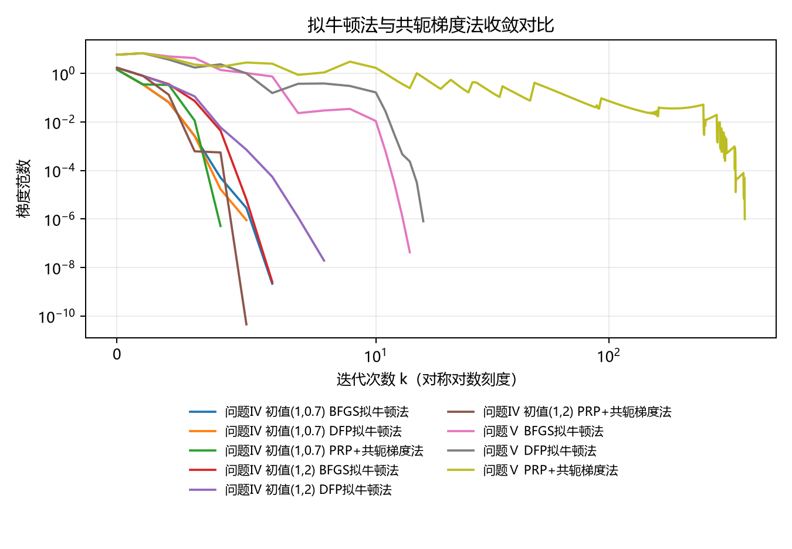

实验二的牛顿法需要 Hessian，也就是目标函数的二阶信息。如果二阶导数难求，怎么办？这次代码用了两条路：

1. **拟牛顿法**：根据已经走过的距离和梯度变化，逐步估计曲率。
2. **非线性共轭梯度法**：把当前负梯度与上一次方向组合，利用一点历史信息。

目标函数在 [实验三 main.py](/downloads/optimization/实验三_拟牛顿法和共轭梯度法/code/main.py)；具体方法放在 `code/methods/`。本代码只运行 BFGS、DFP、PRP+ 三种方法。

## 1. 最重要的四个量：x、g、s、y

| 变量 | 数学记号 | 通俗意思 |
|---|---|---|
| `x`、`xn` | $x_k,x_{k+1}$ | 走之前、走之后的位置 |
| `gx`、`gn` | $g_k,g_{k+1}$ | 两个位置分别算出的梯度 |
| `s` | $s_k=x_{k+1}-x_k$ | 这一步移动了多少 |
| `y` | $y_k=g_{k+1}-g_k$ | 走过这一步后，梯度变了多少 |

### 配套例题：手算 s 和 y

若从 $x_k=(1,2)^T$ 走到 $x_{k+1}=(2,1)^T$，同时梯度从 $(3,4)^T$ 变成 $(5,1)^T$：

$$
s=(2,1)^T-(1,2)^T=(1,-1)^T
$$

$$
y=(5,1)^T-(3,4)^T=(2,-3)^T
$$

代码对应：

```python
s = xn - x
y = gn - gx
sy = float(s @ y)
```

这里 `sy` 是点积 $s^Ty$，为一个数；这道题中 `sy = 1*2 + (-1)*(-3) = 5`。它不是外积 $sy^T$。

## 2. 为什么拟牛顿法维护 H

基本牛顿法需要解 $Gd=-g$，其中 $G$ 是 Hessian。拟牛顿法用 $H$ 来近似 **Hessian 的逆**，直接计算：

$$
d=-Hg
$$

当前代码先令 $H=I$，$I$ 是单位矩阵。第一次若 $H=I$，那么 $d=-Ig=-g$，就和最速下降方向一样；以后再根据 $s,y$ 更新 $H$。

### 配套例题：H 怎样影响方向

若 $g=(2,4)^T$，且 $H=I$，则 $d=(-2,-4)^T$。若后来估计出：

$$
H=\begin{pmatrix}1&0\\0&1/4\end{pmatrix}
$$

则 $d=(-2,-1)^T$。这说明矩阵 $H$ 会对不同方向的梯度进行不同程度的调整。

### 看关键代码

来源：[bfgs.py](/downloads/optimization/实验三_拟牛顿法和共轭梯度法/code/methods/bfgs.py)。DFP 也用相同的方向形式。

```python
H = np.eye(len(x))
# 每轮先算 gx = g(x)
d = -H @ gx
```

别把本代码的 `H` 当成 Hessian 本身；牛顿法的 `hess(x)` 才是当前点的 Hessian。

## 3. 割线条件：让新 H 记住刚走过的路

刚才走了 $s$，梯度变化了 $y$。拟牛顿更新希望新矩阵满足：

$$
H_{k+1}y_k=s_k
$$

这叫**割线条件**。你可以先把它当成一条要求：新估计的逆曲率作用在梯度变化 $y$ 上，应能还原刚才的位置变化 $s$。这条要求不能唯一决定整个矩阵，所以 BFGS 和 DFP 使用不同更新公式。

### 配套例题：检查是否满足

设 $y=(4,0)^T$、$s=(1,0)^T$，如果：

$$
H_{k+1}=\begin{pmatrix}1/4&0\\0&1\end{pmatrix}
$$

那么 $H_{k+1}y=(1,0)^T=s$，所以满足。若把矩阵第一项误写成 4，得到的是 $(16,0)^T$，不满足这个条件。

## 4. BFGS：一种更新 H 的办法

BFGS 的全称是 **Broyden–Fletcher–Goldfarb–Shanno**，取自四位研究者姓氏。记住它是拟牛顿法的一种，不需要凭缩写猜含义。

它先计算 $s^Ty$，再用 $s,y$ 和旧的 $H$ 算新 $H$。不用强迫自己一开始背完整矩阵公式，先看代码里每一项怎么对应：

```python
sy = float(s @ y)
if sy > 1e-12 * np.linalg.norm(s) * np.linalg.norm(y):
    V = np.eye(len(x)) - np.outer(s, y) / sy
    H = V @ H @ V.T + np.outer(s, s) / sy
    H = (H + H.T) / 2
```

`V` 是更新时的中间矩阵；`np.outer(s,y)` 是 $sy^T$；最后一行是减小浮点计算引起的矩阵不对称。只有曲率条件通过才更新，以避免分母不可靠。

#### BFGS 的一整轮

按 [bfgs.py](/downloads/optimization/实验三_拟牛顿法和共轭梯度法/code/methods/bfgs.py) 的顺序，初始化 `x=x0`、`H=I`，记录第 0 轮，状态先设为 `iteration_limit`。每轮：

1. `gx=g(x)` 算当前梯度；范数不超过 `tol` 就设 `gradient_tolerance` 并停止。
2. `d=-H @ gx` 算方向。若 `gx @ d` 不够负，说明方向不可靠，改为 `d=-gx` 并重置 `H=I`。
3. 调用 `armijo(f,x,gx,d,...)` 求 `alpha`。回溯失败则设 `line_search_failed` 并结束。
4. `xn=x+alpha*d`；若存在无穷或 NaN，设 `nonfinite` 并结束。否则计算 `gn=g(xn)`、`s=xn-x`、`y=gn-gx`。
5. 检查 `sy=s @ y` 后按上面的公式更新 `H`；不满足条件就跳过本轮矩阵更新。
6. 记住旧函数值，令 `x=xn`，用 `record()` 保存点、目标值、梯度范数、步长。循环结束后返回结果字典与完整 `history`。

**跟一个简化输入：**若当前 $H=I$、$g=(2,4)^T$，方向就是 $(-2,-4)^T$；Armijo 接受步长后先形成 `xn`，再根据新旧点和梯度算 `s,y`。不能在还没算出新梯度时就更新 $H$。

### 配套例题：为什么不能直接除

取 $s=(1,0)^T$、$y=(0,1)^T$，则 $s^Ty=0$。BFGS 更新要除以这个数，无法计算，因此当前代码跳过该次更新。Armijo 保证充分下降，但单凭它不能保证每次都有可靠的正曲率，所以还需检查。

## 5. DFP：目标相同，更新公式不同

DFP 全称 **Davidon–Fletcher–Powell**。它同样维护逆 Hessian 近似 $H$，只是根据 $s,y$ 修改 $H$ 的方式不同：

$$
H_{k+1}=H_k+\frac{ss^T}{s^Ty}-\frac{H_kyy^TH_k}{y^TH_ky}
$$

看不懂整个式子时，先认识分母：$s^Ty$ 和 $y^TH_ky$ 都是数。如果分母不合适，就不能安全地照公式算。

### 配套例题：与代码一项项对照

来源：[dfp.py](/downloads/optimization/实验三_拟牛顿法和共轭梯度法/code/methods/dfp.py)。

```python
Hy = H @ y
yh = float(y @ Hy)
if yh > 0:
    H += np.outer(s, s) / sy - np.outer(Hy, Hy) / yh
```

`Hy` 是 $Hy$，`yh` 是 $y^THy$；`outer(s,s)` 是 $ss^T$。实际代码还先检查 `sy` 是否满足曲率条件。算出新 $H$ 后，下一轮仍使用 $d=-Hg$。

#### DFP 的迭代和 BFGS 哪里不同

[dfp.py](/downloads/optimization/实验三_拟牛顿法和共轭梯度法/code/methods/dfp.py) 的起点、梯度停止、非下降方向重置、Armijo 回溯、检查新点和保存记录，顺序与上一节 BFGS 一样。区别集中在**计算出 `s,y,sy` 后**：DFP 先算 `Hy=H@y`、`yh=y@Hy`，只有 `sy` 通过阈值并且 `yh>0` 时才执行上面的 DFP 更新。之后代码将 `H` 对称化，再进入下一轮。

**代入一次：**若 $H=I$、$s=(1,0)^T$、$y=(2,1)^T$，则 `sy=2`、`Hy=(2,1)`、`yh=5`，两道检查均通过，可以应用 DFP 更新；如果 `sy=0`，则不能除，保留旧 $H$。

### 实验原题：BFGS 和 DFP 谁一定更快

当前保存数据中，问题 IV 的初值 $(1,0.7)$：BFGS 更新 6 次，DFP 更新 5 次；问题 V：BFGS 更新 14 次，DFP 更新 16 次。只能比较**这次实现和这些初值**，不能断言哪一种在所有问题上必胜。

## 6. PRP+：新方向混入旧方向

PRP+ 是一种非线性共轭梯度方法，全称可以记作 **Polak–Ribière–Polyak 的非负截断版本**。它不靠更新 $H$ 选方向，而是：

$$
d_{k+1}=-g_{k+1}+\beta_kd_k
$$

第一项是当前位置的负梯度，第二项是上一轮方向乘权重 $\beta_k$。如果 $\beta_k=0$，就相当于重新回到负梯度方向。

本代码用：

$$
\beta_k=\max\left(0,\frac{g_{k+1}^T(g_{k+1}-g_k)}{g_k^Tg_k}\right)
$$

`max(0, ...)` 是名字里“+”的意思：负数截断为 0。

### 配套例题：手算一轮

设 $g_k=(1,2)^T$、$g_{k+1}=(-1,1)^T$、$d_k=(-1,-2)^T$。梯度差是 $y=(-2,-1)^T$，因此：

$$
\beta=\max(0,1/5)=0.2,\qquad
d_{k+1}=(1,-1)^T+0.2(-1,-2)^T=(0.8,-1.4)^T
$$

当前梯度与新方向的点积为 $-2.2<0$，所以这个新方向是下降方向。

### 看关键代码

来源：[conjugate_gradient.py](/downloads/optimization/实验三_拟牛顿法和共轭梯度法/code/methods/conjugate_gradient.py)。

```python
beta = max(0.0, float(gn @ y / (gx @ gx)))
if (k + 1) % len(x) == 0:
    beta = 0.0
d = -gn + beta * d
```

`len(x)` 是变量个数，即维数。每过 $n$ 次更新便令 `beta=0`，叫**周期重启**；若方向不再下降，代码也会重启。该文件中的 `H`、`s`、`sy` 是保留的中间变量，没有参与 PRP+ 的核心方向更新。

#### PRP+ 一整轮按什么顺序运行

1. 初始 `d=-g(x)`，并保存第 0 轮。每轮先算 `gx`；梯度足够小就停止。
2. 检查 $g_k^Td_k$：如果不够负，当前 `d` 被重置为 `-gx`。
3. 用 Armijo 找步长；失败则记录 `line_search_failed`；得到 `xn` 后检查是否有限。
4. 算 `gn=g(xn)` 和 `y=gn-gx`，根据上面的公式算非负 `beta`；若本轮到达每 $n$ 步一次的重启时点，强制令 `beta=0`。
5. 算出**下一轮**方向 `d=-gn+beta*d`，再令 `x=xn`、记录历史。下一轮开始时会再次检查这个方向是否下降。

**接上面的手算：**$g_k=(1,2)$、$g_{k+1}=(-1,1)$ 时计算得到 `beta=0.2`。但若恰好是二维问题的第 2 次更新，周期重启会覆盖它，令 `beta=0`，所以实际下一方向是 $-g_{k+1}=(1,-1)$。单独算公式时必须和程序的重启条件区分。

### 实验原题：为什么三维题不是三步

问题 V 是三维，但保存数据中 PRP+ 更新了 384 次。线性共轭梯度“理想条件下至多 $n$ 步”的结论针对正定二次型等条件；问题 V 是非线性的，还使用 Armijo 和重启，不能照搬。

## 7. 两个原题，答案怎么知道

### 问题 IV

$$
f_4(x)=\frac{x_1^4}{12}+\frac{x_1^2}{2}+x_2\arctan x_2-\frac12\ln(1+x_2^2)
$$

$$
g_4(x)=\begin{pmatrix}x_1+x_1^3/3\\\arctan x_2\end{pmatrix}
$$

第二分量之所以只有 $\arctan x_2$，是乘积求导和对数求导中多出的两项互相抵消。Hessian 在有限点正定，因此驻点 $(0,0)$ 是唯一最优点，值为 0。代码以 $(1,0.7)$、$(1,2)$ 分别作初值。

### 原题例子：代入初值

在 $(1,0.7)$，梯度是 $(4/3,\arctan 0.7)^T$。三种方法从同一个函数和初值出发，但各自构造方向的方式不同。

### 问题 V

$$
f_5(x)=5(x_2^2-x_3)^2+4(x_1^2-x_2)^2+3(x_1-1)^2
$$

所有平方项都不小于 0。三个平方同时等于 0 时，依次得到 $x_1=1,x_2=1,x_3=1$，因此唯一全局最优点为 $(1,1,1)$，最优值为 0。注意：**平方项里面可以是非线性表达式，因此平方和不一定是凸函数。**

### 原题例子：先判最优值再看程序

把 $(1,1,1)$ 代入，三个括号均为 0，函数值就是 0；又因为函数不可能小于 0，所以这是全局最小值。然后再检查代码输出是否接近该点和 0，比只看“程序运行结束”可靠。



## 8. 实际输出怎样读

### 8.1 先看算例名称

```text
[问题 IV_a] 初始点=[1, 0.7]
[问题 IV_b] 初始点=[1, 2]
[问题 V] 初始点=[0, 0, 0]
```

`IV_a` 和 `IV_b` 是同一个问题 IV，使用不同起点；V 是另一个三维函数。每个算例依次运行 `BFGS`、`DFP`、`PRP`；这里 `PRP` 是输出标签，实际实现是 **PRP+**。

### 8.2 拆解一条迭代记录

```text
问题 V，BFGS：
k=     1  f=1.453125  ||g||=6.915e+00  alpha=0.125
```

`k=1` 是第一次更新完成；目标值为 1.453125；梯度范数约为 6.915；`alpha=0.125` 是本次 Armijo 接受的步长。它小于初始尝试值 1，说明尝试过程中做了缩步。方向如何计算，取决于当前方法，而不是 `alpha` 本身。

### 8.3 比较最终摘要

```text
V / BFGS：迭代=14；x=[1, 1, 1]；f=3.077207547e-17；||g||=4.237e-08
V / DFP ：迭代=16；x=[1, 1, 1]；f=2.004173517e-14；||g||=8.057e-07
V / PRP ：迭代=384；x=[1, 1, 1]；f=1.608864436e-12；||g||=9.927e-07
```

三个输出中的 `x` 是**格式化后的近似值**，不代表每个分量在机器内部恰好等于 1；完整值在 `results.json`。`3.077e-17` 表示 $3.077\times10^{-17}$，很接近 0。

这些结果满足该程序的梯度容差，也与 V 的已知最优点 $(1,1,1)$ 和最优值 0 一致。V 中 PRP+ 迭代较多，只是当前题目、初值与实现的比较，不能断言它总是慢。

### 8.4 CSV 和曲线

例如 `exp3_V_bfgs.csv` 每行保存一次迭代的 `k,x,f,delta_f,grad_norm,alpha`。控制台只展示开头几轮和部分间隔轮，完整轨迹仍在 CSV。

图的纵轴是梯度范数，越低表示梯度越小；横轴采用对称对数尺度，方便同时看几次和几百次迭代。**曲线低不能独立证明全局最优**，还需结合 IV 的严格凸性、V 的非负平方和结构。

**问：为什么 `x=[1,1,1]`，但函数值不是严格的 0？** 控制台只显示有限位小数；内部的点只是非常接近 1，加上浮点舍入，目标值可能是很小的正数。

## 本实验一句话

BFGS 和 DFP 都利用 $s,y$ 更新逆 Hessian 近似，PRP+ 把负梯度与旧方向组合；三者配合 Armijo 选步长，不能把线性二次型理想有限步结论搬到一般非线性问题上。
